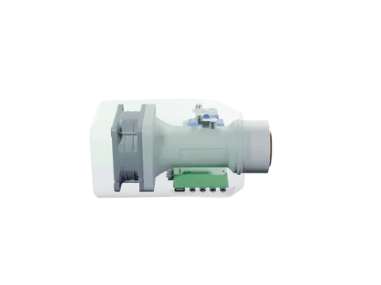

# minimeater

A fan controller for a Big Green Egg Large. It is a single 3D-printed box that clips onto the egg's intake tube. It
meters air into the fire with a fan and a servo-driven flap to hold the pit at a setpoint between 150 and 325 °F.
It runs from one USB-C cable and talks to Home Assistant over MQTT.

<p align="center"></p>

> [!WARNING]
> **Status: design, not yet built.** The board, the enclosure and the firmware are complete enough to order and run in
> simulation, but no unit has been made or used on a real cook. Expect changes, and don't trust it with a fire yet.

## What it does

- **Holds the pit temperature.** A model-predictive controller plans the airflow half an hour ahead on a model of the
  egg, because the pit answers a change of air long after it is made. It treats overshoot as much worse than
  undershoot (a kamado can only be starved of air, not cooled) and continuously estimates what the model doesn't know:
  the fire, the weather and the food. It commands airflow; the fan and the flap are scheduled to deliver it. It
  recovers from an opened lid, tunes itself during a cook and resumes after a power cut.
- **Watches the food.** Four thermistor probe jacks. Any of them can be the pit probe (it is found automatically); the
  rest report temperature, rate of rise, an estimated finish time and stall detection, with high and low alarms.
- **Fits in with a smart home.** Home Assistant entities through MQTT discovery, over TLS 1.3 with a per-device key held
  in a secure element. Metrics go to any OpenTelemetry collector. WiFi is set up from the browser (Improv) or the
  serial console.
- **Needs nothing else.** One USB-C port powers it, flashes it and carries the console. No 12 V supply, no separate
  blower.

## Safety

This device controls a fire. A fault in the controller, the firmware or the setup can leave the fan running and the
pit far hotter than intended. Use it only on a cooker you would otherwise trust to be left alone, keep the cooker's
own vents set so that a fan running flat out is still safe, and don't leave a cook unattended until you have tested it
yourself. It comes with no warranty (see [License](#license)).

## How it is built

| | Where | Docs |
|---|---|---|
| **Board** | `hw/`: KiCad 10, four layers, assembled by JLCPCB. An ESP32-C6, the probe front end, USB-C power, the fan and servo drivers, an ATECC608B for the device key | [ADRs](docs/adr/), [ICD](docs/icd.md), [ordering](docs/ordering.md) |
| **Enclosure** | `src/minimeater/mech/`: build123d, printed in MJF nylon (duct, hood, pan) with a few CNC parts (flap, crank, coupler, rod) | [mech](docs/mech.md), [JLC3DP notes](docs/jlc3dp.md), [CFD](docs/cfd.md) |
| **Firmware** | `fw/`: Rust, `no_std`, embassy. `minimeater-core` (control, food estimator, probe conversion), `minimeater-app` (the application, generic over the board), `minimeater-fw` (the ESP32-C6 binding) | [MQTT protocol](docs/protocol.md), [telemetry](docs/telemetry.md), [provisioning](docs/provisioning.md) |
| **Digital twin** | `fw/minimeater-sim` and `fw/minimeater-twin`: the real application tasks on a virtual clock against a simulated board and kamado | [sim](docs/sim/) |
| **Models** | `src/minimeater/model/`: the Python plant, airflow and controller models the firmware was ported from | [modeling](docs/modeling/) |

Decisions are recorded in [`docs/adr/`](docs/adr/). The MQTT schema in [`docs/protocol.md`](docs/protocol.md) is
normative.

## Building and testing

You need [just](https://just.systems/), [uv](https://docs.astral.sh/uv/) for the Python side and a Rust toolchain for
the firmware. Every task is a recipe, grouped by area; `just` lists them all.

```bash
just test                     # the Python suite and the firmware's host tests
just ci                       # everything CI runs, KiCad checks included
just fw::flash                # build the firmware and flash an ESP32-C6 over USB-C
```

Run a cook on the twin, or the whole scenario suite:

```bash
just fw::twin::run --scenario kamado-brisket --speed 60x
just fw::twin::scenarios      # bounds and baselines for every scenario, a plot of each
```

Regenerate the derived outputs:

```bash
just model::all               # docs/modeling and docs/sim
just mech::export             # STEP and STL of every part, ready to order (build/mech)
just mech::render             # the enclosure renders (docs/mech)
just hw::fab                  # gerbers, BOM and placement for JLCPCB (hw/fab)
just mech::explode            # the animation above (Blender Cycles; needs img2webp)
```

The vendor 3D models of the fan, the servo and a few board parts are not redistributed here. `just vendor::fetch`
fetches or installs them. Everything builds and tests without them; a few fit checks are skipped.

Integration checks against real services run in containers, under `just fw::interop::` (`mqtt`, `tls`, `otlp`,
`ha-discovery`, and `ha-live` against a real Home Assistant). `just stack::up` starts Mosquitto and an OpenTelemetry
collector for the twin to cook against (`just fw::twin::stack`).

## Contributing

Issues and pull requests are welcome. Please run `just test` (or `just ci`) before sending a change, and regenerate
any derived docs you touch rather than editing them by hand.

## License

Copyright (c) 2026 Nathan Howell. The hardware (`hw/` and the enclosure in `src/minimeater/mech/`) is under the
[CERN-OHL-S v2](LICENSES/CERN-OHL-S-2.0.txt). The firmware, the Python models and tools, and the docs are under the
[GPL v3 or later](LICENSES/GPL-3.0-or-later.txt), with an added permission to link the vendor's binary-only radio
libraries. [LICENSE](LICENSE) has the details and lists the third-party files that keep their own terms.

Big Green Egg is a trademark of its owner. This project is not affiliated with or endorsed by it.
