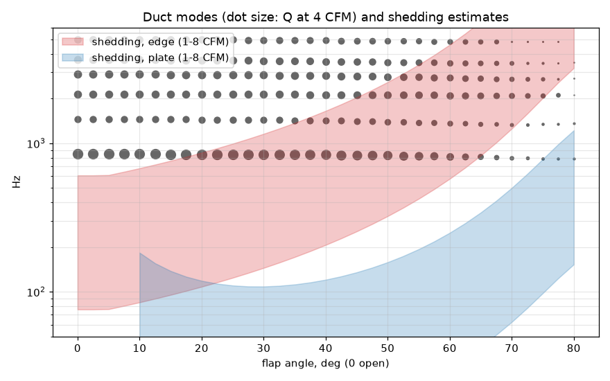
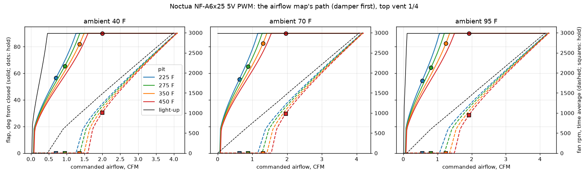

# Duct CFD and acoustics

What the air does between the fan and the tube: the pressure the duct costs the fan (`.2.12`, `.2.13`), and whether the
flap can whistle (`.2.17`-`.2.19`). The code is `src/minimeater/mech/cfd/`; the geometry comes from the same build123d
parts as the print (`mech/parts.py`), so a change to the duct or the flap is a change to the case.

## Steady RANS: `just cfd <case>`

`uv run minimeater-cfd <case> [--flap DEG] [--cfm Q] [--rpm N]` builds the air volume, meshes it and solves it in
OpenFOAM v2606 (`opencfd/openfoam-run:2606`, arm64, in Apple's `container`; no build), and writes
`build/cfd/<case>/results.json`. Named cases: `open`, `open-swirl`, `open-vortex`, `flap-30`, `flap-45`, `flap-60`.

- **Geometry** (`geometry.py`): the fan's outlet annulus (5 mm of the frame's Ø58 bore around the Ø26.5 hub), the
  27 mm cone with the tail cone and its six stator vanes (`HubCone`, subtracted solid), the Ø32 bore with the flap and its rod at the case's angle, the 5 mm neck from it to the tube's bore at the socket's
  shoulder, and 12 diameters of the Ø30.83 tube (the results below were run on the Ø31.6 tube assumed before
  the calipers, a 0.2 mm step and no neck). Patches: inlet, outlet, duct, tube, flap. The fan's blades and struts
  are not modelled; the inlet can swirl: solid-body rotation at `--rpm`, or a free vortex at `--vortex` (r·c_θ / Q in 1/m, in the rotor's sense; `open-vortex` is 18, the Euler floor at the operating line). Every case samples U on five planes along the duct at its end; `python -m minimeater.mech.cfd.swirl <case>` reports the swirl angle, r·c_θ and the swirl's dynamic head on each.
- **Mesh**: snappyHexMesh, 2 mm background, 0.5 mm at the duct's walls, 0.25 mm on the flap, 1 mm through the bore and
  the first two tube diameters; 3 boundary layers (2 on the flap). About 0.75 M cells.
- **Solver**: simpleFoam (SIMPLEC), k-omega SST with wall functions; the fan's flow fixed into the annulus at 10 %
  turbulence; the outlet at 0 Pa. Up to 2000 iterations, 8 ranks: about 20 minutes on the Mac.
- **Loss** (`run.py`): static pressure on planes across the tube, one per diameter; a line through the last six (the
  developed flow) extrapolated back to the shoulder. Referenced to the tube's velocity head q:
  - `k_static` = (inlet static - line at the shoulder) / q: what the fan's (static) curve must supply for the duct,
    including the acceleration from the annulus into the tube. It replaces `Intake.k_box + k_entry` less the grille.
  - `k_total` = the total-pressure loss: what is dissipated.
  - The tube's own friction is in neither; the fitted line's slope is checked against Blasius.

### Results, 6 CFM (3.6 m/s in the tube)

| case | k_static | k_total | duct Δp static | tube f (Blasius 0.034) | note |
|---|---|---|---|---|---|
| open | 1.26 | 0.16 | 12.8 Pa | 0.031 | steady |
| flap 30° | 3.63 | 2.56 | 33.0 Pa | 0.050 | sheds: ±0.8 Pa |
| flap 45° | 12.2 | 11.2 | 99.8 Pa | 0.043 | the wake sheds: ±2.4 Pa over the last 500 iterations; the tube has not recovered by the outlet |
| flap 60° | 57.4 | 56.4 | 454 Pa | — | sheds: ±5.6 Pa; far past the fan's 21 Pa, so 6 CFM never happens here (the k still holds) |
| open, swirl 2000 rpm | 8.3 | 8.7 | 70.9 Pa | — | solid-body rotation at the rotor's speed: an upper bound, not the fan |

The swirl case is a warning, not a number: if the fan's exit swirl were anything like solid-body rotation the cone
(which spins it up as it narrows) and the bore would cost several times the straight-flow loss. The real exit swirl of
the NF-A6x25 at these flows is the input that is missing (bake-off rig, `.2.11`, or a fan model); stator vanes in the
cone are the remedy if it is large (`.2.13`).

### The tail cone's struts against stator vanes (`.2.25`, 2026-10-16)

Coarse (807k cells, base 2 mm, 8 ranks on the Mac, about 25 minutes a case), 6 CFM, the measured tube and the neck. The
swirl is a free vortex at the inlet, r·c_θ / Q = 18 per metre in the rotor's sense (Euler's floor on the model's
operating line; `HubCone.swirl`). The table above predates the neck and the tail cone.

| tail cone held by | inlet swirl | duct Δp static | k_static | swirl in the bore | r·c_θ in the bore | swirl head, tube |
|---|---|---|---|---|---|---|
| 3 straight struts | none | 14.6 Pa | 1.30 | 1° | 0 | 0 |
| 3 straight struts | free vortex 18 | 25.1 Pa | 2.40 | 42° | -334 cm²/s | 1.7 Pa |
| 6 stator vanes | none | 18.5 Pa | 1.69 | 11° | -62 cm²/s | 0.15 Pa |
| 6 stator vanes | free vortex 18 | 13.5 Pa | 1.17 | 9° | -43 cm²/s | 0.13 Pa |

With the fan's swirl the vanes take out 91 % of the angular momentum and save 11.6 Pa, more than the whole loss of the
plain duct without swirl. Their cost when the air arrives straight (+3.9 Pa over the struts) is the risk if the real
swirl is much less than the floor; the fan's own rotor in a rotating frame (`cfd/fan.py`) checks it.

With the fan's own exit as the inlet (`--profile`, from `cfd/fan.py` below, scaled to 6 CFM: about twice the floor's
swirl, turning 66-79° at the vanes' leading edges), the solidity-1.2 vanes drawn for the free vortex lose 16.9 Pa
(26° and 3.5 Pa of swirl head left in the bore). The vanes redrawn for that inflow (`HubCone.vane_beta`, solidity 1.3)
lose 16.1 Pa, with 24° and 2.8 Pa of swirl head in the bore and 0.26 Pa in the tube. Most of the angle left in the
bore is the hub and the tip turned in opposite senses (mean c_θ about 0), not net swirl.

The inlet redrawn as a designed pair of curves (the contraction's wall tangent to both bores and a tail cone closing at
18°, `cfd/inlet.py`, docs/mech.md) loses 16.07 Pa on the same profile inlet, with 22.7° and 2.6 Pa of swirl head in
the bore: the same as the straight cone. The vanes rebuilt as one fitted surface with a millimetre root fillet
(`vane_fillet`) on it: 16.21 Pa, the same within the coarse mesh's noise (0.22 Pa of swirl head in the tube either way).

Mesh check (2026-10-16): the final design (the designed inlet, the fitted vanes, the profile inlet) on a 1.4 mm
background (1.84 M cells, 46 minutes on 8 ranks) loses 15.98 Pa against 16.21 on the 2 mm one (0.84 M): 1.4 %, so
these coarse comparisons resolve about 1-2 % and differences inside that are ties. The swirl left is the same
(2.7 Pa of swirl head in the bore, 0.2 in the tube).

The model has carried k_box 2.0 + k_entry 0.5 = 2.5 for this path; the open duct is 1.26 without the grille. The duct
does not need a change for its loss. The 45° figure is inside the range published for butterfly valves (about 10-18). With the flap partly closed the
tube's friction reads high (0.043-0.050): the wake has not died out by the fitted planes, so those k carry some of the
tube's recovery; a longer tube (`tube_d`) is the fix when the numbers matter to better than ~10 %.

### The fan in a rotating frame (`cfd/fan.py`, 2026-10-16)

Noctua's NF-A6x25 model (`mock.fan_step`): frame and rotor, the rotor's cells turning (MRF), a square plenum ahead and
a pipe of the frame's outlet bore behind, sealed to the outlet face as the duct's flange is. Coarse, 8 ranks, about 21
minutes. At 4.2 CFM and 3000 rpm (about 25 % of free flow, the model's operating point) it gives 12.0 Pa static and
21.0 Pa total; the spec curve reads about 16 Pa static there, fair for a coarse rotor mesh. (A first run without the
seal let about 1 CFM loop round the frame's outside and read 6.4 Pa.)

At this flow the rotor is near stall. Inside r ≈ 17 mm the flow recirculates and the air leaves through r 21-29.
r·c_θ / Q runs from -17 to -56 per metre across the annulus, -39 flux-weighted: about twice Euler's floor of 18 that
the vanes were first drawn for. `profile.json` holds the binned c_x and r·c_θ, and `--profile` hands them to the duct
cases as their inlet (`Case.profile`, scaled to the case's flow).

### The intake grille and the gap to the rotor (`cfd/grille.py`, `.2.26`, 2026-10-16)

This is fan.py's case with a room behind the rear face (slip walls, uniform inflow 25 mm out). Then come the rear wall
with its grille, the cavity's section carried from the wall to the fan, and the fan with its sealed pipe. It is run at
the same flow and speed as the free-air case, so the static rise lost against 12.0 Pa is what the wall and the gap cost
the fan. The gap is added to `rear_gap` (4.5 mm); the S-louvre is the concept insert (round field, S blades, hub cover).

| grille | gap added | fan static rise | intake angle | backflow at the rotor face |
|---|---|---|---|---|
| none (fan.py) | | 12.0 Pa | | |
| current straight louvres | 0 | 2.9 Pa | 66° | 26 % |
| current straight louvres | 5 mm | 5.0 Pa | 68° | 35 % |
| current straight louvres | 10 mm | 6.7 Pa | 62° | 24 % |
| current straight louvres | 20 mm | 7.4 Pa | 60° | 21 % |
| current straight louvres | 30 mm | 8.3 Pa | 60° | 22 % |
| S-louvre concept | 5 mm | 1.1 Pa | 68° | 33 % |
| S-louvre concept | 10 mm | 4.0 Pa | 62° | 23 % |

The wall and the 4.5 mm gap cost the fan about three quarters of its static rise, and the gap is what matters: the
first 10 mm give back 3.8 Pa, the next 20 only 1.6 more. The S-louvre concept is worse than the straight louvres at the same gap; its deep field
and hub cover crowd the rotor's inflow. The mesh is coarse (grille level 2) and steady MRF of a fan near stall is the
weakest part of these models, so take the trend, not the numbers.

The gap is now 14.5 mm (`Layout.rear_gap`, `.2.28`). Run with the shells' own shim blocks and the four Ø4 rest pads
standing in the plenum (`gap` 0 at the new rear_gap), the fan keeps 7.3 Pa static (15.6 total), the intake at 60° with
23 % backflow: the pads, out at r 34 in the frame's corners, cost nothing measurable.

The chevron grille (eight gills, 1485 mm², the seam climbing with them) with the 5.1 mm rear wall and the 12.6 mm
plenum it leaves keeps 6.8 Pa (pitch 6.05 gave 7.0, so the pitch's last 0.07 mm is noise). Shaping the plenum
(`--plenum`, all at that grille):

| plenum | fan static rise | total | intake angle | backflow at the rotor face |
|---|---|---|---|---|
| plain | 6.8 Pa | 15.7 Pa | 61° | 25 % |
| ribs: 12 radial, 1.2 thick, r 25-34, wall to 2 mm off the frame | 11.1 Pa | 19.3 Pa | 52° | 22 % |
| dome: a half-ellipsoid r 12.5 over the hub, 1 mm off it | 5.9 Pa | 14.6 Pa | 60° | 24 % |
| ring: r 29.5 separator at the tips, the ribs outside it | 3.9 Pa | 12.4 Pa | 66° | 29 % |
| bell: a 6 mm quarter round down to the fan's bore | 2.8 Pa | 10.2 Pa | 68° | 37 % |

The ribs take the swirl out of the blade tips' recirculation, so the air coming back in meets the rotor without
pre-swirl, and the fan keeps nearly its free-air 12.0. The ring and the bell narrow what the recirculation has to turn
in and lose more than half; the hub carries almost no flow, so the dome only crowds it. As modelled the ribs sit at
15° + 30° steps, one on each diagonal where the fan's M3 heads are; the printed set must move off them.

## Acoustics: `uv run minimeater-acoustics`

`acoustics.py`: below the bore's first cross mode (6.3 kHz) only plane waves travel, so the path is a chain of transfer
matrices: the open end behind the fan, the fan's annulus, the cone, the bore, the flap as a lumped flow resistance and
inertance, the bore, 100 mm of tube, the open end in the firebox, with Kirchhoff wall losses. A fluctuating force on the
flap is a pressure jump across it; the peaks of 1 / |Z_loop| are the modes it can drive, their Q what a feedback loop
must overcome. The flap's loss law (`open_area_fraction`, `flap_k`) is corrected to the CFD at 30°, 45° and 60°.

- Modes at 846, 1455, 2140, 2916, 3656, 5018 Hz with the flap open (Q 25, 12, 14, 15, 14, 13). The first is the
  path's half wave. A closing flap damps them: by 65° the first mode's Q is under 8.
- The 2 mm edge's shedding (St 0.2 on the gap speed) sweeps through the whole ladder as the flap turns and the flow
  changes; the inclined plate's wake (St 0.15 on D sin θ) mostly stays below the first mode. Frequency coincidence alone
  cannot rule a whistle out: there is always a mode near the edge's band somewhere across all angles and flows. The most
  exposed is the first mode (Q ~25) at 15-40° and 4-8 CFM, and at 55-65° at 1-2 CFM: points the firmware does not
  visit (next section).
- Whether the shedding actually feeds a mode is the LES (`.2.18`, on a Linux box) and Howe's energy balance with these
  mode shapes (`.2.19`); the flap's geometry is frozen for the combined JLCCNC + MJF order only after that.

## Where the firmware runs it: `uv run minimeater-operating`

`operating.py` walks the firmware's airflow map (`control.AirflowMap`, ported to `minimeater-core::model::airflow`) and
marks the hold point `FeedForward` gives for each pit temperature and ambient (NF-A6x25, top vent 1/4). The map is
damper first: the flap opens with the fan stopped, and the fan only runs once the flap is fully open (below 600 rpm it
cycles between off and 600). So the fan never blows through a partly closed flap, and light-up (the black line: a cold
pit with no draft) is the fan alone with the flap open, up to about 4.1 CFM.

| pit F | ambient F | hold CFM | flap from closed | fan | flap sees (from open, CFM) | shedding near a mode |
|---|---|---|---|---|---|---|
| 225 | 40 | 0.70 | 57 | off | 33 deg 0.70 | none |
| 275 | 40 | 0.95 | 65 | off | 25 deg 0.95 | none |
| 350 | 40 | 1.36 | 82 | off | 8 deg 1.36 | none |
| 450 | 40 | 2.00 | 90 | 1006 rpm | 0 deg 2.00 | none |
| 225 | 70 | 0.62 | 56 | off | 34 deg 0.62 | none |
| 275 | 70 | 0.88 | 65 | off | 25 deg 0.88 | none |
| 350 | 70 | 1.30 | 82 | off | 8 deg 1.30 | none |
| 450 | 70 | 1.96 | 90 | 984 rpm | 0 deg 1.96 | none |
| 225 | 95 | 0.55 | 54 | off | 36 deg 0.55 | none |
| 275 | 95 | 0.81 | 64 | off | 26 deg 0.81 | none |
| 350 | 95 | 1.25 | 83 | off | 7 deg 1.25 | none |
| 450 | 95 | 1.92 | 90 | 948 rpm | 0 deg 1.92 | none |

- Low-and-slow holds on natural draft alone with the flap 25-36° from open at 0.5-1 CFM: gap speeds of 1-2 m/s.
- With the flap open the edge's shedding is about 76 Hz per CFM (300 Hz at the fan's 4.1 CFM), under the first mode
  (846 Hz); reaching it would take about 11 CFM, past what the fan can push through this path.
- Along every path in the chart, light-up included, no shedding estimate comes within 15 % of a mode. The partly
  closed, high-flow points that crossed the modes in the acoustics chart do not occur under this map.
- That rests on the damper-first map: blending the flap and the fan (the fan running through a partly closed flap)
  would put the operating points back where the chart above shows crossings. Keep it, or re-run this check.
- Not covered: the fan's own tones. Its blade-passing frequency (rpm / 60 × the blade count) and harmonics can drive the
  duct's modes directly, flap or no flap; the 846 Hz mode is the one to watch. That is the fan's noise, not the flap's,
  and belongs with the bake-off (`.2.11`).

## LES of the flap: `just les` (`.2.18`)

`les.py` runs the same air volume and mesher as the steady case under incompressible LES (pimpleFoam, WALE, Spalding wall
functions, backward in time, LUST for the convection) and `les_post.py` turns the time series into spectra. It runs in the
same OpenFOAM container, under whichever runtime the machine has (`runtime.py`: Apple's `container`, podman, docker; the Linux
box uses podman, rootless).

    just les --flap 33 --cfm 0.7 --res coarse      # one case: build/les/round-33deg-0.7cfm-coarse
    just les --sweep --res coarse                  # the operating points below, one after another
    just les --flap 33 --cfm 0.7 --dry             # write the case, print the time step and step count
    just les --flap 33 --cfm 0.7 --mesh-only       # mesh it, report the cell count
    just les --flap 33 --cfm 0.7 --resume          # carry on from the last checkpoint after a stop (same arguments)
    just les-post build/les/*                      # spectra, peaks, les.png, les.json, spectra.npz
    just les-post --compare build/les/A-coarse build/les/A-medium    # the shedding peak must not move (5 % or 2 bins)

- **Sizing from the flow** (`make`): the step is adjustable to Courant 0.8 (at most 50 us, the forces and probes are resampled
  to 20 kHz); the spin-up is three flow-throughs of 150 mm at half the fastest speed, then at least 0.08 s or 40 shedding
  periods to average over. Both come out of `u_ref`, the bulk speed over the share of the bore the tilted disc leaves open (x2).
  The sweep's cases need 17-32 k steps each: about 0.7-0.96 s of physical time for the 0.5-1.4 CFM holds, 0.13-0.17 s for 6 CFM.
- **Resolution** (`--res`): the background cell is 2.5 / 2.0 / 1.6 mm for coarse / medium / fine, the flap's surface cells
  base/16 (0.16 / 0.125 / 0.1 mm), a 38 mm cylinder round the flap at base/4, 6 diameters of tube. The 30 deg, 6 CFM case:
  0.84 M cells coarse (6 min to mesh), 1.35 M medium (11 min). `smoke` (0.17 M) is for checking the pipeline.
- **Inlet**: the annulus at the fan's flow with 5 % random velocity fluctuations (`turbulentInlet`); no swirl yet, no blades.
- **Output** every step: force and moment on the flap and rod (about the shaft: Mz is the servo's torque ripple), p and U at
  probes (the bore wall at +-y and +-z, five stations round the flap; the axis; two points off each edge's shear layer),
  and, every 50 us, the integral of the Lamb vector omega x u over 2 mm slabs from 10 mm upstream to 40 mm downstream of
  the shaft: Howe's source for `.2.19`, to be projected on a duct mode's particle velocity. Fields: mean and rms over the
  window, vorticity, Q.
- **Flap variants** (`--variant`, `variants.py`): `round` (the design), `square` edge, `serrated` (24 V notches, 1 mm), `rib-square`,
  `rib-long`. They are `Damper` parameter sets handed to `parts.flap(dm)`; the design is untouched. A serrated edge leaks when
  shut (about 0.4 cm^2 against the 0.3 target, 0.15 for the round edge: `variants.leak_cm2`; the notches near the rib are skipped, so fewer than 24 count), so it only earns its place if the whistle risk needs it.

### What the sweep is (`SWEEP`)

The damper-first map never runs the fan through a partly closed flap (above), so the cases are the ones it visits: flap
33 deg at 0.7 CFM, 25 deg at 0.95, 8 deg at 1.36 (the natural-draft holds), the open flap at 2.0 and 4.1 CFM (fan, light-up),
and the two points off the map where the acoustics chart crosses the modes (30 deg and 45 deg at 6 CFM, the steady CFD's anchor)
in case the map ever blends fan and flap. Most are low-Reynolds flows (the bore's Re is 900 at 0.7 CFM, 5000 at 4.1):
laminar or transitional, where WALE adds no viscosity and the LES is closer to a DNS of weak shedding. The wall-pressure
and force levels there decide whether the 6 CFM points even matter.

### Cost (measured on the smoke case, 12 cores shared)

The pipeline ran end to end on the 168 k-cell smoke mesh: 0.26 s a step on 8 ranks, about 1.5 us per cell per step. That puts
a medium case (1.35 M cells, 17-20 k steps) near 11 h on this box, coarse near 6 h, and a fine one a day. The coarse sweep is
about 1.5 days, the medium one 3-4. Not measured at medium yet: time one case's first steps before committing to the sweep.

## Not yet in it

- The duct and the fan in one case (the duct cases take the fan's exit as a fixed inlet profile); the LES inlet has no swirl.
- The flap's torque on the servo (the flap patch's force and moment are on the mesh).
