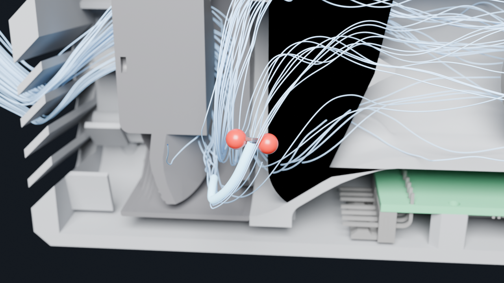

# Enclosure

One printed pebble that slips onto the egg's stainless intake tube. The fan, the flap damper, the controller board and its connectors are all in it. The CAD is `src/minimeater/mech/` (build123d); everything below is generated from it, and `uv run pytest tests/test_mech.py tests/test_skin.py` holds the claims.

This is the second design (v1): the v0 box with the board over the fan and the servo on a tower was 97 mm tall and read as a box with a pipe. v1 lays everything in one low body. It is built on the same provisional parts: the Noctua NF-A6x25 fan (`.2.2`), a Hitec HS-5065MG servo (`.2.9`), a 44 × 54 mm board (`.1.6`) and the egg's tube as measured with calipers (34.89 mm OD, 30.83 ID, 31.94 standing off the egg; `.2.8`). Each is a parameter in `params.py`, tagged with how sure it is.


## Layout

Frame: +X is the flow, the tube axis is the X axis, +Z is up, +Y is to the left looking along the flow (toward the egg). The socket mouth is the plane x = 0, the body extends to -X. Overall 139 × 75 × 74 mm (x × y × z) including the 21 mm of socket that shows at the front (11 mm of the original socket and its 10 mm extension); the shells alone are 115 long. v0 with its skin was 112 × 76 × 97.

Everything sits in one tunnel at the fan's height. From the back: the louvred rear wall (5.1 mm), a 12.6 mm plenum in front of the fan's rotor, the fan (60 × 60 × 25, x = -121.5 to -96.5), the 27 mm contraction from its Ø58 bore to the Ø32 bore (a curve tangent to both, 36° at its steepest) with a tail cone on its axis, 42 mm of straight bore with the flap at x = -37.5, a smootherstep up to the Ø46 socket, and the socket's 20 mm on the tube. The board lies flat under the straight section, parts up: its 11 mm keep-out ends 1 mm under the duct, and it is the belly's depth (the belly is 5.7 mm under the fan). The servo stands beside the duct on the +y side, output up, and drives the flap through a parallelogram over the duct's crown. The ports are in the -y flank, low, under the body's overhang.

| Part | Print pose | What |
|---|---|---|
| `duct` | flange on the bed, flow axis up | fan flange (62 square, r8), cone with the tail cone on six stator vanes, bore with the flap station, servo shelf, flare, socket with O-ring groove, drip collar and the 10 mm extension (lobed inside, a smooth Ø46 sleeve outside) |
| `hood` | standing on its rear face, nose up | the upper shell: half the nose notch, half the grille, the screw bosses, the seam rib, the label recess |
| `pan` | the same | the lower shell: the board on three standoffs, the port bay, the ambient louvres, the flange pads, the screw columns, the seam tongue |

The chassis is the duct with the fan screwed to its flange, the servo on its shelf, the linkage and the rod: a working damper on its own, before any shell goes on. Bought: fan with 4 M3 × 30 socket-head screws (through its corners from the inlet side into Ø2.5 pilots in the flange, the heads in the plenum), servo with a Secraft 15 mm aluminium arm (Hitec 24T) and 2 M2 × 6, a Ø3 rod 42.7 mm long (+-0.1: its end stands 0.3 mm above the crank and 0.6 mm under the coupler when the flap is closed) with a 2.5 mm D flat, not yet sourced, the made `crank` and `coupler` (below), two M2 shoulder screws (Ø3 shoulder, 3 mm long) with nyloc nuts and washers for the pivots, a 34 × 2.5 O-ring, 3 M2 × 6 for the board, 4 M2 × 16 for the shells, five silicone caps. Two thread sizes in all: M2 everywhere (the servo's tab holes and the arm's holes force it), M3 only for the fan, whose Ø4.3 corner holes an M2 head would slip through. Every screw self-taps into a pilot in the nylon (M2 Ø1.7, M3 Ø2.5); a heat-set insert, if one is wanted after the first prototype, goes in by hand once the pilot is drilled out (M2 Ø3.2, M3 Ø4.0).

The full list of what to buy, with quantities for five units, is `docs/ordering.md`.

## Tail cone behind the fan's hub

- The duct's outside follows the airway: the contraction's wall offset by the bore's 2.2 mm wall, so round the vanes it is a bell of even thickness (about 4 mm inside the straight cone it replaced just behind the flange, and less nylon), met by a 3 mm fillet where it leaves the flange's back face (`Params.duct_fillet`; OCC's own fillet on that ring: a curve drawn tangent to the face cannot be unioned onto it). At the socket the step up from Ø36.4 to Ø46 is a smootherstep tangent to both (`Coupling.flare_x`, x = -25.5 to -18): it starts at the board's front edge, whose keep-out is 1 mm under the duct, and ends 2 mm onto the socket, behind the O-ring groove and the drip collar.
- The fan's outlet face carries its motor plate, a flat Ø26.5 disc that is part of Noctua's frame (stationary; checked in their STEP model: 3 mm thick, flush with the outlet face, four swept struts, the label in a Ø20 × 0.45 recess). Behind it the flow would leave a dead zone. A tail cone printed with the duct fills it: Ø26.5 at the plate, flush with the flange face, parallel to the axis there so the flow leaves the plate's edge without a turn, closing to an 18° tip at the bore's start, 27 mm on (`HubCone.profile`). It and the contraction's wall (`Params.contraction`) are one designed pair: two degree-7 Bernstein curves, each revolved, chosen together (`cfd/inlet.py`) so the mean speed rises as evenly as the 27 mm allow, with gentle curvature on both and the annulus never widening (2091 mm² at the fan to the bore's 804; a test holds it monotonic). The first pair, a straight 26° cone with a corner at each end and a tail r₀(1 − t²) closing at 44°, sped the air up unevenly: its acceleration peaked at the tail's tip at 2.6× the even rate. The designed pair's peak is 1.25×. On the coarse CFD with the fan's own exit profile the two lose the same (16.1 Pa); the gain is the corners and the tip gone. The wall is built as a loft of circles on its curve (within 2 µm): a revolved spline is the same surface, but OCC's mesher took half an hour on it for the CFD's STL.
- It is hollow (1.6 mm wall) and open toward the fan: MJF is priced by volume, and a closed hollow would trap powder. Six stator vanes hold it from the contraction's wall, one straight up and one straight down (`HubCone.vanes`; six is co-prime with the rotor's seven blades, so the two share no tone). They are there for the swirl as much as the support. The rotor leaves the air turning with it (clockwise looking downstream, read off the blades in Noctua's model), and by Euler's equation a rotor that makes Δp has given the air at least r·c_θ = Δp / (ρω): on the model's operating line (0.6 to full speed, 4.2 CFM at full) that is r·c_θ / Q ≈ 18-21 per metre, independent of the speed because the system's curve sets both (`HubCone.swirl` = 18, a floor: the rotor's losses only add to it). That is 58° from the axis at the fan's face, and the contraction spins it up (42° and 8.9 Pa of swirl head in the bore with plain struts).
- Each vane's section is a NACA 4-digit thickness laid on a circular-arc camber line in the passage between the cone and the wall, at a fixed fraction of the passage's height. It thins from the root to the tip, 2.2 mm at the cone to 1.5 at the wall (`HubCone.vane_t`), and is closed round where it reaches the 1.2 mm thin-wall limit. The camber line starts along the air's direction at the leading edge and turns to axial plus Carter's deviation (m = 0.28 over √solidity: the air leaves a cambered vane short of its metal angle, so the vane overturns by it; 0.23 left 9 % of the swirl). That direction is the fan's own: the duct CFD on the exit profile of the fan's rotor in a rotating frame (`cfd/fan.py`, near stall at 4.2 CFM, the air leaving through the outer third) reads 66-79° over the span, about twice the turning of Euler's floor, and `HubCone.vane_beta` is a least-squares cubic through it (72° at the hub, 75 a third out, 67 two thirds out, 72 at the wall; a piecewise-linear table left kinks that showed as ripples on the vanes). Each section's chord is whatever gives it a solidity (camber length over pitch) of 1.3, so the vanes deepen toward the wall, where the pitch is widest: the trailing edge runs from 16.6 mm behind the plate at the hub to 29.1 at the wall (`vane_te_max` = 31, inside the flap's swing). The leading edge is a forward-bowed crescent, about 3.5 mm behind the plate at the hub and 7 at the wall. Each root has a fillet into the cone and the wall: the section's thickness grows by 2 R (1 − s/R)² at s mm from the wall (R = 1 mm, `vane_fillet`; tangent to the blade at s = R, 63° to the wall), on the NACA distribution itself, so the nose stays round at any thickness, and the trailing edge's round grows with it. Each vane wraps 53° round the axis at the hub and 41° at the wall. The turning is steep for a stator, but the contraction accelerates the axial flow about 2.6× through the vanes, which keeps them from stalling. It is one B-spline surface fitted through a grid of section points: rows are 29 span stations (packed 0.02-0.04 apart through both fillets), columns the same chord stations round every section, so the leading edge sits on one parameter line from root to tip. It is closed at the trailing edge's seam, capped at both buried ends and sewn to a solid. The first vanes were lofted section to section through periodic splines; the loft matched the sections' points imperfectly, which twisted and nicked the leading edges, and the old thickness flare left ridges in the fillet zones.
- The coarse steady CFD (6 CFM, the fan's swirl as a free vortex at the inlet; `.2.25`): the duct's static loss is 25.1 Pa with the three plain struts and 13.5 with the first, fixed-chord vanes (17-26 mm trailing edge, 1.8 mm thick, m = 0.23), which take out 91 % of the angular momentum (9° left in the bore, 0.13 Pa of swirl head in the tube). Without swirl the struts lose 14.6 and the vanes 18.5: the vanes win whenever the fan's real swirl is more than about half the Euler floor. On the fan's measured exit profile (scaled to 6 CFM) the solidity-1.2 vanes drawn for the free vortex lose 16.9 Pa and these 16.1, with 24° left in the bore and 0.26 Pa of swirl head in the tube (docs/cfd.md).
- It is printed, not glued to the fan: printed, it is concentric to the bore by construction and cannot sag or shift on an adhesive.

## Coupling to the tube

- The socket is a Ø35.19 bore (tube Ø34.89 plus 0.3), 20 mm deep. Its bottom is a flat shoulder the tube's end face sits on, with a 0.4 × 0.5 mm ring pit at the outer corner so the print's corner round cannot hold the tube off. The tube's wall is 2.03 mm, so its bore (Ø30.83) is 0.585 mm per side inside the duct's Ø32; the bore necks down to it over the last 5 mm before the shoulder (x = -25 to -20, a 6.7° half-angle: a gradual contraction, essentially lossless; `Coupling.neck_len`), so the airway runs on flush into the tube and no end face meets the flow (a plain step would be K ≈ 0.04). The flap's swing is clear of the neck: the disc's sphere is 9.8 mm in radius where the neck starts. A Ø31 bore would need no neck but costs about 13 % more loss at the flap station (1-2 % of the fan's flow) and a new flap, rod and linkage.
- The joint is downstream of the flap, so a leak there bypasses it (`docs/parts/heatermeter-adapter.md`). An O-ring in a groove seals it, centred 15 mm in from the mouth (5 mm from the shoulder, so its seal line is clear of the tube's cut end and its chamfer or burr, and as far from the hot egg, and as little travel through the ring on fitting, as that allows): a 34 × 2.5 ring stretches 2.6 % over the tube and is pinched 0.45 mm (18 %) between the tube and the groove bottom; the test holds that to 10-30 % squeeze and under 5 % stretch.
- Retention is the socket's own grip; there is no thumbscrew. The socket runs on 10 mm past the old mouth (to x = 10, `Coupling.ext_len`): the tube stands 31.94 mm off the egg, so seated on the shoulder its end is 1.94 mm short of the egg. From 1 mm in front of the O-ring's groove (x = -12.4, `Coupling.wave_x0`: the ring sits in round, rigid bore) to the mouth, the bore goes from round to eight sinusoidal lobes (±0.8 mm on the radius) along a smootherstep (6t⁵ − 15t⁴ + 10t³: no slope or curvature step at either end), its mean growing 1 mm on the diameter on the same curve; the lobed wall (1.7 mm) follows the wave, so the lobes can flex. The crests touch the tube from x ≈ -1.3 to 8.5 and reach 0.15 mm into it at x ≈ 7.1 (`Coupling.grip`: the amplitude is solved so the deepest crest is exactly that); the last 3 mm opens so the crests clear the tube by 0.15 at the mouth and it starts freely. Outside, a smooth 1.2 mm sleeve carries the socket's Ø46 on to the mouth, so the extension looks like the rest of the duct; behind it an annular slot, at least 0.89 mm wide and open at the mouth, frees the lobed wall from x = -10 (3.4 mm in front of the groove, in front of the shell's nose; the slot prints upward and lets the powder out). Filled solid instead, the crests would be nylon several millimetres thick and the 0.15 mm grip a rigid press fit. The thinner lobes grip about a third as hard as a 2.4 mm wall, but over 9.8 mm of crest line (3.9 when they started at the old mouth); the print test ring (`.2.5`) sets `Coupling.grip`. Tests check the grip profile and that the loft stays on its formula (`test_the_socket_grips_the_tube_over_its_lobes_only`, `test_the_socket_loft_follows_its_formula`).
- What hangs on the tube (`analysis.mass_budget`, from the CAD's volumes at PA12's 1.01 g/cm³, 304 for the machined parts, and the bought parts' data): about 273 g, its centre about 69 mm behind the mouth (the fan, 50 g at the back, pulls it there; the three printed parts are 168 g). As a lever on the tube's 30 mm (`analysis.tube_loads`) that is about 7 N up at the tube's end and 4 N down at the mouth, and 0.2 N·m at the egg: nothing for the nylon at the tube's 65-90 °C or for the steel. The weight needs no grip; the lobes are for bumps and a cable's pull along the tube, and a hard yank should pull the box off rather than drag the egg. The cables and plugs on the ports (perhaps 20-50 g more) are not in it.
- A collar behind the hood's front ring (Ø49, a 44° cone on its front, a chamfer behind) seats on the shells' front cone 0.3 mm away: it stops the chassis moving forward and catches water that gets past the nose.

## Flap and linkage

- The flap turns about a vertical rod in a blind pocket in the bottom wall and a Ø3.4 bore through the top wall: one shaft leak path. The flap is machined (see below): a Ø31.7 disc 2.0 mm thick with a full-round edge (R1.0, so no square corners face the flow or the bore), centred on a 4 × 5 mm rib (a 1 mm bump each side; a stadium section: its ends facing and leaving the flow are Ø4 half-rounds, not square) with the Ø3 D-bore for the rod down its centre; its radius keeps the edge 0.15 mm off the bore at every angle: the round edge lies inside the sphere the closed edge circle spans, which the turn about the rod maps onto itself (a square edge's corners came 0.03 mm closer at about 86°). The printed duct's bore is good to ±0.3 mm (JLC), which would jam the flap or open the gap to a 0.36 cm² leak (a test holds both numbers), so the bore is reamed at the flap station from the fan's end, through the cone (a Ø32 reamer cannot pass the neck: stop its tip at x = -25) (Ø32 H7, +0.025/0, 40 mm long: a standard machine reamer size; the bore was Ø31.6, the tube's ID as then assumed, which has no stock reamer; the duct's straight wall is 2.2 mm) after printing; then the gap is 0.09-0.21 mm and the worst-case leak 0.24 cm².
- Closed-flap leak: 0.18 cm² nominal (ring plus shaft) against the 0.3 cm² budget (`docs/modeling/README.md` §5). Open-flap blockage 16 % of the bore, mostly the rib. A hand estimate (a strip of Cd 1.2 square, 0.4 rounded, in the bore at 16 % blockage) puts the rib's loss at k ≈ 0.26 with square ends and ≈ 0.1 rounded, referenced to tube velocity: about 0.1 CFM of 4.5 on the NF-A6x25, so the rounding is free but not large; the edge-on disc's 2 mm edge is left square because its diameter sets the leak. CFD (`.2.13`, `minimeat-p4k`) checks it. The disc is centred on the rib, so the flow's forces on the rod balance and the disc's edge circle is on the rod's axis. JLCCNC quoted it at $21.90 against $21.34 for the one-sided flap (the disc flush with the rib's bottom, milled from plate with the rib standing on one face; 6061, bead blasted, quantity 1), so the extra face costs about 3 %. `Damper.rib_both_sides = False` gives the one-sided flap; `build/mech/quote/` has both STEPs.
- Drive: a parallelogram. The crank on the rod's top end and the servo's arm are equal 12 mm arms (the Secraft 15 mm Hitec-24T aluminium arm has M2 holes at 12 and 15 mm; the 12 is used). A coupler bar, 6 × 2 mm with a 0.9 mm boss under each hole, rides 0.9 mm above both arms (the bosses rest on them) with its two Ø3.1 holes 25.0 mm apart, on M2 shoulder screws with a Ø3 × 3 mm shoulder (heads on top, Ø5 × 2.0: McMaster/Zoro STR601M3X4, a 4 mm shoulder in the catalogue, take the 3 mm; the thread goes into the crank and through the horn's M2 hole; a nyloc nut under the horn, a tapped hole in the crank). The servo's output axis is straight across from the rod at y = 25.0, so the bar runs along y and the flap angle equals the servo angle: 0° open (arms pointing at the fan), 90° closed (arms pointing at -y, over the crown). The crank's lug hits two 3 mm posts printed on the duct's crown (the first beside the lug at 0°, the second at 90°; both under the arm, 1 mm below its underside): the flap stops hard at exactly 0° and 90° nominal, so the firmware can home against them by stalling the servo (`minimeat-xdn`); the posts are good to the print's ±0.3 mm, about ±2° at their radius, which the closed leak ignores. Flap zero is set coarsely by the horn's spline (15° steps) and finely by the crank's set screw on the rod. The plane is 0.8 mm over the duct's crown. The bar's lift is there for the rod: its end stands 0.3 mm above the crank and the bar clears it by 0.6 mm when the flap is closed and the bar lies over it (to pull the rod, take the crank off first: the rod then stands about 7 mm above the duct's crown); the pin heads stop 1.6 mm under the roof's nominal underside. Open, the horn pin's head is under the roof's corner round, which comes down to 0.5 mm over it, so the hood has a relief there: a teardrop pocket (pointed at the nose, so it prints) 1.2 mm over the head, leaving 1.6 mm of roof. Both heads then clear the hood by 1.2 mm or more over the travel (a test checks 0, 5, 10, 45 and 90°). The whole travel is checked for interference at four angles with every part and mock, shells included. The real board (KiCad's STEP of every part on it, `tests/test_board_fit.py`) is checked against the shells and the chassis with the flap closed and open: nothing intersects, and a board moved 6 mm into the pan does (the check has teeth). It needs KiCad, the Mac app or the kicad container under podman (`board3d.py`); the container has no KiCad stock 3D library, so there the small stock parts (resistors, capacitors) are not in the board, only the vendored models (module, connectors, inductor, switch, LED).
- Why machined and not RC links: the horn's 24-tooth spline is not worth machining, so the arm is bought, but everything between the arms is free to be exactly the size it needs. Ball links on a threaded rod (the usual RC coupler) have bodies about 18-25 mm long, so two need 30-45 mm between the pins, and here it is 25.0 (the duct radius and the servo's width fix it); E-Z connectors would fit but are loose. A plain bar on shoulder screws has no play and no spacing limit, and moving the servo is not needed. This is a planar parallelogram, so plain pivots are enough.
- Made parts (JLCPCB CNC, 5 off each, `cnc/flap.step`, `cnc/crank.step` and `cnc/coupler.step`, with a drawing beside each (`cnc/flap.pdf` etc., named like the STEP file because JLCCNC pairs them by filename) with the thread and bore callouts: the STEP carries a thread only as a plain hole at the tap-drill diameter): the crank is a Ø8 hub with a slip-fit D-bore (0.1 mm), an M2 set screw radial on the rod's flat, an arm out to a tapped M2 hole, and a stop lug (a 3 mm wide rib under the arm, from the hub to 9.5 mm); the coupler is the bar. Stainless 304 for both is the better choice next to a tube that can reach 65-90 °C (`.2.5`); 6061 is fine if the quote is much lower. Printed plastic would creep and wear its pin holes there. The flap is machined too: its D-bore and edge need ±0.05 mm and a printed part cannot hold that (above); it also stands a few centimetres from the socket and is the first thing a flashback reaches. It has no thread: the rod is retained with compound. Threads are on the crank only (two M2 x 0.4-6H, tap drill Ø1.6).
- Servo calibration (`minimeat-bkz`): the servo is absolute (a pulse always gives the same angle across boots), so the closed and open pulses are found once per assembly and stored in the board's flash (`servo` on the serial console: `docs/icd.md`); until then the firmware uses the nominal 1000 us closed and 2000 us open. With no cook running (the console refuses a jog during one, and a cook that starts ends it), open the console and: (1) `servo jog 1000` holds the servo near one end (use `servo` to see what is held); (2) with the crank loose on the rod, push the horn onto the spline at the 15 degree step that leaves the arms nearest the closed position, then hold the flap square in the bore and tighten the crank's set screw on the rod's flat; (3) nudge with `servo jog +10` or `-10` (us per step, the servo moves within a second) until the flap sits square in the bore and the lug is just short of the closed post, and look through the bore for the leak: `servo mark closed`; (4) jog to the other end until the arms lie along the flow, the flap edge-on and the lug just short of the open post: `servo mark open`; (5) `servo save`, which checks that the two marks are 200 us or more apart, stores them and lets go (a servo mounted the other way round has closed above open, and is accepted). `servo done` lets go without saving; `servo clear` forgets the calibration. Approach the posts, do not press on them: a stalled servo draws about 1.2 A (the load switch trips at 0.6 A). The accepted pulses are 500 to 2500 us, wider than any hobby servo travels, so a typing error cannot ask for more; the HS-5065MG's real range is still to be read off the bench (`minimeat-bkz` follow-up). Homing (`minimeat-xdn`, `servo home`, and by itself at power-on when no calibration is saved and no cook is resuming) replaces steps 1 to 5: with the fan off, the firmware sweeps the servo at about 9 degrees a second toward the lower pulses until the crank's lug meets the first post and the servo stalls, then toward the higher pulses to the second post, cuts the servo for a second after each stall, and stores the stalled pulses less an estimated lead as closed (the lower) and open. The stall is seen in the servo's current across the board's shunt (`minimeat-sul`: a mean of 0.45 A over a 0.1 s step, before the load switch limits at 0.6 A; 40 us of lead), or failing that on the shared fault line the switch holds low in current limit (60 us of lead), so a dead current sense still homes. It refuses a result less than 200 or more than 1300 us wide (the posts are missing, or it found the servo's own end stops) and keeps the nominal pulses. A servo mounted the other way round (closed above open) is calibrated by hand, since homing takes the lower stop to be closed. A cook starting stops it. The sweep, threshold, leads and limits are estimates until a bench (`minimeat-vzg`).
- Servo: body at y = 19.2-30.8 (1 mm off the duct, 3.8 off the wall), z = -4.8 to 15.2, long axis along the flow toward the fan. It drops through a cutout in a 2.5 mm shelf cast on the duct at z = 9.7-12.2. Under each end's tab the shelf has a solid block, 7 mm deep from the tab's underside (the body's width, flat under the whole tab), with an M2 pilot (6 mm deep, 1 mm floor) under each of the tab's six screw holes: three at each end, 6 mm across, the middle one 0.8 mm further out (positions read off Hitec's STEP; the drawing's 19.2 and 7.8 mm are the outer pairs). Fit 2, 4 or 6 M2 × 6 screws as field testing says. The front block's face toward the body is a vertical 12 × 7 mm bridge (84 mm²); the rear end leans 44°. A test checks all six pilots against the STEP's holes. The shelf is why the servo is aligned with the rod by the print, not by assembly. Its lead leaves the bottom of the body with 14 mm to the board. Heat: the servo is rated 60 °C. The body touches nothing but its tabs; the duct beside it carries the fan's air, and the shelf's front end stops 10 mm short of the socket, which is the hot part. The shelf is the one conduction path from the duct; if the tube measurement (`.2.5`) says the socket runs hot, slot the shelf between the socket and the tabs.

## Board and ports

- The board (47.5 × 54 × 1.6, `uv run mech-envelope` for the contract) sits on three Ø5.5 standoffs on the pan floor at its mounting holes (the corners are taken by the connector row and the module; the connector row is held by the port wall). The connector edge is trimmed back 1.75 mm (the sheet frame stays 54 mm; the board is 46 × 52.25, square corners on that edge), so the connectors hang past it. **The board is turned over**: its SMT face (F.Cu) is down on the standoffs at z = -27.0 with the parts hanging under it, and its back (B.Cu) faces the duct at z = -25.4 with only the through-hole tails (2 mm) above it, so the keep-out above is -22.9 against the duct's bottom at -18.2. The connector axes stay at z = -28.6 (the jacks hang 1.6 mm under the face), so the port wall and the bay did not move. Under the board: 7.3 mm to the pan floor (z = -34.3, unchanged) for the right-angle KK headers (6.36 tall, J6 and J7, the plugs entering toward the rear edge) and the SMT parts (3.7 at most). Turned over about x, the real board has its connectors at -y and its USB-C at -x, which is the sheet's own x and y: an earlier model mirrored it, with the parts up. In x it spans -72.0 to -24.5: the parts start at -70.5, 1 mm into the cone's start, and the last 1.5 mm (`Pcb.usb_end`, past the USB-C's first-jack web; below) goes 2.5 mm into the cone, which the thin top side clears; the straight section is sized by it.
- Connectors on the -y long edge, reaching into the port wall: the jacks' fronts are 0.1 mm inside the frame's edge and the USB-C's shell front 0.6 mm, 1.65 and 1.15 mm past the trimmed edge (`hw/tools/connector_edge.py`: 0.5 mm of board edge to the nearest copper), so a plug's barrel travels 0.85 mm past the wall's outer face instead of 2.6 before it enters the jack. The USB-C receptacle the USB-C receptacle (GCT USB4105-GF-A, 9.4 × 3.3) at board x = -18.05 (the rear end) and the four 2.5 mm TRRS jacks (SHOU HAN PJ-242 from ADR 0002: 5 wide, 3.2 tall, 12 mm back from the edge) at -7.05, 1.65, 10.35 and 19.05. The pitch, 8.7 mm, is set by the Ø8 plug overmolds (0.7 mm apart), not the jacks. Both connector axes come out 1.6 mm over the board, so the five openings are one row at z = -28.6. The port wall is the pan's own 2.4 mm wall, its inner face 0.1 mm past the trimmed edge, outer face at y = -27.75: a 13.2 × 7.4 opening for the USB-C overmold (the USB spec's largest is 12.35 × 6.5, cables run bigger; the first jack's opening is 1.7 mm away: the board grew 1.5 mm at the USB-C's end (commit fd4c019) to leave a printable wall between them, which had been 0.2 mm and one joined slot) and, for each jack, the Ø5 plug hole joined to a 5.4 × 4.0 rectangle that the jack's housing (5 wide, 3.15 tall plus a 0.45 tab) stands in. The jack holes are teardrops pointed +x so they print.
- The port bay is the recess that puts the port wall 9.05 mm inside the flank at the eave: x = -74.5 to -24, floor at z = -34 (the belly's round), ceiling at -21. The body's lower round above it is the eave, with a 1 mm drip lip along its edge (ending flush with the bay's front end); the front end wall is 45° in plan (for the print and for a thumb), and stops 0.66 mm short of the front screw column (it ran into the column and left the pan's STL open; the front plug clears it by 2 mm). The export test checks every STL is closed. The end walls are plain: no holes, no scallop. Plugs enter horizontally; the probe cables hang.
- Ambient sensor: the TMP117 on the board's parts face at the rear +y corner (board x = -18.85, y = 24.8; single-sided assembly), 2 mm in from the +y edge, with no copper under its thermal pad. With the board turned over it faces the pan floor, and two 8 × 1.4 slots through the floor under it (y = 23.3 and 26.3) let outside air in; it is far from the duct, the regulators and the module, with the whole board between it and the duct (`.3.10`).
- Fan and servo leads stay inside: headers on the board, unplugged when the pan comes off.

## Exterior


Form. One lofted body: rounded-rectangle sections on smooth profiles. The rear face is 72 × 70 with r14 corners and a 3 mm 44° chamfer (it is the print bed face); over 10 mm it eases out to the full 74.4 × 71.1 section with r16.4 corners (the fan's corners need r ≤ 16.4); the roof then crowns 2 mm and the corners open to r19 at x = -62; from x = -40 the roof eases down and from -28 the plan closes to the nose, a 60 mm wide, 60 tall ring with r18 corners, a 1.6 mm land and an r5 round around the Ø47 hole the socket leaves through. The belly is flat (it sits on a bench) and rises 3.7 mm over the last 12 mm. Two massings were drawn: a loaf (the same body with a flat roof and r16.4 throughout) and this one; the crown and the wider mid-body rounds are what make it a pebble and cost 2 mm of height.

Parting line. The plane z = 0, the tube axis: the hood (the egg's green) above, the pan (charcoal) below, so the seam runs through the nose's centre and the socket is the one element that comes out of the body. On the rear face only it follows the gills' 6° V, rising to 3.8 mm at the axis and back to the plane at the face's sides, and through the wall it climbs inward at 44° like the gills (4.93 mm across the 5.1 mm wall), fading to level over |y| 32.5-36 so that along the flanks it stays level (`shell.seam_at`; the pan takes the ruled wedge under it, `seam_wedge`). The hood lifts straight off: the socket leaves through the half-round notch. The pan drops away with the board; the chassis can stay on the tube on its thumbscrew. The label (40 × 10, 0.8 deep) is on the hood's -y flank over the ports.

Fixings. Four M2 × 16 from below, all hidden in the belly: two at (x = -18, y = ±28) up through the pan's thick front zone into bosses that merge with the hood's front cone, and two at (x = -127.8, y = ±33.3) through columns beside the fan's rear plenum. Each has a teardrop counterbore from the belly for the head and the driver. The chassis is captured, not screwed: the collar against the front cone, the fan's rear face on four Ø4 pads inside the rear wall (0.3 mm of play), the flange on two wedges on the pan floor, and blocks on both shells' side walls that hold the fan sideways with 0.4 mm of play.

Grille. Eight chevron gills across the rear face: each slot is a shallow 6° V, apex up on the axis, so water on the blades runs off to the sides, and its ends are cut at 44°, the rear chamfer's angle and the louvres' own, so the house angle shows at the outline. They are 3.2 mm across the slot (4.45 high on the face) at 6.12 mm vertical pitch, so the blades between are 1.20 mm thick (6.12 cos 44° − 3.2: JLC3DP's thin-wall check flags anything under 1.2), each as long as keeps its outline 1 mm inside the face's flat and, after its 4.93 mm rise through the wall, 1 mm inside the inner face (`shell.grille_slots`; a gill that can't reach 20 mm a side is dropped, so all eight run 30-32 mm a side). Each outline is extruded through the wall along 44°, so each slot descends outward. Climbing inward, the top slots would break out through the rear chamfer, an upward face over the grille that rain would run into, so the cut keeps 1.2 mm of wall under the chamfer (`shell.under_chamfer`; a test holds it). The hood/pan split on the rear face follows the same V and climbs at the gills' 44°, so it sits in the middle of the band where one gill would be: 7.79 mm on the face (`grille_seam`, two pitches less a slot's 4.45 height), the gills evenly pitched either side of it and the split centred in its blade. The first rounded-square field of straight slots had a flat parting bar there, and the first chevron seam was level, off-centre in a thinner blade with a rear lip behind it. Open area through the slots 1485 mm² (the straight slots had 1596, the inner grille of v0 1294).

Shell walls 2.8 mm, seven perimeters (the duct's 2.4; the rear wall 5.1, so the louvre blades are 7.1 mm long). The 2.8 is not arbitrary: at the seam the hood's skirt is the wall less the pan's tongue and 0.2 clearance, 2.8 - 1.3 - 0.2 = 1.3 mm, and JLC3DP's thin-wall check flags anything under 1.2, the taper leaves the normal thickness a little under that. Clearance is checked against every chassis part, the bought parts, the board's keep-out and the plugs, with the flap open and closed. The tightest spots are the board's keep-out corners against the front cone and wedge (under 1 mm) and the collar in its seat (0.3 mm).

## Rain

The box lives outdoors; the target is IPX4 (splashed from any direction, no immersion). Per opening:

- Status LED and button: on the board's +y edge (the -y edge is full). The LED is a side-view Lite-On LTST-S220KGKT facing +y behind a Ø1.9 hole in the pan's flank holding a piece of clear 1.75 mm filament as a light pipe, glued flush: sealed, and the hole is the only break. The button is an ALPS SKRPACE010, a top-push tact switch (2.5 mm tall, 2.55 N), facing down: a Ø3.2 hole in the pan floor under it takes a paper clip (reset and WiFi provisioning; the hole is on the underside, facing the ground, and can take a plug). Heights under the board (LED 0.5 mm) are estimates until the parts are in hand.
- Ports: in the bay, 9.05 mm under the eave with its drip lip, in a vertical wall; the floor is the belly's round, open all along. Silicone caps for USB-C and unused jacks (untethered: the end walls have no holes). A probe plug in a jack is a 2.5 mm barrel in a Ø5 hole beside the housing: not sealed; the jack's own body is the next barrier.
- Inlet: 44° louvres in a 5.1 mm wall, blades 7.1 mm long. The rise across the wall (5.1 tan 44° = 4.93 mm) is more than a slot's height (3.2 / cos 44° = 4.45), so nothing falling or level has a straight path in; only spray rising from more than 5° below the horizontal lines up with the slots, and it reaches the fan's rear face, which the fan tolerates. (With the first 3.2 mm wall a 1.36 mm band per slot was open level, and rain falling at up to 23° got straight in.) The wall's extra 1.9 mm came out of the plenum (12.6 mm), so the box keeps its length; the open area is 1485 mm² (was 1596).
- Ambient louvre: two slots straight through the pan floor under the sensor; what gets in meets the sensor's face, and the board shields it from the duct.
- Seam: along the flanks the pan's inner half-wall rises 3 mm inside the hood's wall and a 1.4 mm rib from the hood hangs 3 mm inside that: the path turns twice. At the rear wall the split itself climbs 4.93 mm inward at 44° through the 5.1 mm wall, the gills' own rise, so it has no level line of sight and needs no lip (the level V seam had a 1.2 mm lip behind it, which showed outside as a tab where it reached the corners). At the nose the two half-round notches close on the socket with 0.5 mm of play; the collar inside the front ring stops what runs along the socket. No hole goes through the socket's wall.
- Top: the roof crowns and rolls; no flat pocket. The label is on a vertical flank.

Nothing is proven. The spray test (IEC 60529 IPX4: oscillating tube, 10 L/min, 10 min, then open and look) is a bead to file; the first thing it will say is whether the nose notch and the port holes need gaskets.

## Printing

Printed at 0.4 mm: seven perimeters on the shells (2.8 mm walls), six on the duct (2.4 mm). Every designed overhang is 44°, inside the 45 the test allows, so the inventory (`overhangs()` in `printing.py`: downward faces steeper than 45° in the print pose) lists only what is meant to be there:

- `duct`, flange down: the O-ring groove's 2 mm ceiling (221 mm², a bridge as in v0) and the socket's flare (376 mm²: a smootherstep, steeper than 44° in its middle; the duct is MJF only). The collar's chamfer, the shelf's ends and the shelf's bosses are the 44° features for this pose.
- `hood` and `pan`, nose up on the rear face: about 60 and 50 mm² of slivers at the ends of the rear pads and around the port openings (the test caps each shell at 150, no patch over 60). The cavity's front is a 44° cone down to the nose hole (plus a 44° wedge under it in the pan, so the board's corners fit), the screw bosses and standoffs are teardrop columns pointed down, every hole along z is a teardrop pointed up, and the bay's end walls and the ambient well's cross fins lean 44°. The USB-C opening's top is a 13 mm bridge.

Minimum feature 0.8 mm: the louvre blades are 1.1 at the faces, the webs between port holes 1.3.


## What the form costs

- Length: the front cone that makes the shells printable eats the cavity's corners for the last 25 mm, so the board had to move 1.5 mm back; with the 12.6 mm plenum and the 5.1 mm rear wall behind the fan the body is 128 long (it was 118 with a 4.5 mm gap for the fan's screw heads). The horizontal board costs 7 mm of height over a vertical one (73 against 66).
- Airflow: the inlet turns 44° through the gills; the open area is 30 % more than v0's grille. The rear gap is 12.6 mm, a plenum in front of the rotor: with the louvres 4.5 mm off it the coarse CFD left the fan 2.9 Pa of its 12 Pa static at 4.2 CFM; at 14.5 it keeps 7.3 (`docs/cfd.md`; 24.5 mm gave 7.4, so this is the knee; 12.6 since the rear wall thickened inward). The chevron grille at 12.6 keeps 6.8; twelve anti-swirl ribs at the blade tips on the rear wall's inner face (`shell.tip_ribs`: 1.2 thick, r 25-34, 15° + 30i° off vertical so none is on the parting plane) lift it to 10.6, near the fan's free air. They stop 4 mm off the fan's frame, 1 mm short of its M3 heads, so the shells close past the heads (2 mm off gave 11.1). It costs 10 mm of length and 11 g, and moves the centre of mass 3 mm back.
- Heat: the socket is outside the shells; the board is under the straight section, not under the socket. The servo is beside the cone, in the fan's air.
- Service: the hood comes off upward on four screws from below; the pan brings the board with it; the chassis stays on the tube. The fan comes off the flange from the rear once the chassis is out. The duct pulls off the tube against the lobes' grip.
- Plugs: the bay is under the body: plugging in is by feel from the side, the overmolds are 0.7 mm apart, and the recess is 7 mm, so a plug with an overmold longer than 18 mm stands proud of the flank.
- Board: 47.5 × 54, turned over, 6.4 mm under it (3.7 along the +y edge, where the floor curves up) and 2.5 above; the two front corners have under 1 mm to the cone.

## Provisional values to confirm

| Value | Where | Settled by |
|---|---|---|
| tube roundness, end condition, clearance on the egg | `Tube` (OD 34.89, ID 30.83, free length 31.94 measured) | calipers on the tube (`.2.8`) |
| fan outline, hole size, aperture, screw head height | `Fan`, `Layout.rear_gap` | the fan in hand (`.2.2`, `.2.11`) |
| servo body, tab spacing, horn (hub, thickness are estimates) and its hole radii | `Servo`, `Linkage.arm_r` | the servo and arm in hand (`.2.9`) |
| whether the arm's M2 holes are tapped or clear (nut under the horn), M2 shoulder screw head | `Linkage.pin_*` | the arm in hand (the `.2.9` bring-up) |
| board size, hole positions, connector positions and heights, sensor spot | `Pcb`, `envelope.py` | the ICD and layout (`.1.2`, `.3.6`, `.3.7`) |
| plug overmold Ø8, USB-C overmold (opening 13.2 × 7.4) | `Pcb` | the probes and cable bought |
| flap gap, rib size | `Damper` | the first machined flap and a smoke test (`.2.7`) |
| rain: nose notch, port holes, seam | `Shell` | the IPX4 spray test |

Nothing here has been printed yet.

## The animation: one air molecule through the assembly and the egg (`film.py`, `just scene`)

An O2 molecule enters at the grille, passes the plenum, the fan, the stator cone, the flap and the tube, riding one of the CFD's pathlines
(`docs/cfd.md`, "Pathlines through the whole airway"). It goes on into a stand-in kamado, meets a glowing coal and becomes CO2, which rises
in smoke to the brisket. `uv run --group scene mech-scene` (Blender as the `bpy` module, Cycles, ADR 0007) builds `build/scene/scene.blend`
from `assembly.glb` and the pathlines; `--still N` renders frames, `--video` the film (`--preview` for a quick one), `--shot` holds one
camera instead of the film's cuts, `--no-fire` leaves the egg out, `--no-cut` skips the cutaway.



*Frame 290 of the film: the O2 behind the fan's inlet, its pathline from the CFD (a Cycles render, `just scene --still 290 --shot follow`).*

**The film** is 50 s in five parts (`SECONDS`): 22 s from the room to the tube, 8 s through the egg to the coal, 9 s of the reaction, 8 s of
the rise and 3 s at the meat. Cameras and cuts are timeline markers in the .blend, to hand-tune (`SHOTS`): outside the gills, a follow
camera through the fan, a close-up of the flap as it passes, the follow camera again, a wide shot of the machine, the whole egg, the coal
(through the reaction) and the plume. Every camera object is `cam_<shot>`.

- **The cut.** Every part is cut at y = 0 by a Boolean (Exact, hole tolerant), so the air path is open to the camera; the egg's parts too. It takes
  about a minute at build. The rotor keeps its modifier live and spins inside the fixed cut.
- **The molecule** is ball-and-stick (two balls, two sticks for the double bond) at 4e7 times life size (`--scale`): at life size an
  O=O bond is 1.21 angstrom, and the gills are 10^8 times that. It tumbles slowly with seeded thermal jitter, so a render is repeatable.
- **Time is re-timed.** The molecule takes about 190 ms in the CFD from the room to the tube, 6 ms of it in the rotor, and its speed
  varies 40-fold. Screen time advances by ds / speed^0.5 (`--alpha`: 0 is constant screen speed, 1 is real time scaled). The
  rotor turns by omega times the molecule's own clock, so the blades are where the CFD had them as it passes.
- **The gas moves** (`swarm.py`). The molecule is one parcel of a stream: about 1800 more are on the CFD's own lines (606 of the 648 that reach the
  tube), each a comet, a head with a tail that is its last 0.5 s, coloured by its local speed (blue slow to red fast; a fast parcel has a long
  tail). Every line is re-timed by the molecule's law with the molecule's constant, so a parcel's screen speed depends on the local speed
  alone and neighbours move in step; the stream is steady, each parcel looping round its line out of step with the others. Past the tube each
  goes on along the molecule's hand-drawn way in carrying its own sideways offset, narrowing through the grate's hole, and is consumed at
  the coal. The positions are baked to `build/scene/gas-air.pc2` and read back by a Mesh Cache modifier; Geometry Nodes draw the comets.
  The parcels in the rotor's zone follow the lines as traced (in the rotor's frame, turned by omega times the line's own time), so
  they are not in step with the blades as drawn: a parcel can be seen crossing one. The molecule keeps its own trail, drawn behind it.
- **The egg is illustrative** (`firebox.py`): a large egg's shape (300 mm fire ring, 456 mm across, 570 to the top vent), the port the tube
  enters, a grate with a ring of holes, about 180 charcoal lumps, a cooking grid and a brisket. The minimeater's CFD ends at the tube, so the air's
  way in is drawn by hand: the port, the cavity under the grate, up through one hole in the grate and the bed to a lump, a spline with
  made-up speeds (about 0.5-1 m/s). It is not a flow simulation, and the film should say so.
- **The reaction** (`molecule.py`) is the textbook one, C + O2 -> CO2: a carbon atom comes out of the lump's face, the two oxygens part to
  2.32 angstrom either side of it, the O-O double bond runs out and two C=O double bonds (four sticks) grow in, so the product is linear
  O=C=O. The coal's glow flares with a seeded flicker as it happens and a point light follows it.
- **The smoke** (`smoke.py`) is a tube of scrolling-noise volume that grows along the rise path a little ahead of the molecule. It is full of
  parcels of its own (grey-to-warm comets, about 40 a second, spiralling and widening up the path, a made-up flow like the egg's way in), and
  28 amber particles spiral up among them as individuals picked out of the plume. They are the flavour, kept apart from the CO2 on purpose:
  smoke flavour is the wood's pyrolysis products (phenols, carbonyls), not CO2. They land on the brisket's underside and darken it there.
- Not done: ember sparks and the heat shimmer. Rendered frames and video stay in `build/scene/`; nothing here is checked in but the scripts.

## Commands

```bash
uv run pytest tests/test_mech.py tests/test_skin.py   # builds the parts and shells, fit, leak and overhang checks
uv run mech-export [dir] [--flap DEG]  # build/mech (--flap: the flap's angle in the assembly files, 0 open, 90 closed): 3dprint/ (duct, hood, pan: STEP and STL in print pose) and cnc/ (flap, crank, coupler: STEP and a PDF drawing each, same names), each with a README and a zip of the same files; assembly.step (a product per part; the board is one flat "pcb", so an exploded view moves it as a unit), assembly.glb (the same for Blender: File > Import > glTF; metres, one object per part and the board in five colours, a PBR material and smooth normals on each, the fan's rotor a node of its own (`fan_rotor`: turn it about x), the air path's stations as empties `air.0.grille` .. `air.7.tube_end` along the flow axis, and the flap angle on the scene; `scene.py`; the cutaway is a Boolean in the Blender scene, see its docstring), envelope.json, plugs_mock.step (docs/jlc3dp.md)
uv run mech-render [dir]             # the images above (default build/)
uv run mech-envelope                 # the board contract
just scene --preview --video         # the air-molecule film (needs `just pathlines` and mech-export first; docs above)
```
