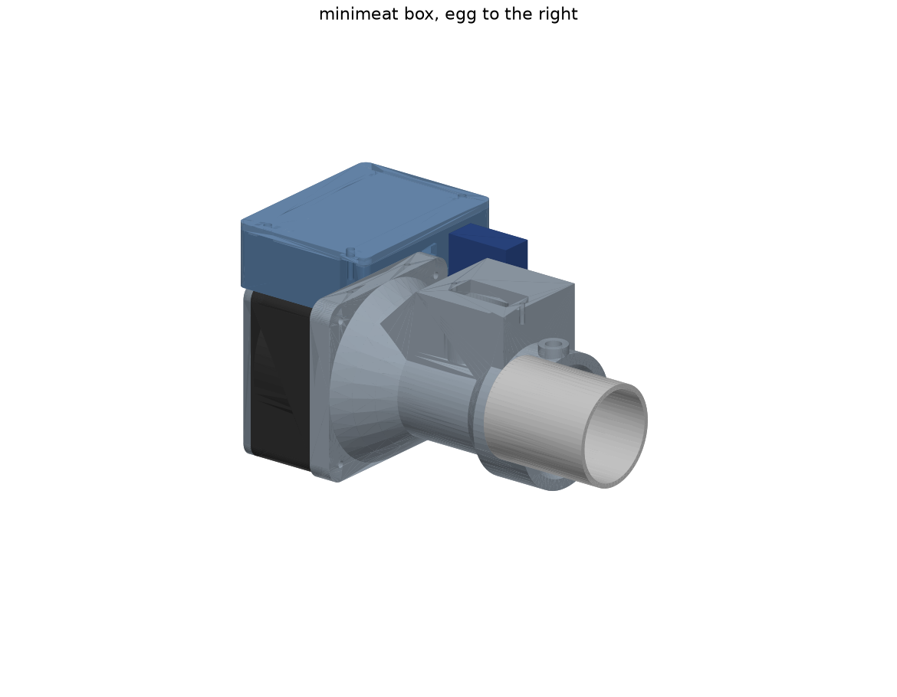
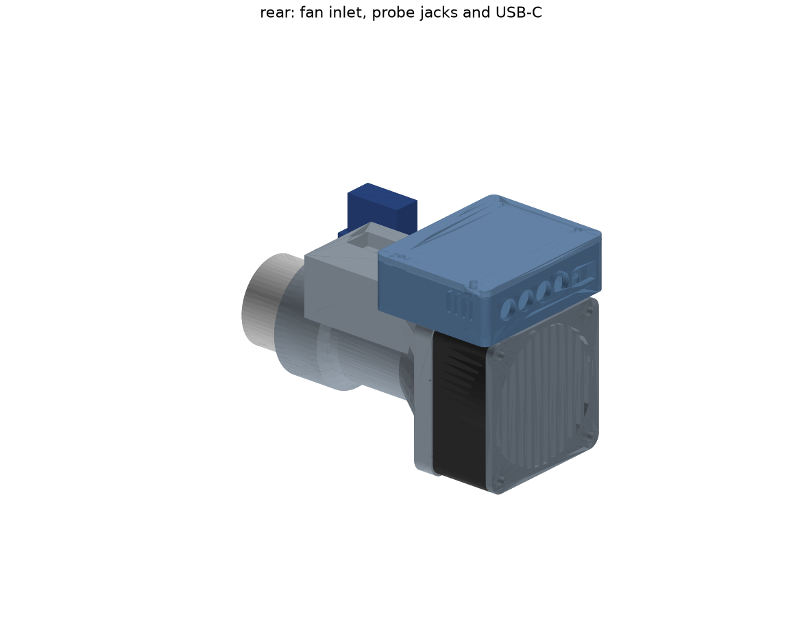
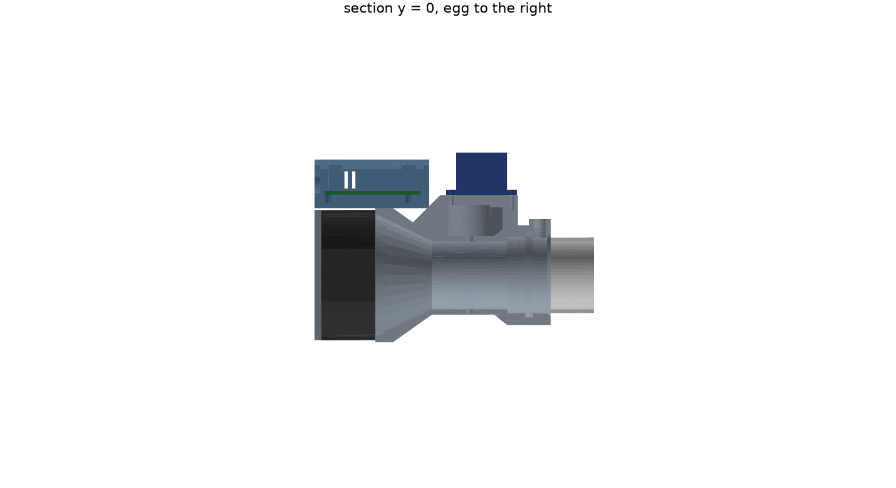
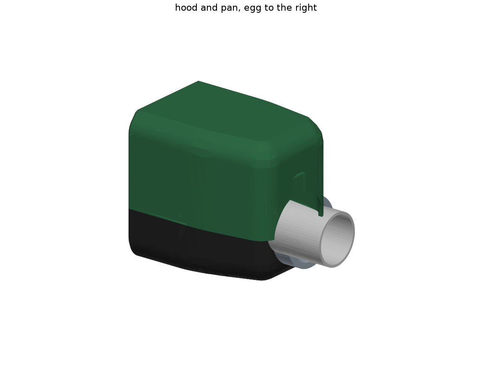
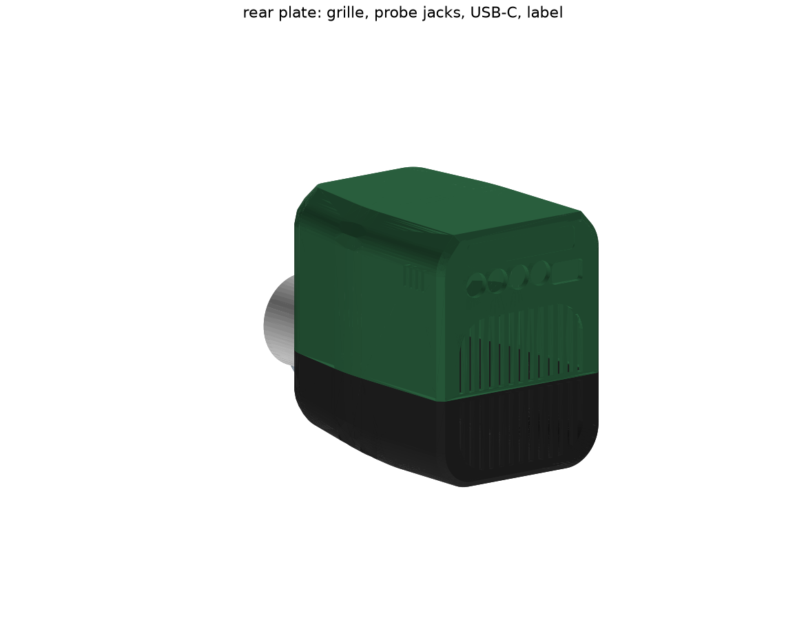
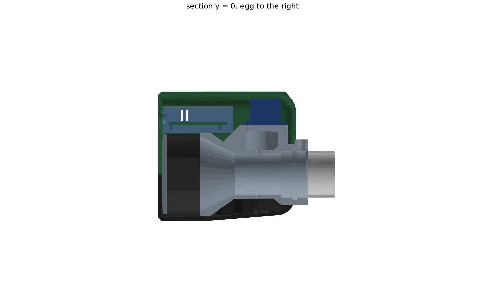
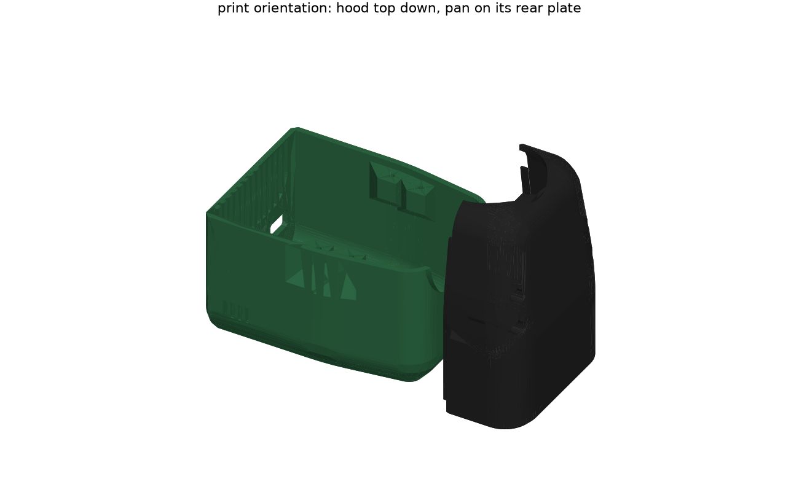

# Enclosure

One printed box that slips onto the egg's stainless intake tube. The fan, the flap damper, the controller board and the USB-C port are all in it. The CAD is `src/minimeat/mech/` (build123d); everything below is generated from it, and `uv run pytest tests/test_mech.py` holds the claims.

This is a first design (v0). It is built on provisional parts: the Noctua NF-A6x25 fan (`.2.2`), a Hitec HS-5065MG servo (`.2.9`), a 54 × 44 mm board (`.1.6`) and the 34.93 mm tube from `docs/parts/heatermeter-adapter.md` (`.2.8`). Each of those is a parameter in `params.py`, tagged with how sure it is.







## Layout

Frame: +X is the flow, the tube axis is the X axis, +Z is up. The socket mouth is the plane x = 0, the box extends to -X and the egg is at +X. Overall 109 × 67 × 88 mm for the internals (x × y × z, z from -31 to +57); the exterior shells below add up to 112 × 76 × 97.

Air path, from the back: inlet grille, fan (60 × 60 × 25), a 26 mm cone from the fan's Ø57 aperture to the Ø31.6 bore, the flap station, then the socket on the tube. The tray with the board sits on top of the fan, as far from the hot tube as the box allows. The servo stands on a tower over the flap with its output pointing down at the flap shaft.

| Part | Print pose | What |
|---|---|---|
| `duct` | flange on the bed, flow axis up | fan flange (4 pilot holes for the fan screws), cone, bore, servo tower, socket with O-ring groove, thumbscrew boss |
| `flap` | disc flat | Ø31.2 disc, 2.4 mm, on one side of a 6 × 5 mm rib that carries the Ø3 D-bore for the rod |
| `link` | flange down | D-bored hub on the rod end and a flange with the round horn's screw circle (4 holes, 90° clocking) |
| `grille` | flat | inlet guard on the fan's rear face; the fan screws pass through it |
| `tray` | floor on the bed | board on four 4 mm standoffs, connector openings in the rear wall, four lid posts, cable slots |
| `lid` | plate on the bed, lip up | four M2.5 screws |

Bought: fan, servo and round horn, a Ø3 rod 40 mm long with a flat (steel or brass), a 34 × 2.5 O-ring (silicone or FKM), an M4 heat-set insert and a thumbscrew, M2.5 self-tapping screws for the tray and lid, M3 screws for the fan, 2 to 4 M2 screws for the horn.

## Coupling to the tube

- The socket is a Ø35.23 bore (tube Ø34.93 plus 0.3), 20 mm deep. A shoulder at the bottom stops the tube; it leaves 1.8 mm for a 1.67 mm tube wall, so the airway is flush.
- The joint is downstream of the flap, so a leak there bypasses it (`docs/parts/heatermeter-adapter.md`). An O-ring in a groove seals it. A 34 × 2.5 ring stretches 2.7 % over the 34.93 mm tube and is pinched 0.45 mm (18 %) between the tube and the groove bottom; the test holds that to 10-30 % squeeze and under 5 % stretch.
- Retention is friction plus an M4 thumbscrew through the top of the socket, 5 mm from the mouth.
- The socket outer is Ø46, thick enough to take heat from the tube without softening the first layers. A real thermal break (a stand-off sleeve, or a ceramic washer behind the shoulder) waits for a measurement of the tube's temperature (`.2.5`).

## Flap and servo

- The flap turns about a vertical rod. Open is parallel to the flow, closed is across it. The rod sits in a blind pocket in the bottom wall and in a Ø3.4 bore through the top wall, so there is one shaft leak path, not two.
- The disc is one-sided: it is flush with the rib's bottom face so it prints flat with no support. Its radius is trimmed so the edge stays 0.15 mm off the bore at every angle (checked with the flap at 0, 30, 60 and 90°).
- Closed-flap leak: the ring around the disc plus the shaft bore is 0.23 cm² against the 0.3 cm² budget (`docs/modeling/README.md` §5). This is nominal; the printed gap will vary by a tenth of a millimetre either way. The smoke test in `.2.7` settles it.
- Open-flap blockage is 20 % of the bore, mostly the rib. That is the loss to shave when CFD (`.2.13`) runs.
- Drive: the rod's top end is in the link hub; the link flange bolts to a round horn; the horn sits on the servo's spline. The servo's long axis lies along the flow, with its tabs resting on the tower's plate and two screws into the plate.

## Electronics tray

- The board sits on four standoffs at its mounting holes, 4 mm up, so the lead stubs clear. Above it there are 11 mm for the tallest part, and 1 mm of air to the lid.
- The rear wall has the USB-C opening (13.4 × 7.3, for an overmolded plug) and four Ø8.5 holes at 10 mm pitch for the 2.5 mm probe plugs. The board edge is 4.4 mm behind the wall's outer face, so the plugs must be short enough to reach: a long USB-C shell is fine, but check the probe plug overmold.
- Four slots in the +y wall are the ambient air window for the ambient sensor (`.3.10`), at the rear where the air is coolest.
- Cables: the fan lead goes up through a slot in the floor, the servo lead through a slot in the front wall.
- The tray is screwed to the flange from the inside with two M2.5 screws; its front-bottom edge is cut to clear the tower's slope.

## Printing

ASA (or PETG with a slower, cooler cook) at 0.4 mm, six perimeters (2.4 mm walls). Everything prints without support in the poses above; `tests/test_mech.py` totals the downward-facing faces steeper than 45° and what is left is bridges and small holes: the O-ring groove's 2 mm ceiling, the servo window (an 11.8 mm bridge), the connector openings and the rod bores. The 45° slope under the servo tower and the 6 mm flare at the socket are there for this.


## Exterior

Two more printed shells go over everything above: `src/minimeat/mech/skin.py`, held by `tests/test_skin.py`. They are the product's outside; the duct, tray, grille and fan stay as they are inside them and the v0 lid is left out (the hood is the board's cover). The v0 box without them is still a complete, working unit.







Form. One body, 103 mm long, 76 wide, 97 tall, with the socket's last 9 mm and the thumbscrew showing at the front. In plan the sides are parallel over the board and fan, then taper 8.5° a side from the tray's front edge to the nose, blended with r120 at the shoulder and r14 at the front corners; the belly is flat under the fan and rises 5 mm toward the nose. The long top edges are a 4.1 × 4.6 mm facet rolling into r14, the bottom edges r15, the rear plate's edges a 2.4 mm chamfer; the top and front are flat. Two concepts were drawn first: a pale hood over a bare pipe and fan (the fan's square and the pipe show; it reads as a pump with a cover) and this one, a single tapered body split in two colours at the tube axis. The second was built because the split puts the seam through the nose's centre, so the socket reads as the one element that comes out of the body, and because every surface then belongs to one of two simple shells.

Parting line. The plane z = 0, the tube axis. The hood (the egg's green) is everything above it, the pan (charcoal) everything below; each carries its half of the flat rear plate. The hood lifts straight off: the socket leaves through the half-round notch in its front and the thumbscrew's boss and knob through the 13 × 34.5 slot above the notch, which also keys the hood on the socket. The chassis (duct, fan, tray) sits in the pan and drops out of it the same way.

Rear plate. 2.4 mm, flat, both halves bevelled to the body. The inlet grille is thirteen 2.6 mm vertical slots at 4.6 mm pitch in a 58 mm rounded square around the fan's axis, in line with the inner grille's slots, 1751 mm² open; the slots stop 1.6 mm each side of the parting plane, so the two halves meet in a 3.2 mm bar. Above it the four Ø9.5 jack holes and the 14.4 × 8.3 USB-C opening sit on the tray's axes, 1 mm bigger than the tray's; above those a 50 × 9 label recess, 0.5 deep. The plug goes through both plates: the board edge is then 7.2 mm behind the outer face, so the probe plugs must have at least that much shank.

Fixings. Four M2.5 × 20 from below. In the pan, a rib along each side wall beside the cone (x = -60 and -45) carries two screw bores with Ø6 counterbores 8 mm up, so the head and the driver are inside the belly; the rib's front face is 45° so the pan prints. In the hood the same blocks, 10 mm tall, take the pilot holes, each with a 45° gusset above. A 1.2 mm lip on the pan's side walls locates the hood; the rear plate halves butt at the parting plane.

Vents and cables. Four 1.6 mm slots in the hood's +y wall in line with the tray's ambient window. The fan and servo leads never leave the shells.

Walls 2.6 mm (the taper takes the normal thickness a little under the plan offset), the rear plate 2.4. Clearance to the internals is checked against every v0 part but the lid plus the bought parts and the board's keep-out, with the flap open and closed; the tightest spots are the hood's front-top roll over the servo (1.2 mm) and the tower's corner behind the front wall (0.6 mm).

Printing. The hood prints top down: the facet-and-roll top edge is a 42° slope from the bed into the r14 round, which is what makes the dome printable without turning the top into a bridge. The pan prints standing on its rear plate; the rib's 45° face and the teardrop bores are for that pose. What is left (`tests/test_skin.py`): in the hood the ceilings of the USB-C opening (14 mm bridge) and the jack holes and the label's 0.5 mm step, 226 mm²; in the pan the inside of the front wall's fillets around the notch, 940 mm² of curved ceiling that is hidden inside. The rear plate's 45° chamfer is at the limit in both poses.

What the form costs. Height: the board over the fan and the servo over the flap set 97 mm; a flat layout with the board beside the duct would lose about 25 mm and is the change to make if the box should sit lower. The hood is 103 long because the servo's far tab and the tower's corner sit 3.5 mm behind the front wall. Airflow: the skin's grille is in front of the inner grille with 0.8 mm between them; the open area is the inner grille's 1294 mm², not the skin's. The thumbscrew's knob sits in the slot with 2 mm of it behind the hood's face and 10 mm outside, so it still turns by hand. Heat: the socket stays outside the shells.



## Provisional values to confirm

| Value | Where | Settled by |
|---|---|---|
| tube OD 34.93, ID 31.6, free length | `Tube` | calipers on the tube (`.2.8`) |
| fan outline, hole size, aperture | `Fan` | the fan in hand (`.2.2`, `.2.11`) |
| servo body, tab spacing, spline and horn | `Servo` | the servo in hand (`.2.9`) |
| board size, hole positions, connectors | `Pcb`, `envelope.py` | the ICD and layout (`.1.2`, `.3.6`, `.3.7`) |
| flap gap, rib size | `Damper` | a print and a smoke test (`.2.7`) |

Run `uv run mech-envelope` for the board contract the tray assumes. Nothing here has been printed yet.

## Commands

```bash
uv run pytest tests/test_mech.py     # builds the parts, fit and overhang checks
uv run mech-export [dir]             # STEP and STL per part in print pose, assembly.step, envelope.json (default build/mech)
uv run mech-render [dir]             # the images above, the skin's included (default build/)
```
