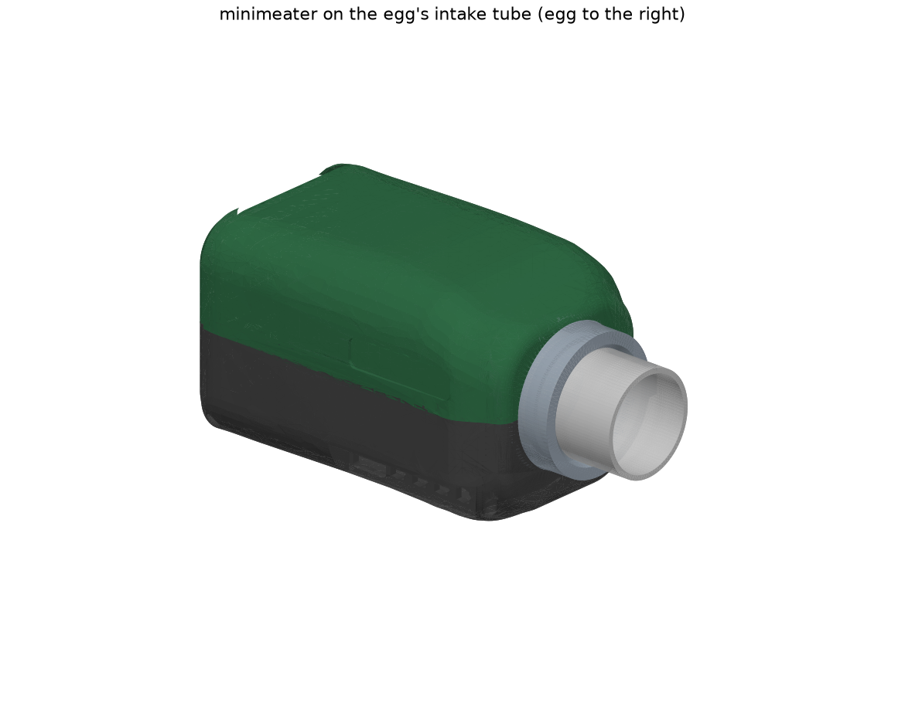
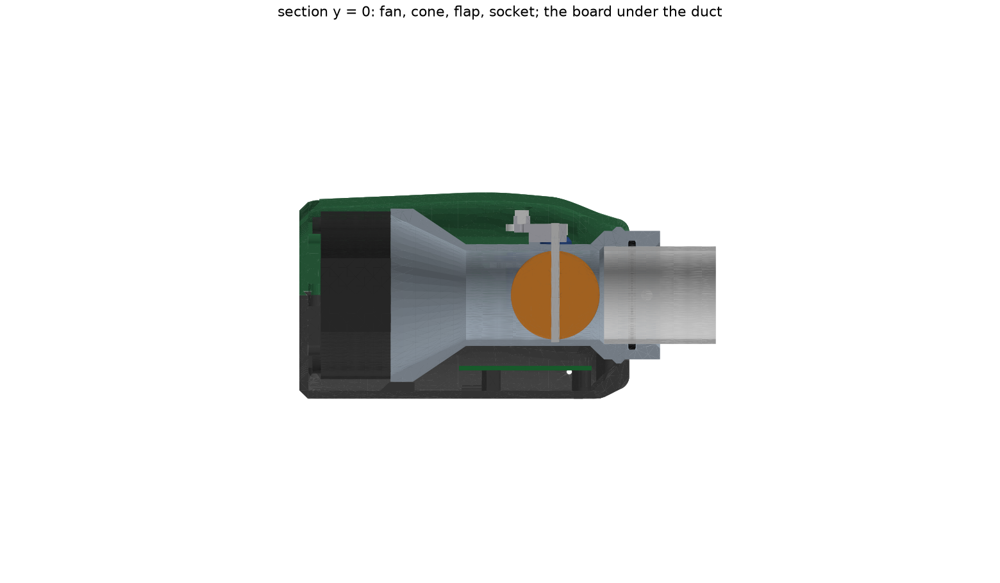
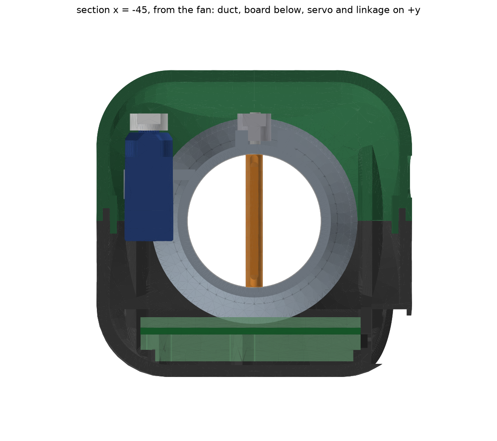
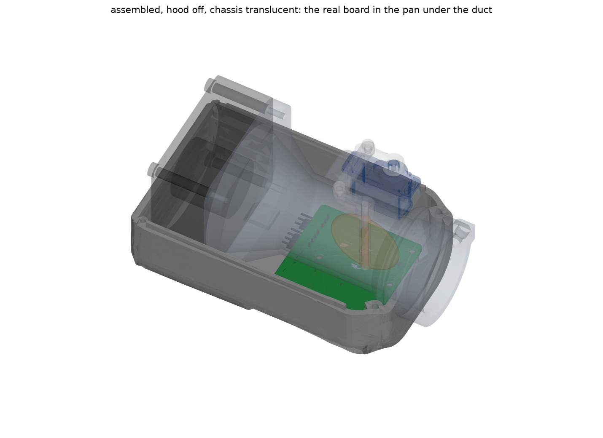
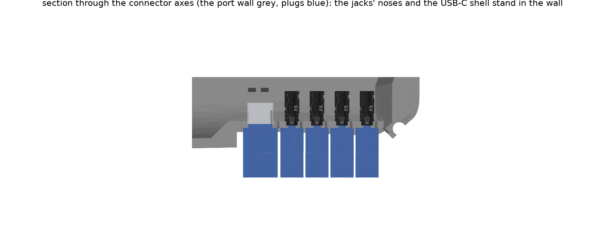
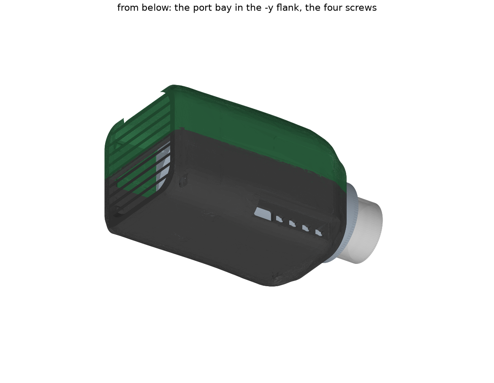
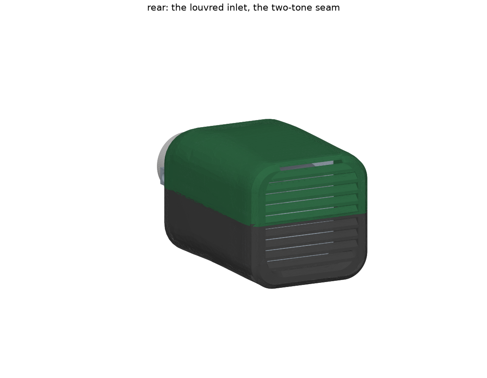
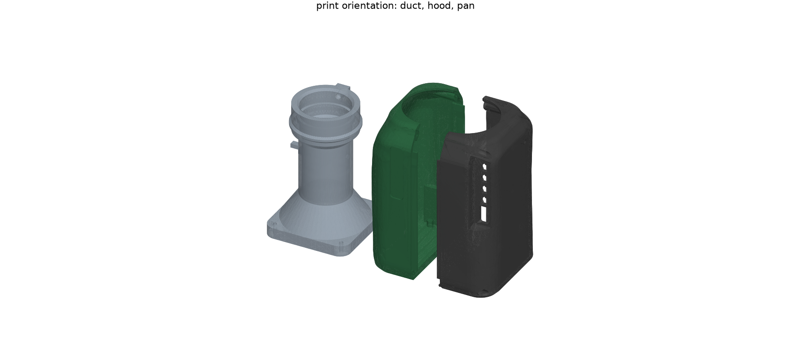
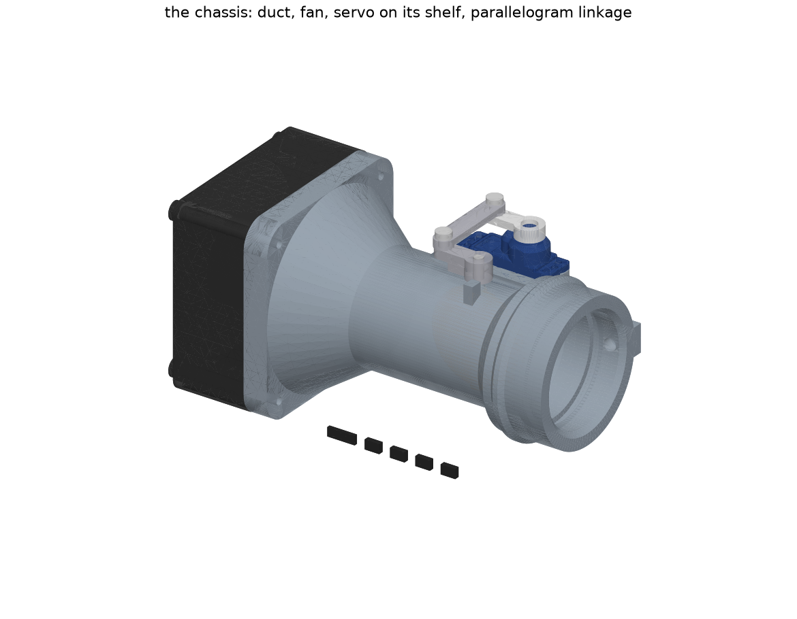

# Enclosure

One printed pebble that slips onto the egg's stainless intake tube. The fan, the flap damper, the controller board and its connectors are all in it. The CAD is `src/minimeater/mech/` (build123d); everything below is generated from it, and `uv run pytest tests/test_mech.py tests/test_skin.py` holds the claims.

This is the second design (v1): the v0 box with the board over the fan and the servo on a tower was 97 mm tall and read as a box with a pipe. v1 lays everything in one low body. It is built on the same provisional parts: the Noctua NF-A6x25 fan (`.2.2`), a Hitec HS-5065MG servo (`.2.9`), a 44 × 54 mm board (`.1.6`) and the 34.93 mm tube from `docs/parts/heatermeter-adapter.md` (`.2.8`). Each is a parameter in `params.py`, tagged with how sure it is.











## Layout

Frame: +X is the flow, the tube axis is the X axis, +Z is up, +Y is to the left looking along the flow (toward the egg). The socket mouth is the plane x = 0, the body extends to -X. Overall 126 × 74 × 73 mm (x × y × z) including the 11 mm of socket and the thumbscrew that show at the front; the shells alone are 115 long. v0 with its skin was 112 × 76 × 97.

Everything sits in one tunnel at the fan's height. From the back: the louvred rear wall, a 5 mm gap for the fan's screw heads, the fan (60 × 60 × 25, x = -121.5 to -96.5), the 27 mm cone from its Ø58 bore to the Ø32 bore (half-angle 26°), 42 mm of straight bore with the flap at x = -37.5, a 44° flare up to the Ø46 socket, and the socket's 20 mm on the tube. The board lies flat under the straight section, parts up: its 11 mm keep-out ends 1 mm under the duct, and it is the belly's depth (the belly is 5.7 mm under the fan). The servo stands beside the duct on the +y side, output up, and drives the flap through a parallelogram over the duct's crown. The ports are in the -y flank, low, under the body's overhang.

| Part | Print pose | What |
|---|---|---|
| `duct` | flange on the bed, flow axis up | fan flange (62 square, r8), cone, bore with the flap station, servo shelf, flare, socket with O-ring groove, drip collar and thumbscrew boss |
| `hood` | standing on its rear face, nose up | the upper shell: half the nose notch, half the grille, the screw bosses, the seam rib, the label recess |
| `pan` | the same | the lower shell: the board on three standoffs, the port bay, the ambient louvres, the flange pads, the screw columns, the seam tongue |

The chassis is the duct with the fan screwed to its flange, the servo on its shelf, the linkage and the rod: a working damper on its own, before any shell goes on. Bought: fan (with 4 of its screws, from the rear), servo with a Secraft 15 mm aluminium arm (Hitec 24T) and 2 M2 × 6, a Ø3 rod 42.7 mm long (+-0.1: its end stands 0.3 mm above the crank and 0.6 mm under the coupler when the flap is closed) with a 2.5 mm D flat, not yet sourced, the made `crank` and `coupler` (below), two M2 shoulder screws (Ø3 shoulder, 3 mm long) with nyloc nuts and washers for the pivots, a 34 × 2.5 O-ring, an M4 heat-set insert and thumbscrew, 3 M2.5 × 6 for the board, 2 M2.5 × 20 and 2 M2 × 16 for the shells, five silicone caps.

The full list of what to buy, with quantities for five units, is `docs/ordering.md`.

## Coupling to the tube

- The socket is a Ø35.23 bore (tube Ø34.93 plus 0.3), 20 mm deep. A 44° chamfer at its bottom is the shoulder the tube stops on; it leaves 1.8 mm for a 1.67 mm tube wall, so the airway is flush.
- The joint is downstream of the flap, so a leak there bypasses it (`docs/parts/heatermeter-adapter.md`). An O-ring in a groove seals it: a 34 × 2.5 ring stretches 2.7 % over the tube and is pinched 0.45 mm (18 %) between the tube and the groove bottom; the test holds that to 10-30 % squeeze and under 5 % stretch.
- Retention is friction plus an M4 thumbscrew, now on the socket's +y side, 4.7 mm from the mouth: a 9.4 mm block flush with the mouth (so it prints), outside the hood, reachable with the shells closed.
- A collar behind the hood's front ring (Ø49, a 44° cone on its front, a chamfer behind) seats on the shells' front cone 0.3 mm away: it stops the chassis moving forward and catches water that gets past the nose.

## Flap and linkage

- The flap turns about a vertical rod in a blind pocket in the bottom wall and a Ø3.4 bore through the top wall: one shaft leak path. The flap is machined (see below): a Ø31.6 disc 2.0 mm thick with a full-round edge (R1.0, so no square corners face the flow or the bore), centred on a 4 × 5 mm rib (a 1 mm bump each side; a stadium section: its ends facing and leaving the flow are Ø4 half-rounds, not square) with the Ø3 D-bore for the rod down its centre; its radius keeps the edge 0.15 mm off the bore at every angle: the round edge lies inside the sphere the closed edge circle spans, which the turn about the rod maps onto itself (a square edge's corners came 0.03 mm closer at about 86°). The printed duct's bore is good to ±0.3 mm (JLC), which would jam the flap or open the gap to a 0.36 cm² leak (a test holds both numbers), so the bore is reamed at the flap station (Ø32 H7, +0.025/0, 40 mm long: a standard machine reamer size; the bore was Ø31.6, the tube's ID, which has no stock reamer, and the duct's straight wall is now 2.2 mm) after printing; then the gap is 0.09-0.21 mm and the worst-case leak 0.24 cm².
- Closed-flap leak: 0.18 cm² nominal (ring plus shaft) against the 0.3 cm² budget (`docs/modeling/README.md` §5). Open-flap blockage 16 % of the bore, mostly the rib. A hand estimate (a strip of Cd 1.2 square, 0.4 rounded, in the bore at 16 % blockage) puts the rib's loss at k ≈ 0.26 with square ends and ≈ 0.1 rounded, referenced to tube velocity: about 0.1 CFM of 4.5 on the NF-A6x25, so the rounding is free but not large; the edge-on disc's 2 mm edge is left square because its diameter sets the leak. CFD (`.2.13`, `minimeat-p4k`) checks it. The disc is centred on the rib, so the flow's forces on the rod balance and the disc's edge circle is on the rod's axis. JLCCNC quoted it at $21.90 against $21.34 for the one-sided flap (the disc flush with the rib's bottom, milled from plate with the rib standing on one face; 6061, bead blasted, quantity 1), so the extra face costs about 3 %. `Damper.rib_both_sides = False` gives the one-sided flap; `build/mech/quote/` has both STEPs.
- Drive: a parallelogram. The crank on the rod's top end and the servo's arm are equal 12 mm arms (the Secraft 15 mm Hitec-24T aluminium arm has M2 holes at 12 and 15 mm; the 12 is used). A coupler bar, 6 × 2 mm with a 0.9 mm boss under each hole, rides 0.9 mm above both arms (the bosses rest on them) with its two Ø3.1 holes 25.0 mm apart, on M2 shoulder screws with a Ø3 × 3 mm shoulder (heads on top, Ø5 × 2.0: McMaster/Zoro STR601M3X4, a 4 mm shoulder in the catalogue, take the 3 mm; the thread goes into the crank and through the horn's M2 hole; a nyloc nut under the horn, a tapped hole in the crank). The servo's output axis is straight across from the rod at y = 25.0, so the bar runs along y and the flap angle equals the servo angle: 0° open (arms pointing at the fan), 90° closed (arms pointing at -y, over the crown). The crank's lug hits two 3 mm posts printed on the duct's crown (the first beside the lug at 0°, the second at 90°; both under the arm, 1 mm below its underside): the flap stops hard at exactly 0° and 90° nominal, so the firmware can home against them by stalling the servo (`minimeat-xdn`); the posts are good to the print's ±0.3 mm, about ±2° at their radius, which the closed leak ignores. Flap zero is set coarsely by the horn's spline (15° steps) and finely by the crank's set screw on the rod. The plane is 0.8 mm over the duct's crown. The bar's lift is there for the rod: its end stands 0.3 mm above the crank and the bar clears it by 0.6 mm when the flap is closed and the bar lies over it (to pull the rod, take the crank off first: the rod then stands about 7 mm above the duct's crown); the pin heads stop 1.6 mm under the roof's nominal underside. Open, the horn pin's head is under the roof's corner round, which comes down to 0.5 mm over it, so the hood has a relief there: a teardrop pocket (pointed at the nose, so it prints) 1.2 mm over the head, leaving 1.6 mm of roof. Both heads then clear the hood by 1.2 mm or more over the travel (a test checks 0, 5, 10, 45 and 90°). The whole travel is checked for interference at four angles with every part and mock, shells included.
- Why machined and not RC links: the horn's 24-tooth spline is not worth machining, so the arm is bought, but everything between the arms is free to be exactly the size it needs. Ball links on a threaded rod (the usual RC coupler) have bodies about 18-25 mm long, so two need 30-45 mm between the pins, and here it is 25.0 (the duct radius and the servo's width fix it); E-Z connectors would fit but are loose. A plain bar on shoulder screws has no play and no spacing limit, and moving the servo is not needed. This is a planar parallelogram, so plain pivots are enough.
- Made parts (JLCPCB CNC, 5 off each, `cnc/flap.step`, `cnc/crank.step` and `cnc/coupler.step`, with a drawing beside each (`cnc/flap.pdf` etc., named like the STEP file because JLCCNC pairs them by filename) with the thread and bore callouts: the STEP carries a thread only as a plain hole at the tap-drill diameter): the crank is a Ø8 hub with a slip-fit D-bore (0.1 mm), an M2 set screw radial on the rod's flat, an arm out to a tapped M2 hole, and a stop lug (a 3 mm wide rib under the arm, from the hub to 9.5 mm); the coupler is the bar. Stainless 304 for both is the better choice next to a tube that can reach 65-90 °C (`.2.5`); 6061 is fine if the quote is much lower. Printed plastic would creep and wear its pin holes there. The flap is machined too: its D-bore and edge need ±0.05 mm and a printed part cannot hold that (above); it also stands a few centimetres from the socket and is the first thing a flashback reaches. It has no thread: the rod is retained with compound. Threads are on the crank only (two M2 x 0.4-6H, tap drill Ø1.6).
- Servo: body at y = 19.2-30.8 (1 mm off the duct, 3.8 off the wall), z = -4.8 to 15.2, long axis along the flow toward the fan. It drops through a cutout in a 2.5 mm shelf cast on the duct at z = 9.7-12.2. Under each end's tab the shelf has a solid block, 7 mm deep from the tab's underside (the body's width, flat under the whole tab), with an M2 pilot (6 mm deep, 1 mm floor) under each of the tab's six screw holes: three at each end, 6 mm across, the middle one 0.8 mm further out (positions read off Hitec's STEP; the drawing's 19.2 and 7.8 mm are the outer pairs). Fit 2, 4 or 6 M2 × 6 screws as field testing says. The front block's face toward the body is a vertical 12 × 7 mm bridge (84 mm²); the rear end leans 44°. A test checks all six pilots against the STEP's holes. The shelf is why the servo is aligned with the rod by the print, not by assembly. Its lead leaves the bottom of the body with 14 mm to the board. Heat: the servo is rated 60 °C. The body touches nothing but its tabs; the duct beside it carries the fan's air, and the shelf's front end stops 10 mm short of the socket, which is the hot part. The shelf is the one conduction path from the duct; if the tube measurement (`.2.5`) says the socket runs hot, slot the shelf between the socket and the tabs.

## Board and ports

- The board (47.5 × 54 × 1.6, `uv run mech-envelope` for the contract) sits on three Ø5.5 standoffs on the pan floor at its mounting holes (the corners are taken by the connector row and the module; the connector row is held by the port wall). The connector edge is trimmed back 1.75 mm (the sheet frame stays 54 mm; the board is 46 × 52.25, square corners on that edge), so the connectors hang past it. **The board is turned over**: its SMT face (F.Cu) is down on the standoffs at z = -27.0 with the parts hanging under it, and its back (B.Cu) faces the duct at z = -25.4 with only the through-hole tails (2 mm) above it, so the keep-out above is -22.9 against the duct's bottom at -18.2. The connector axes stay at z = -28.6 (the jacks hang 1.6 mm under the face), so the port wall and the bay did not move. Under the board: 7.3 mm to the pan floor (z = -34.3, unchanged) for the right-angle KK headers (6.36 tall, J6 and J7, the plugs entering toward the rear edge) and the SMT parts (3.7 at most). Turned over about x, the real board has its connectors at -y and its USB-C at -x, which is the sheet's own x and y: an earlier model mirrored it, with the parts up. In x it spans -72.0 to -24.5: the parts start at -70.5, 1 mm into the cone's start, and the last 1.5 mm (`Pcb.usb_end`, past the USB-C's first-jack web; below) goes 2.5 mm into the cone, which the thin top side clears; the straight section is sized by it.
- Connectors on the -y long edge, reaching into the port wall: the jacks' fronts are 0.1 mm inside the frame's edge and the USB-C's shell front 0.6 mm, 1.65 and 1.15 mm past the trimmed edge (`hw/tools/connector_edge.py`: 0.5 mm of board edge to the nearest copper), so a plug's barrel travels 0.85 mm past the wall's outer face instead of 2.6 before it enters the jack. The USB-C receptacle the USB-C receptacle (GCT USB4105-GF-A, 9.4 × 3.3) at board x = -18.05 (the rear end) and the four 2.5 mm TRRS jacks (SHOU HAN PJ-242 from ADR 0002: 5 wide, 3.2 tall, 12 mm back from the edge) at -7.05, 1.65, 10.35 and 19.05. The pitch, 8.7 mm, is set by the Ø8 plug overmolds (0.7 mm apart), not the jacks. Both connector axes come out 1.6 mm over the board, so the five openings are one row at z = -28.6. The port wall is the pan's own 2.4 mm wall, its inner face 0.1 mm past the trimmed edge, outer face at y = -27.75: a 13.2 × 7.4 opening for the USB-C overmold (the USB spec's largest is 12.35 × 6.5, cables run bigger; the first jack's opening is 1.7 mm away: the board grew 1.5 mm at the USB-C's end (commit fd4c019) to leave a printable wall between them, which had been 0.2 mm and one joined slot) and, for each jack, the Ø5 plug hole joined to a 5.4 × 4.0 rectangle that the jack's housing (5 wide, 3.15 tall plus a 0.45 tab) stands in. The jack holes are teardrops pointed +x so they print.
- The port bay is the recess that puts the port wall 9.05 mm inside the flank at the eave: x = -74.5 to -24, floor at z = -34 (the belly's round), ceiling at -21. The body's lower round above it is the eave, with a 1 mm drip lip along its edge (ending flush with the bay's front end); the front end wall is 45° in plan (for the print and for a thumb), and stops 0.66 mm short of the front screw column (it ran into the column and left the pan's STL open; the front plug clears it by 2 mm). The export test checks every STL is closed. The end walls are plain: no holes, no scallop. Plugs enter horizontally; the probe cables hang.
- Ambient sensor: the TMP117 on the board's parts face at the rear +y corner (board x = -18.85, y = 24.8; single-sided assembly), 2 mm in from the +y edge, with no copper under its thermal pad. With the board turned over it faces the pan floor, and two 8 × 1.4 slots through the floor under it (y = 23.3 and 26.3) let outside air in; it is far from the duct, the regulators and the module, with the whole board between it and the duct (`.3.10`).
- Fan and servo leads stay inside: headers on the board, unplugged when the pan comes off.

## Exterior





Form. One lofted body: rounded-rectangle sections on smooth profiles. The rear face is 72 × 70 with r14 corners and a 3 mm 44° chamfer (it is the print bed face); over 10 mm it eases out to the full 74.4 × 71.1 section with r16.4 corners (the fan's corners need r ≤ 16.4); the roof then crowns 2 mm and the corners open to r19 at x = -62; from x = -40 the roof eases down and from -28 the plan closes to the nose, a 60 mm wide, 60 tall ring with r18 corners, a 1.6 mm land and an r5 round around the Ø47 hole the socket leaves through. The belly is flat (it sits on a bench) and rises 3.7 mm over the last 12 mm. Two massings were drawn: a loaf (the same body with a flat roof and r16.4 throughout) and this one; the crown and the wider mid-body rounds are what make it a pebble and cost 2 mm of height.

Parting line. The plane z = 0, the tube axis: the hood (the egg's green) above, the pan (charcoal) below, so the seam runs through the nose's centre and the socket is the one element that comes out of the body. The hood lifts straight off: the socket leaves through the half-round notch. The pan drops away with the board; the chassis can stay on the tube on its thumbscrew. The label (40 × 10, 0.8 deep) is on the hood's -y flank over the ports.

Fixings. Four screws from below, all hidden in the belly: M2.5 × 20 at (x = -18, y = ±28) up through the pan's thick front zone into bosses that merge with the hood's front cone, and M2 × 16 at (x = -119.4, y = ±33.3) through columns beside the fan's rear gap. Each has a teardrop counterbore from the belly for the head and the driver. The chassis is captured, not screwed: the collar against the front cone, the fan's rear face on four Ø4 pads inside the rear wall (0.3 mm of play), the flange on two wedges on the pan floor, and blocks on both shells' side walls that hold the fan sideways with 0.4 mm of play.

Grille. Ten louvres 3.2 mm thick (across the slot) at 6.2 mm vertical pitch, so the blades between are 1.26 mm thick (they were 0.81: JLC3DP's thin-wall check flags anything under 1.2) in a 58 mm rounded square around the fan's axis, cut 44° so each slot descends outward (the field is sheared the same way, so every slot is open through the whole wall). Open area through the slots 1520 mm² (the inner grille of v0 had 1294). The slots stop 1.6 mm each side of the parting plane: the two halves of the rear wall meet in a bar.

Shell walls 2.8 mm, seven perimeters (the duct's 2.4; the rear wall 3.2, so the louvre blades are 4.5 mm long). The 2.8 is not arbitrary: at the seam the hood's skirt is the wall less the pan's tongue and 0.2 clearance, 2.8 - 1.3 - 0.2 = 1.3 mm, and JLC3DP's thin-wall check flags anything under 1.2, the taper leaves the normal thickness a little under that. Clearance is checked against every chassis part, the bought parts, the board's keep-out and the plugs, with the flap open and closed. The tightest spots are the board's keep-out corners against the front cone and wedge (under 1 mm) and the collar in its seat (0.3 mm).

## Rain

The box lives outdoors; the target is IPX4 (splashed from any direction, no immersion). Per opening:

- Status LED and button: on the board's +y edge (the -y edge is full). The LED is a side-view Lite-On LTST-S220KGKT facing +y behind a Ø1.9 hole in the pan's flank holding a piece of clear 1.75 mm filament as a light pipe, glued flush: sealed, and the hole is the only break. The button is an ALPS SKRPACE010, a top-push tact switch (2.5 mm tall, 2.55 N), facing down: a Ø3.2 hole in the pan floor under it takes a paper clip (reset and WiFi provisioning; the hole is on the underside, facing the ground, and can take a plug). Heights under the board (LED 0.5 mm) are estimates until the parts are in hand.
- Ports: in the bay, 9.05 mm under the eave with its drip lip, in a vertical wall; the floor is the belly's round, open all along. Silicone caps for USB-C and unused jacks (untethered: the end walls have no holes). A probe plug in a jack is a 2.5 mm barrel in a Ø5 hole beside the housing: not sealed; the jack's own body is the next barrier.
- Inlet: 44° louvres, blades 4.5 mm long. No straight path to the fan at any angle up to 44° from the horizontal; spray from steeper below gets to the fan's rear face, which the fan tolerates.
- Ambient louvre: two slots straight through the pan floor under the sensor; what gets in meets the sensor's face, and the board shields it from the duct.
- Seam: along the flanks the pan's inner half-wall rises 3 mm inside the hood's wall and a 1.4 mm rib from the hood hangs 3 mm inside that: the path turns twice. At the rear wall the pan's inner half rises 1.2 mm behind a 44° face. At the nose the two half-round notches close on the socket with 0.5 mm of play; the collar inside the front ring stops what runs along the socket. The thumbscrew's insert hole is blind on the outside and opens into the bore between the mouth and the O-ring, which drains out of the mouth.
- Top: the roof crowns and rolls; no flat pocket. The label is on a vertical flank.

Nothing is proven. The spray test (IEC 60529 IPX4: oscillating tube, 10 L/min, 10 min, then open and look) is a bead to file; the first thing it will say is whether the nose notch and the port holes need gaskets.

## Printing

Printed at 0.4 mm: seven perimeters on the shells (2.8 mm walls), six on the duct (2.4 mm). Every designed overhang is 44°, inside the 45 the test allows, so the inventory (`overhangs()` in `printing.py`: downward faces steeper than 45° in the print pose) lists only what is meant to be there:

- `duct`, flange down: the O-ring groove's 2 mm ceiling (221 mm², a bridge as in v0), the underside of the thumbscrew boss (13 mm², 9 × 3) and the rims of its hole and the insert's. The flare, the collar's chamfer, the shoulder, the shelf's ends and the shelf's bosses are the 44° features for this pose.
- `hood` and `pan`, nose up on the rear face: about 60 and 50 mm² of slivers at the ends of the rear pads and around the port openings (the test caps each shell at 150, no patch over 60). The cavity's front is a 44° cone down to the nose hole (plus a 44° wedge under it in the pan, so the board's corners fit), the screw bosses and standoffs are teardrop columns pointed down, every hole along z is a teardrop pointed up, and the bay's end walls and the ambient well's cross fins lean 44°. The USB-C opening's top is a 13 mm bridge.

Minimum feature 0.8 mm: the louvre blades are 1.1 at the faces, the webs between port holes 1.3.





## What the form costs

- Length: the front cone that makes the shells printable eats the cavity's corners for the last 25 mm, so the board had to move 1.5 mm back; with the 5 mm rear gap for the fan's screw heads the body is 126 long against the 124 aimed at. The horizontal board costs 7 mm of height over a vertical one (73 against 66).
- Airflow: the inlet turns 44° through the louvres; the open area is still 22 % more than v0's grille. The rear gap is 5 mm, so the inlet sees the pads and the screw heads.
- Heat: the socket is outside the shells; the board is under the straight section, not under the socket. The servo is beside the cone, in the fan's air.
- Service: the hood comes off upward on four screws from below; the pan brings the board with it; the chassis stays on the tube. The fan comes off the flange from the rear once the chassis is out. The thumbscrew is on the side, not the top.
- Plugs: the bay is under the body: plugging in is by feel from the side, the overmolds are 0.7 mm apart, and the recess is 7 mm, so a plug with an overmold longer than 18 mm stands proud of the flank.
- Board: 47.5 × 54, turned over, 6.4 mm under it (3.7 along the +y edge, where the floor curves up) and 2.5 above; the two front corners have under 1 mm to the cone.

## Provisional values to confirm

| Value | Where | Settled by |
|---|---|---|
| tube OD 34.93, ID 31.6, free length | `Tube` | calipers on the tube (`.2.8`) |
| fan outline, hole size, aperture, screw head height | `Fan`, `Layout.rear_gap` | the fan in hand (`.2.2`, `.2.11`) |
| servo body, tab spacing, horn (hub, thickness are estimates) and its hole radii | `Servo`, `Linkage.arm_r` | the servo and arm in hand (`.2.9`) |
| whether the arm's M2 holes are tapped or clear (nut under the horn), M2 shoulder screw head | `Linkage.pin_*` | the arm in hand (the `.2.9` bring-up) |
| board size, hole positions, connector positions and heights, sensor spot | `Pcb`, `envelope.py` | the ICD and layout (`.1.2`, `.3.6`, `.3.7`) |
| plug overmold Ø8, USB-C overmold (opening 13.2 × 7.4) | `Pcb` | the probes and cable bought |
| flap gap, rib size | `Damper` | the first machined flap and a smoke test (`.2.7`) |
| rain: nose notch, port holes, seam | `Shell` | the IPX4 spray test |

Nothing here has been printed yet.

## Commands

```bash
uv run pytest tests/test_mech.py tests/test_skin.py   # builds the parts and shells, fit, leak and overhang checks
uv run mech-export [dir]             # build/mech: 3dprint/ (duct, hood, pan: STEP and STL in print pose) and cnc/ (flap, crank, coupler: STEP and a PDF drawing each, same names), each with a README and a zip of the same files; assembly.step (a product per part; the board is one flat "pcb", so an exploded view moves it as a unit), assembly.glb (the same for Blender: File > Import > glTF; metres, one object per part and the board in five colours), envelope.json, plugs_mock.step (docs/jlc3dp.md)
uv run mech-render [dir]             # the images above (default build/)
uv run mech-envelope                 # the board contract
```
