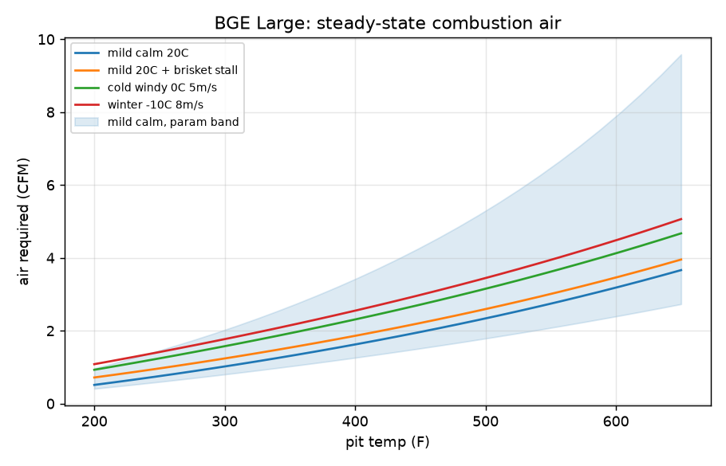
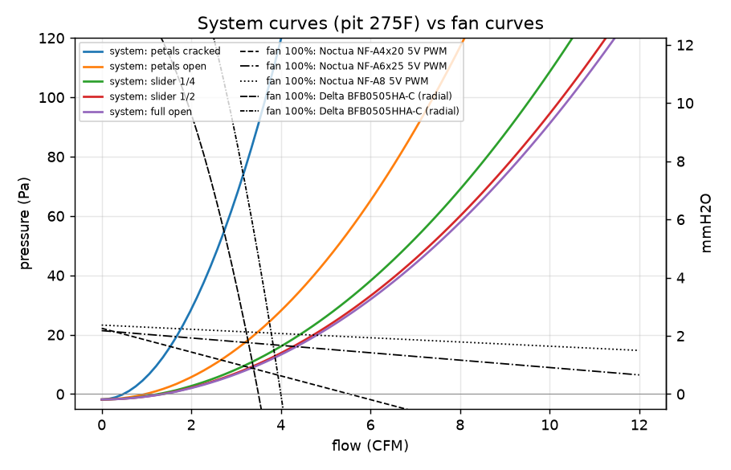
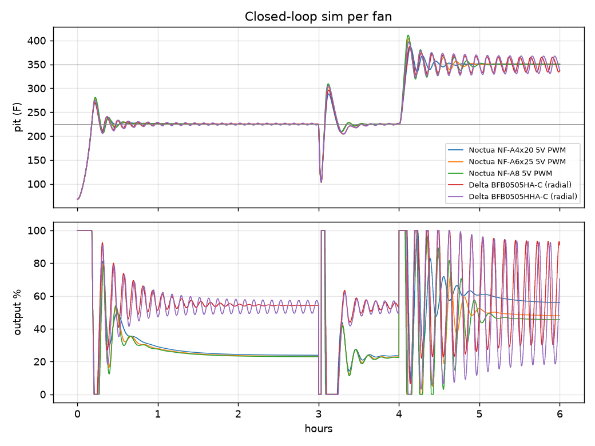
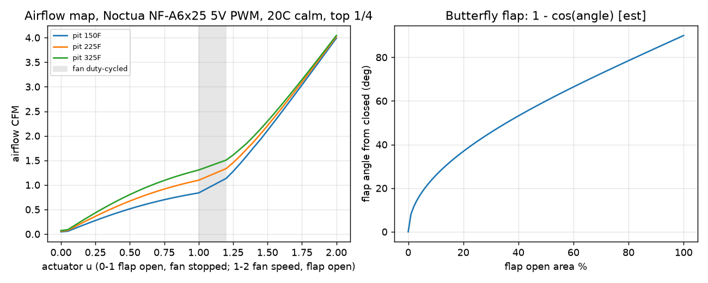

# BGE Large airflow & thermal model

_Generated by `uv run minimeater-model` from `src/minimeater/model/`. Do not edit by hand._

First-principles model of a Big Green Egg Large driven through a BBQ Guru-style stainless intake tube (1.374" OD / 30.8 mm ID). Most inputs are estimates (see `params.py`, tagged `[spec]`/`[forum]`/`[est]`). Use the results to rank options and set direction, not as absolute values; the measurement beads replace the estimates.

## 1. Combustion air needed to hold a pit temperature (steady state)

| scenario \ pit temp | 150F | 180F | 225F | 275F | 325F |
|---|---|---|---|---|---|
| mild calm 20C | 0.29 | 0.42 | 0.63 | 0.88 | 1.16 |
| mild 20C + brisket stall | 0.49 | 0.62 | 0.84 | 1.10 | 1.38 |
| cold windy 0C 5m/s | 0.63 | 0.81 | 1.08 | 1.41 | 1.75 |
| winter -10C 8m/s | 0.77 | 0.95 | 1.25 | 1.59 | 1.95 |

CFM at ambient density. Nominal parameters. Uncertainty band (mild calm):

| params | 150F | 180F | 225F | 275F | 325F |
|---|---|---|---|---|---|
| low loss | 0.24 | 0.34 | 0.50 | 0.70 | 0.91 |
| nominal | 0.29 | 0.42 | 0.63 | 0.88 | 1.16 |
| high loss | 0.55 | 0.79 | 1.21 | 1.73 | 2.34 |

Energy balance, mild calm:

| pit | fire W | shell loss W | flue loss W | lump lb/h | outer shell F |
|---|---|---|---|---|---|
| 150F | 306 | 297 | 9 | 0.10 | 112 |
| 180F | 438 | 420 | 18 | 0.14 | 127 |
| 225F | 653 | 616 | 37 | 0.21 | 148 |
| 275F | 915 | 847 | 68 | 0.29 | 171 |
| 325F | 1202 | 1091 | 111 | 0.39 | 192 |

Sanity check: forum reports of 20+ h at 225F on a full Large load (~8-10 lb) imply <=0.4 lb/h, consistent with the model. Reports of 4-5 h at 400-500F imply ~2 lb/h, ~3x the model; hot cooks run vents wide open with large excess air and are rarely at thermal steady state, so treat the high-temperature numbers as a floor.

## 2. Where the pressure goes

Pa at 3.0 CFM, pit 275F, 20C ambient, k_box=2.0:

| top vent | box (transition+flap+grille) | intake tube | fire grate | charcoal bed | top vent | stack draft (helps) | total Pa | total mmH2O |
|---|---|---|---|---|---|---|---|---|
| petals cracked | 4.3 | 3.5 | 0.4 | 0.2 | 59.8 | -1.8 | 66.4 | 6.78 |
| petals open | 4.3 | 3.5 | 0.4 | 0.2 | 8.4 | -1.8 | 15.0 | 1.53 |
| slider 1/4 | 4.3 | 3.5 | 0.4 | 0.2 | 1.7 | -1.8 | 8.3 | 0.85 |
| slider 1/2 | 4.3 | 3.5 | 0.4 | 0.2 | 0.4 | -1.8 | 7.0 | 0.72 |
| full open | 4.3 | 3.5 | 0.4 | 0.2 | 0.1 | -1.8 | 6.7 | 0.69 |

The daisy wheel dominates when nearly closed; once it is past ~1/4 open the **intake tube and our own box internals dominate**. Inside the egg, the grate and charcoal bed are negligible.

## 3. Natural draft (fan stopped, damper open)

Convective draft pulled through the stopped Noctua NF-A6x25 5V PWM (CFM):

| top vent | 150F | 225F | 275F | 325F |
|---|---|---|---|---|
| petals cracked | 0.36 | 0.45 | 0.48 | 0.51 |
| petals open | 0.68 | 0.87 | 0.95 | 1.01 |
| slider 1/4 | 0.84 | 1.10 | 1.21 | 1.30 |
| slider 1/2 | 0.88 | 1.16 | 1.29 | 1.39 |
| full open | 0.89 | 1.18 | 1.31 | 1.42 |
| slider 1/4, stopped Delta BFB0505HHA-C (radial) | 0.35 | 0.45 | 0.50 | 0.54 |
| **required (mild calm)** | **0.29** | **0.63** | **0.88** | **1.16** |

A stopped axial fan barely obstructs the egg's convective draft, so with the daisy wheel at 1/4 or more, natural draft through an open damper alone **exceeds** what most of the 150-325F range needs. A stopped radial blower chokes it below the 225F requirement, so a blower would have to run even at low-and-slow. So: (a) the damper must seal well when closed (leakage directly sets the minimum achievable temperature), (b) at low-and-slow the damper angle, not fan speed, is the primary actuator, and (c) the user should run a small top-vent opening for low-and-slow.

## 4. Fan capability through this intake

| fan | size | max CFM (1/4 top, 275F) | max CFM (1/2 top, 275F) | max steady F (mild, 1/2 top) | max steady F (winter, 1/2 top) | max steady F (winter, high-loss params) |
|---|---|---|---|---|---|---|
| Noctua NF-A4x20 5V PWM | 40x40x20 | 3.2 | 3.3 | 626 | 489 | 274 |
| Noctua NF-A6x25 5V PWM | 60x60x25 | 4.0 | 4.3 | 720 | 578 | 325 |
| Noctua NF-A8 5V PWM | 80x80x25 | 4.4 | 4.7 | 757 | 614 | 347 |
| Delta BFB0505HA-C (radial) | 50x50x15 | 3.4 | 3.4 | 623 | 494 | 280 |
| Delta BFB0505HHA-C (radial) | 50x50x15 | 3.8 | 3.9 | 671 | 543 | 308 |

Every candidate's free-air rating is far above what it delivers here: the 30.8 mm tube plus our box chokes the flow, so static pressure matters more than free-air CFM. The high-loss column is the conservative case for sizing (the model under-predicts hot-cook fuel burn).

### Operating points: speed, noise, power

**hold 225F, mild** - 0.63 CFM against -0.7 Pa (-0.07 mmH2O):

| fan | speed | rpm / mode | est dB(A) | est W |
|---|---|---|---|---|
| Noctua NF-A4x20 5V PWM | natural draft enough (damper only) | - | - | - |
| Noctua NF-A6x25 5V PWM | natural draft enough (damper only) | - | - | - |
| Noctua NF-A8 5V PWM | natural draft enough (damper only) | - | - | - |
| Delta BFB0505HA-C (radial) | natural draft enough (damper only) | - | - | - |
| Delta BFB0505HHA-C (radial) | natural draft enough (damper only) | - | - | - |

**hold 325F, winter** - 1.95 CFM against 1.4 Pa (0.14 mmH2O):

| fan | speed | rpm / mode | est dB(A) | est W |
|---|---|---|---|---|
| Noctua NF-A4x20 5V PWM | 48% | 2423 rpm | <10 (inaudible) | 0.057 |
| Noctua NF-A6x25 5V PWM | 32% | 959 rpm | <10 (inaudible) | 0.031 |
| Noctua NF-A8 5V PWM | 28% | 611 rpm | <10 (inaudible) | 0.019 |
| Delta BFB0505HA-C (radial) | 57% | 2553 rpm | 20.2 | 0.164 |
| Delta BFB0505HHA-C (radial) | 50% | 2926 rpm | 22.3 | 0.159 |

**recover 225F after lid-open (3x hold flow)** - 1.89 CFM against 5.0 Pa (0.51 mmH2O):

| fan | speed | rpm / mode | est dB(A) | est W |
|---|---|---|---|---|
| Noctua NF-A4x20 5V PWM | 68% | 3386 rpm | <10 (inaudible) | 0.155 |
| Noctua NF-A6x25 5V PWM | 54% | 1630 rpm | <10 (inaudible) | 0.150 |
| Noctua NF-A8 5V PWM | 50% | 1089 rpm | <10 (inaudible) | 0.109 |
| Delta BFB0505HA-C (radial) | 57% | 2576 rpm | 20.4 | 0.169 |
| Delta BFB0505HHA-C (radial) | 50% | 2944 rpm | 22.4 | 0.161 |

**heat-up toward 325F, winter (2x hold flow)** - 3.91 CFM against 13.9 Pa (1.42 mmH2O):

| fan | speed | rpm / mode | est dB(A) | est W |
|---|---|---|---|---|
| Noctua NF-A4x20 5V PWM | cannot reach | - | - | - |
| Noctua NF-A6x25 5V PWM | 93% | 2785 rpm | 17.7 | 0.748 |
| Noctua NF-A8 5V PWM | 84% | 1838 rpm | 13.8 | 0.525 |
| Delta BFB0505HA-C (radial) | cannot reach | - | - | - |
| Delta BFB0505HHA-C (radial) | cannot reach | - | - | - |

Noise is the datasheet free-air max scaled by 50*log10(speed); real noise against back-pressure and inside a box will differ - the bake-off measures it.

## 5. Sensitivity: our box and the tube matter most

Noctua NF-A6x25 5V PWM max flow (pit 275F, top 1/2) vs box loss coefficient k_box:

| k_box | max CFM |
|---|---|
| 0.5 | 5.2 |
| 1.0 | 4.8 |
| 2.0 | 4.3 |
| 4.0 | 3.6 |
| 8.0 | 2.8 |

Noctua NF-A6x25 5V PWM max flow vs intake tube size:

| tube | max CFM |
|---|---|
| 1.0" OD / 22.0 mm ID | 2.4 |
| 1.315" OD / 26.6 mm ID | 3.4 |
| 1.375" OD / 30.83 mm ID | 4.3 |
| 1.5" OD / 35.0 mm ID | 5.2 |
| 2.0" OD / 47.0 mm ID | 7.4 |

(1.315" row assumes a 1" sch40 NPT nipple, 26.6 mm ID.)

## 6. Closed-loop dynamics (PI, P=2 %/F, I=0.005 %/F/s)

Light at t=0 with a starter in a cold egg, setpoint 225F, lid opened for 2 min at 3 h, setpoint 350F at 4 h. Top vent 1/4, mild calm. Damper-first output mapping: the flap opens proportionally over 0-50% output and the fan ramps over 50-100% (time-averaged below its minimum speed). An earlier on/off-damper version limit-cycled +/-15F at 225F because natural draft through a fully open flap already exceeds the low-and-slow requirement (section 3).

| fan | min to 220F | overshoot F | mean output @225 % | lid recovery min | min to 345F after step |
|---|---|---|---|---|---|
| Noctua NF-A4x20 5V PWM | 10 | 44 | 24.0 | 3 | 6 |
| Noctua NF-A6x25 5V PWM | 11 | 54 | 23.3 | 2 | 5 |
| Noctua NF-A8 5V PWM | 11 | 56 | 23.0 | 2 | 4 |
| Delta BFB0505HA-C (radial) | 10 | 44 | 54.3 | 3 | 6 |
| Delta BFB0505HHA-C (radial) | 11 | 49 | 53.4 | 2 | 5 |

Fan choice barely changes control quality. Gain sweep with the NF-A6x25 (std dev of pit temp in the hold windows):

| P %/F | I %/F/s | startup overshoot F | sd @225 | sd @350 |
|---|---|---|---|---|
| 4 | 0.02 | 45 | 8.7 | 23.1 |
| 4 | 0.005 | 46 | 0.0 | 17.0 |
| 2 | 0.01 | 53 | 0.0 | 23.7 |
| 2 | 0.005 | 54 | 0.0 | 0.2 |
| 1 | 0.005 | 65 | 0.0 | 0.2 |

HeaterMeter's defaults (P=4, I=0.02) limit-cycle on this plant, and gains stable at 225F can oscillate at 350F (plant gain changes with temperature): autotune and possibly gain scheduling are needed. Startup overshoot (40-80F) is set by running 100% output while the fire spreads, regardless of gains; the shell time constant is ~1.5 h, so overshoot is slow to bleed off. The firmware needs a startup mode (output ramp/cap, or D on measurement) rather than plain PI from cold.

## 7. Actuator inversion (what the firmware commands)

| pit F | flap closed (leak) CFM | flap open, fan off CFM | fan at min speed CFM | fan full CFM |
|---|---|---|---|---|
| 150 | 0.046 | 0.84 | 1.13 | 3.99 |
| 225 | 0.060 | 1.10 | 1.33 | 4.02 |
| 325 | 0.072 | 1.30 | 1.51 | 4.04 |

The controllers command airflow; firmware (`minimeater-core::model::airflow::AirflowMap`, parity-tested against `control.AirflowMap`) inverts this table at the measured pit temperature, damper first. Below the fan's minimum continuous speed (20%) the fan alternates between off and minimum (delta-sigma, 10 s minimum dwell; `FanCycler`) so the average matches the command, which is what the table assumes. The flap angle uses the projected-area law of a butterfly in a round tube until CFD/bench data (`.2.13`) replaces it. The table is built from the firmware-side model with an assumed top vent; the MPC's disturbance estimate absorbs the error.

## Parameters

| Egg | value |
|---|---|
| outer_area_m2 | 1.25 |
| inner_area_m2 | 0.95 |
| wall_m | 0.025 |
| ceramic_k | 1.3 |
| ceramic_cp | 900.0 |
| shell_mass_kg | 45.0 |
| firebox_mass_kg | 17.0 |
| emissivity_out | 0.9 |
| h_in | 10.0 |
| rad_fraction | 0.4 |
| gas_heat_capacity | 3000.0 |
| stack_height_m | 0.55 |
| lhv_j_kg | 29000000.0 |
| afr_stoich | 10.4 |
| excess_air | 1.3 |
| combustion_eff | 0.85 |
| cp_flue | 1100.0 |
| fire_tau_s | 120.0 |
| fire_max_w | 20000.0 |
| lit_initial | 0.03 |
| ignition_tau_s | 300.0 |
| probe_tau_s | 20.0 |
| grate_area_m2 | 0.003 |
| grate_cd | 0.6 |
| bed_area_m2 | 0.07 |
| bed_depth_m | 0.12 |
| lump_d_m | 0.03 |
| bed_void | 0.45 |
| bed_t_k | 900.0 |
| top_cd | 0.6 |
| leak_area_m2 | 3e-05 |

| Intake | value |
|---|---|
| tube_od_m | 0.03489 |
| tube_id_m | 0.03083 |
| tube_len_m | 0.1 |
| k_entry | 0.5 |
| k_exit | 1.0 |
| k_box | 2.0 |

| Top vent | area cm^2 |
|---|---|
| petals cracked | 3 |
| petals open | 8 |
| slider 1/4 | 18 |
| slider 1/2 | 37 |
| full open | 75 |

| Fan | kind | CFM | mmH2O | rpm | dB(A) | W | rpm min | notes |
|---|---|---|---|---|---|---|---|---|
| Noctua NF-A4x20 5V PWM | axial | 5.53 | 2.26 | 5000 | 14.9 | 0.5 | 1100 | specs: noctua.at; watts [est] |
| Noctua NF-A6x25 5V PWM | axial | 17.19 | 2.18 | 3000 | 19.3 | 0.935 | 600 | specs: noctua.at; rpm_min [est]; stopped_k from the stopped-rotor CFD at 1 CFM (4.2 at 0.5: docs/cfd.md) |
| Noctua NF-A8 5V PWM | axial | 32.67 | 2.37 | 2200 | 17.7 | 0.9 | 450 | specs: noctua.at / retailers; watts [est] |
| Delta BFB0505HA-C (radial) | radial | 3.5 | 14.3 | 4500 | 32.5 | 0.9 | 1500 | CFM/pressure/dBA: DigiKey listing; rpm, watts, rpm_min [est] |
| Delta BFB0505HHA-C (radial) | radial | 4.0 | 20.1 | 5900 | 37.5 | 1.3 | 2000 | pressure/rpm/dBA/W: distributor listing; CFM [est, unconfirmed] |
