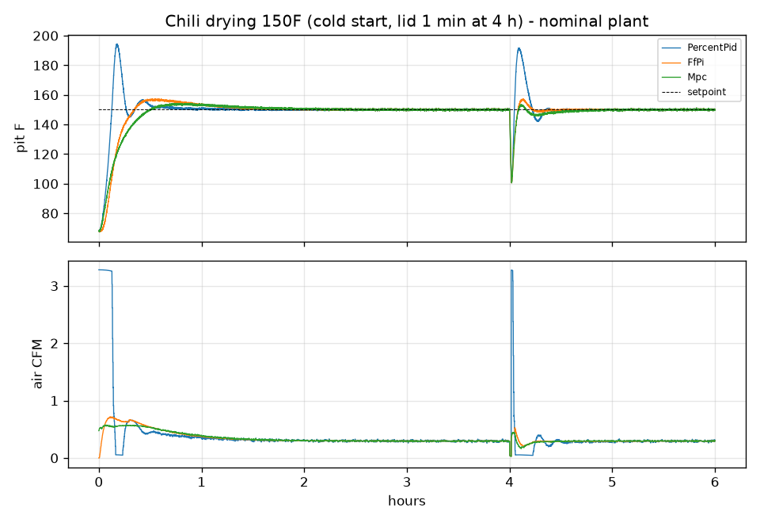
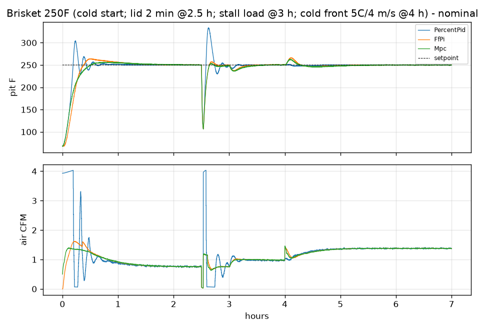
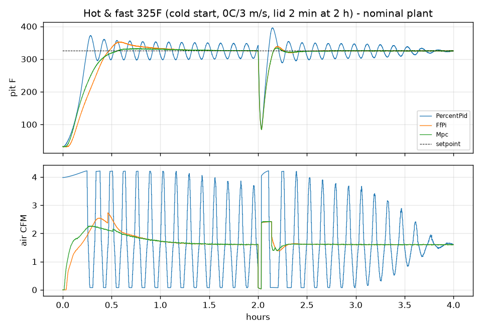
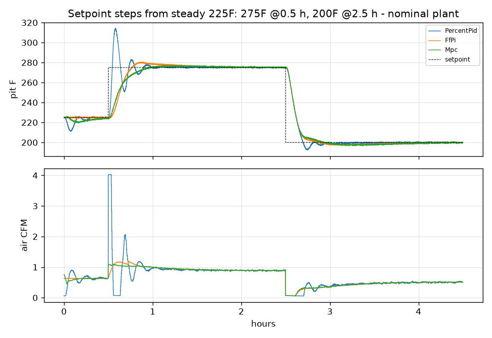

# Controller bake-off: BGE Large, 150-325F

_Generated by `uv run minimeater-control` from `src/minimeater/model/control*.py`. Do not edit by hand._

Plant: the BGE Large model at three parameter sets (low loss / nominal / high loss), fan Noctua NF-A6x25 5V PWM, 0.3F probe noise, 10 s control period. The controllers only see the noisy probe, the setpoint, a lid-open flag and the on-board ambient sensor. FfPi and Mpc use a *firmware-side* model (nominal parameters, top vent assumed 1/4 open) for feedforward and actuator inversion, plus a per-egg FOPDT model from a simulated autotune (a 30% airflow step at each of 150, 225, 275, 325F). The real top vent differs per scenario, so model mismatch is part of every run.

Controllers:

- **PercentPid**: PI on 0-100% output (P=2 %/F, I=0.005 %/F/s), damper-first mapping. HeaterMeter-style baseline.
- **FfPi**: commands airflow, not %. Steady-state feedforward from the model and ambient sensor, actuator inversion (airflow to damper/fan), tethered reference shaping, SIMC gains from the autotuned model, gain-scheduled by setpoint, conditional-integration anti-windup.
- **Mpc**: offset-free linear MPC on the same model and inversion. Kalman disturbance estimate, 30 min horizon in 6 blocks, overshoot weighted 8x undershoot (a kamado cannot be actively cooled), move penalty, actuator limits.

## Identified models (simulated autotune)

| plant | setpoint F | gain F/CFM | tau min | dead time s |
|---|---|---|---|---|
| low loss | 150 | 157 | 9.1 | 96 |
| low loss | 225 | 145 | 8.7 | 104 |
| low loss | 275 | 138 | 8.5 | 108 |
| low loss | 325 | 132 | 8.4 | 111 |
| nominal | 150 | 128 | 8.9 | 97 |
| nominal | 225 | 116 | 8.4 | 107 |
| nominal | 275 | 110 | 8.2 | 111 |
| nominal | 325 | 104 | 8.0 | 115 |
| high loss | 150 | 68 | 8.5 | 103 |
| high loss | 225 | 58 | 8.0 | 116 |
| high loss | 275 | 52 | 7.7 | 124 |
| high loss | 325 | 48 | 7.4 | 132 |

## Chili drying 150F (cold start, lid 1 min at 4 h)

Top vent: petals open.

| controller | plant | reach min | overshoot F | hold RMS F | hold max |e| F | lid recovery min | lid overshoot F | servo strokes/h | fan on % |
|---|---|---|---|---|---|---|---|---|---|
| PercentPid | low loss | 7.3 | 47.5 | 0.3 | 1.3 | 1.5 | 48.0 | 5.4 | 2.8 |
| PercentPid | nominal | 7.3 | 44.4 | 0.3 | 1.2 | 1.7 | 41.5 | 5.4 | 2.9 |
| PercentPid | high loss | 7.3 | 31.8 | 0.3 | 1.2 | 2.5 | 30.0 | 5.0 | 12.7 |
| FfPi | low loss | 15.8 | 8.6 | 0.3 | 1.4 | 2.6 | 10.4 | 2.0 | 2.6 |
| FfPi | nominal | 17.5 | 7.4 | 0.3 | 1.2 | 3.3 | 7.3 | 2.4 | 3.7 |
| FfPi | high loss | 20.1 | 5.0 | 0.3 | 1.4 | 5.3 | 3.9 | 4.2 | 17.9 |
| Mpc | low loss | 22.1 | 4.0 | 0.5 | 2.8 | 2.7 | 6.5 | 2.2 | 1.7 |
| Mpc | nominal | 23.7 | 4.3 | 0.4 | 2.3 | 3.3 | 3.5 | 2.6 | 2.5 |
| Mpc | high loss | 27.0 | 3.7 | 0.4 | 1.8 | 5.7 | 0.0 | 4.3 | 18.1 |

## Brisket 250F (cold start; lid 2 min @2.5 h; stall load @3 h; cold front 5C/4 m/s @4 h)

Top vent: slider 1/4.

| controller | plant | reach min | overshoot F | hold RMS F | hold max |e| F | lid recovery min | lid overshoot F | servo strokes/h | fan on % |
|---|---|---|---|---|---|---|---|---|---|
| PercentPid | low loss | 11.4 | 60.8 | 1.1 | 10.1 | 2.4 | 95.6 | 5.8 | 5.0 |
| PercentPid | nominal | 11.4 | 54.2 | 1.1 | 8.2 | 2.8 | 83.6 | 3.8 | 42.5 |
| PercentPid | high loss | 13.1 | 20.1 | 3.7 | 10.6 | 4.6 | 42.5 | 0.6 | 97.1 |
| FfPi | low loss | 20.0 | 17.4 | 3.8 | 21.1 | 5.1 | 9.6 | 1.9 | 6.0 |
| FfPi | nominal | 21.2 | 14.3 | 3.3 | 16.5 | 5.9 | 7.4 | 1.5 | 45.4 |
| FfPi | high loss | 25.0 | 10.0 | 2.7 | 13.5 | 7.6 | 5.6 | 0.4 | 99.5 |
| Mpc | low loss | 25.5 | 6.6 | 3.6 | 16.6 | 5.1 | 5.7 | 2.2 | 4.1 |
| Mpc | nominal | 27.0 | 6.3 | 3.2 | 14.1 | 6.0 | 3.8 | 1.8 | 44.9 |
| Mpc | high loss | 28.3 | 6.5 | 3.0 | 14.0 | 7.7 | 2.0 | 0.4 | 99.5 |

## Hot & fast 325F (cold start, 0C/3 m/s, lid 2 min at 2 h)

Top vent: slider 1/2.

| controller | plant | reach min | overshoot F | hold RMS F | hold max |e| F | lid recovery min | lid overshoot F | servo strokes/h | fan on % |
|---|---|---|---|---|---|---|---|---|---|
| PercentPid | low loss | 14.3 | 63.6 | 6.9 | 23.2 | 3.6 | 93.3 | 10.4 | 29.3 |
| PercentPid | nominal | 14.7 | 47.2 | 14.4 | 27.7 | 4.3 | 70.6 | 12.3 | 52.3 |
| PercentPid | high loss | 33.9 | 13.1 | 8.7 | 13.6 | 9.9 | 14.2 | 0.5 | 99.2 |
| FfPi | low loss | 26.4 | 36.4 | 0.8 | 3.4 | 6.7 | 14.5 | 2.0 | 18.3 |
| FfPi | nominal | 27.5 | 27.5 | 0.8 | 3.6 | 7.1 | 13.6 | 0.8 | 95.8 |
| FfPi | high loss | 38.6 | 7.2 | 1.0 | 4.0 | 9.9 | 5.3 | 0.7 | 98.6 |
| Mpc | low loss | 29.9 | 7.8 | 0.8 | 3.2 | 6.7 | 10.1 | 2.3 | 18.5 |
| Mpc | nominal | 30.8 | 6.9 | 0.9 | 3.4 | 7.1 | 9.2 | 0.8 | 96.5 |
| Mpc | high loss | 35.9 | 6.3 | 0.9 | 3.5 | 9.9 | 2.1 | 0.8 | 98.3 |

## Setpoint steps from steady 225F: 275F @0.5 h, 200F @2.5 h

Top vent: slider 1/4.

| controller | plant | reach min | overshoot F | hold RMS F | hold max |e| F | lid recovery min | lid overshoot F | servo strokes/h | fan on % |
|---|---|---|---|---|---|---|---|---|---|
| PercentPid | low loss | 2.2 | 45.3 | 0.4 | 1.3 | nan | nan | 5.7 | 1.9 |
| PercentPid | nominal | 2.5 | 39.2 | 0.3 | 1.3 | nan | nan | 5.6 | 2.3 |
| PercentPid | high loss | 4.3 | 29.0 | 0.5 | 1.7 | nan | nan | 2.8 | 51.4 |
| FfPi | low loss | 12.3 | 7.1 | 0.8 | 2.4 | nan | nan | 1.5 | 0.0 |
| FfPi | nominal | 13.1 | 5.6 | 0.7 | 2.4 | nan | nan | 1.9 | 0.1 |
| FfPi | high loss | 16.1 | 3.6 | 0.8 | 2.4 | nan | nan | 2.1 | 53.0 |
| Mpc | low loss | 16.8 | 2.2 | 1.0 | 3.0 | nan | nan | 1.9 | 0.0 |
| Mpc | nominal | 18.4 | 2.2 | 1.0 | 2.9 | nan | nan | 2.4 | 0.0 |
| Mpc | high loss | 20.9 | 2.3 | 1.0 | 2.9 | nan | nan | 2.1 | 52.5 |

## Summary across all scenarios and plants

mean / worst:

| controller | reach min | overshoot F | hold RMS F | hold max |e| F | lid recovery min | lid overshoot F | servo strokes/h | fan on % |
|---|---|---|---|---|---|---|---|---|
| PercentPid | 10.8 / 33.9 | 41.3 / 63.6 | 3.2 / 14.4 | 8.5 / 27.7 | 3.7 / 9.9 | 57.7 / 95.6 | 5.3 / 12.3 | 33.3 / 99.2 |
| FfPi | 21.1 / 38.6 | 12.5 / 36.4 | 1.3 / 3.8 | 6.1 / 21.1 | 5.9 / 9.9 | 8.6 / 14.5 | 1.8 / 4.2 | 36.7 / 99.5 |
| Mpc | 25.5 / 35.9 | 4.9 / 7.8 | 1.4 / 3.6 | 5.9 / 16.6 | 6.0 / 9.9 | 4.8 / 10.1 | 2.0 / 4.3 | 36.4 / 99.5 |
