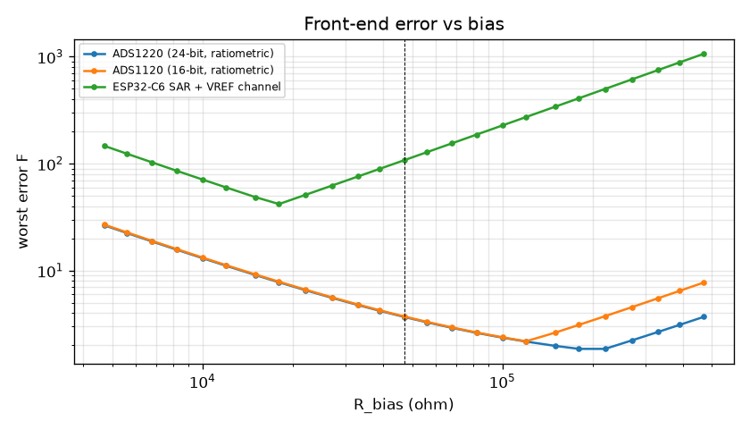

# Probe front-end error budget

_Generated by `uv run minimeat-probes` from `src/minimeat/model/probes*.py`. Do not edit by hand._

Topology per jack: `VREF - R_bias - AINx - probe NTC - AGND`, single-ended. A ratiometric ADC (ADS1x20) takes its reference from the same VREF, so it reads `x = R_t/(R_t+R_bias)` and supply drift cancels. Errors are worst-case magnitudes, summed linearly, in F.

## Probe families

| probe | 32F | 77F | 225F | 325F | 500F | 700F | coefficients |
|---|---|---|---|---|---|---|---|
| ThermoWorks Pro-Series | 317.7k | 96.4k | 5.0k | 1.2k | 186 | 43 | [forum] tvwbb 69233, fitted on a calibration block (~96k at 25C) |
| Maverick ET-732 | 3.72M | 995.1k | 37.3k | 7.6k | 975 | 192 | [forum] LinkMeter v2 thread (~1M at 25C) |
| Generic 100k B3950 | 336.2k | 100.0k | 5.7k | 1.5k | 291 | 81 | [est] typical import probe |

## Bias resistor and ADC sweep

Worst design-attributable error over all probe families at 32-500F. Any jack may hold any probe in either role. Probe-intrinsic terms (lead resistance, insulation leakage) are excluded here and shown in the budget below.

| ADC | best R_bias | worst F at best | worst F at 47.0k | basis |
|---|---|---|---|---|
| ADS1220 (24-bit, ratiometric) | 220.0k | 1.86 | 3.70 | [spec] PGA bypassed, gain 1, 20 SPS: 3.89 uVrms; offset 30 uV max; gain err 0.1% max (PGA on, 0.015% typ off); abs input current ~5 nA @25C, 20-50 nA @85C (Fig 6-22..6-24) + [est] ESD leakage |
| ADS1120 (16-bit, ratiometric) | 120.0k | 2.19 | 3.73 | [est] same analog core as ADS1220, quantisation-limited at 20 SPS; offset/gain assumed equal |
| ESP32-C6 SAR + VREF channel | 18.0k | 41.91 | 107.48 | [est] 12-bit, eFuse-calibrated, INL ~+/-10 LSB (Espressif blog 2025-08); rail measured on a 5th channel, residual 0.2%; sampling cap needs a low-impedance node or big C |

## Per-temperature error, chosen design (47.0k, ADS1220 (24-bit, ratiometric))

| probe | 32F | 100F | 150F | 212F | 225F | 325F | 400F | 500F |
|---|---|---|---|---|---|---|---|---|
| ThermoWorks Pro-Series | 0.46 | 0.25 | 0.21 | 0.19 | 0.19 | 0.23 | 0.32 | 0.58 |
| Maverick ET-732 | 3.70 | 0.77 | 0.39 | 0.28 | 0.27 | 0.23 | 0.24 | 0.31 |
| Generic 100k B3950 | 0.46 | 0.26 | 0.22 | 0.20 | 0.21 | 0.25 | 0.33 | 0.54 |

## Error budget by mechanism (F)

| probe | T F | noise/quantisation (3 sigma) | ADC offset | ADC gain + rail | input current | bias tolerance | self-heating | lead resistance | probe shunt leakage |
|---|---|---|---|---|---|---|---|---|---|
| ThermoWorks Pro-Series | 32 | 0.000 | 0.003 | 0.273 | 0.116 | 0.035 | 0.031 | 0.000 | 0.554 |
| ThermoWorks Pro-Series | 150 | 0.000 | 0.002 | 0.071 | 0.030 | 0.050 | 0.057 | 0.003 | 0.048 |
| ThermoWorks Pro-Series | 225 | 0.001 | 0.006 | 0.068 | 0.029 | 0.062 | 0.024 | 0.012 | 0.015 |
| ThermoWorks Pro-Series | 325 | 0.004 | 0.030 | 0.081 | 0.034 | 0.079 | 0.007 | 0.067 | 0.005 |
| ThermoWorks Pro-Series | 500 | 0.036 | 0.264 | 0.115 | 0.049 | 0.114 | 0.001 | 0.614 | 0.001 |
| Maverick ET-732 | 32 | 0.003 | 0.023 | 2.547 | 1.088 | 0.032 | 0.003 | 0.000 | 5.421 |
| Maverick ET-732 | 150 | 0.000 | 0.002 | 0.206 | 0.088 | 0.045 | 0.048 | 0.000 | 0.376 |
| Maverick ET-732 | 225 | 0.000 | 0.002 | 0.100 | 0.043 | 0.056 | 0.069 | 0.001 | 0.104 |
| Maverick ET-732 | 325 | 0.001 | 0.005 | 0.082 | 0.035 | 0.071 | 0.033 | 0.009 | 0.027 |
| Maverick ET-732 | 500 | 0.006 | 0.047 | 0.105 | 0.045 | 0.103 | 0.006 | 0.105 | 0.005 |
| Generic 100k B3950 | 32 | 0.000 | 0.003 | 0.277 | 0.118 | 0.034 | 0.030 | 0.000 | 0.567 |
| Generic 100k B3950 | 150 | 0.000 | 0.002 | 0.075 | 0.032 | 0.052 | 0.059 | 0.003 | 0.053 |
| Generic 100k B3950 | 225 | 0.001 | 0.006 | 0.074 | 0.032 | 0.066 | 0.027 | 0.012 | 0.019 |
| Generic 100k B3950 | 325 | 0.004 | 0.026 | 0.089 | 0.038 | 0.087 | 0.008 | 0.057 | 0.007 |
| Generic 100k B3950 | 500 | 0.026 | 0.193 | 0.130 | 0.056 | 0.130 | 0.002 | 0.445 | 0.002 |

Lead resistance and insulation leakage belong to the probe, not the front-end: 1 ohm of lead and a 20 M ohm damp-insulation shunt. They are why high-resistance probes (1M-class Maverick) read poorly near freezing whatever the front-end.

## Probe present / fault detection

| condition | ratio x |
|---|---|
| short (below) | 1.40e-04 |
| hottest valid reading (700F, lowest-R family) | 9.20e-04 |
| coldest valid reading (-20F, highest-R family) | 0.99789 |
| open (above) | 0.99930 |

## Ambient sensor accuracy requirement

| pit F | feedforward CFM per C ambient | pit offset F per C error (at 116 F/CFM) |
|---|---|---|
| 150 | 0.0055 | 0.64 |
| 225 | 0.0050 | 0.58 |
| 325 | 0.0040 | 0.46 |

The offset is transient, because the integral/disturbance estimate removes it. It shows a 2C sensor is ample, and that placement (keeping clear of board and egg heat) matters more than the sensor's spec.
