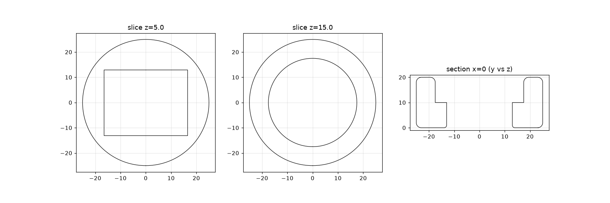

# Existing HeaterMeter blower adapter (`Adapter.stl`)

This is the user's printed part that joins the old HeaterMeter blower (Roto Damper family, thingiverse:1194140) to the egg's stainless intake tube. The dimensions below were measured from the STL (Rhino export, mm) Calipers on the tube since (`.2.8`, 2026-10-15): OD 34.89 mm, ID 30.83 mm (a 2.03 mm wall), 31.94 mm free length; the 1.375" reading stands, the ID was 0.8 mm under the assumed 31.6. The STL itself is third-party, so it is not committed.

## Dimensions

| Feature | Dimension | Notes |
|---|---|---|
| Body | Ø50.0 × 20.0 mm puck | 1 mm edge round top and bottom |
| Tube socket (top half, z = 10-20) | **Ø35.0 mm round bore, 10 mm deep** | entry rounded to about Ø37 |
| Blower socket (bottom half, z = 0-10) | **33.0 × 26.0 mm rectangle, 10 mm deep**, sharp corners | open at the bottom; the blower or damper outlet spigot slides in |
| Tube stop | shoulder at z = 10 where the rectangle meets the bore | 4.5 mm ledge on the long sides, 1.0 mm on the short sides |
| Flow area | rectangle 858 mm² vs tube bore 784 mm² (at 31.6 mm ID) | almost no contraction; the step is abrupt |

## What this tells us

- **The tube is the 1.375" BBQ Guru style.**
  - A Ø35.0 bore over a 34.93 mm (1.375") tube leaves 0.07 mm of diametral clearance in CAD.
  - As printed, holes usually come out 0.1-0.3 mm undersize, so this part is a push or press fit on that tube.
  - The 1" NPT alternative (33.4 mm OD) would rattle in a 1.5 mm gap, so it's ruled out unless the part was shimmed.
  - The model's `tube_od_m` (1.375") stands. The tube ID (31.6 mm assumed) can't be read from this part.
- **Engagement is only 10 mm** and held by friction. Our box can use a deeper socket for alignment, about 15-20 mm, as long as the tube's free length allows (check with calipers).
- **The joint is downstream of our flap, so any leak there bypasses it.**
  - A 0.1 mm radial gap around Ø35 is π · 35 · 0.1 ≈ 11 mm² = 0.11 cm².
  - That is about a third of the 0.3 cm² closed-flap leak budget (`docs/modeling/README.md` §5).
  - So the coupling needs a seal: an O-ring groove or silicone sleeve sized to the measured OD, or an interference fit verified on a test ring. A plain clearance fit won't do.
- **The old blower outlet was a 33 × 26 mm rectangle.** It is irrelevant to the new box, which has its own fan, but it is useful if a drop-in replacement for the old blower is ever wanted.
