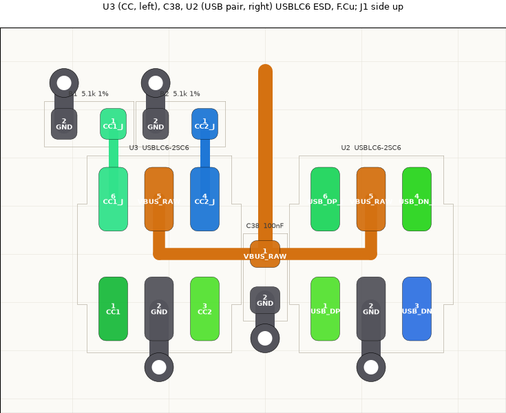
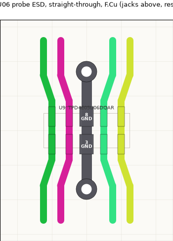

# PCB layout blocks

Each IC is laid out with its own parts first, off the board, to its datasheet's layout guidance: placement, local
tracks and copper fills, ground vias to the In1 plane. Blocks are then placed on the board as units and joined by hand.
Edits go through Konnect (live KiCad over IPC). Renders: `hw/tools/pcbdump.py` (KiCad's python) then
`hw/tools/render.py`; F.Cu only, colour by net.

Staging: a temporary second board outline (x 0-130, y 64-124) and an In1 GND zone (`STAGING_In1_GND`) under it, so
the block fills fill and its vias land on a plane as they will on the board. Both are removed once every block is on
the board.

Netclasses (`hw/minimeater.kicad_pro`): Default 0.2/0.15; PowerHigh 0.8/0.2 (VBUS_RAW, VBUS_F, VFAN, VSERVO,
BUCK_SW); Power 0.5/0.2 (3V3, 3V3A, 3V3A_FILT, VBUS_LDO); GND 0.4/0.15; USB 0.27 with a 0.15 gap (90 ohm
edge-coupled on F.Cu over In1, 7628 prepreg ~0.21 mm); Analog 0.2/0.25 (TIPx, AINx, VREF_PROBE). Vias 0.6/0.3.

## U4 TLV62569 buck (3V3), origin (20, 75)

Datasheet SLVSDG1C section 10, figure 20 (DBV):

- Cin and the inductor as close to the IC as possible; power paths short and wide: VIN, SW and VOUT are fills, not
  traces. U4 is turned 180 degrees so the pins fall as in figure 20: VIN top left, SW top right, GND right middle,
  FB bottom left, EN bottom right.
- L1 straight above SW; the SW fill is only the overlap between pin 3 and L1 pad 1 (smallest switching area).
- C14 (100 nF) then C4 (10 uF) beside VIN on the VIN fill; their grounds drop to In1 (C4 via in pad, C14 via beside).
- C5, C6 (10 uF) under L1's output pad on the VOUT fill; ground pads with vias in the pad, a via beside pin 2, a
  ground fill from pin 2 to both, so the output loop is closed on top.
- EN is tied to VIN under the package body (0.25 mm, 0.35 mm from both pin rows): no via.
- FB is a signal: R3/C7/R4 sit below, away from SW; FB drops straight from pin 5. The 3V3 sense runs from C6's pad
  round the outside of the block (as figure 20's sense trace), so it reads the output capacitor and never passes SW.

## U5 TLV75533P analog LDO (3V3A), origin (40, 75)

Datasheet SBVS320D section 7.4, figure 7-7 (DBV), at the footprint's own orientation: IN top left, OUT top right,
GND left middle, EN bottom left, NC bottom right.

- Cin (C8, 1 uF) and Cout (C9 1 uF, then C15 100 nF) right at their pins, as close as the courtyards allow.
- C8's ground pad sits beside pin 2, joined on top: the input loop closes on F.Cu without going through a via.
- The ground fill wraps under the package from C8 to C9/C15 (figure 7-7's ground plane), with a via at each end.
- FB1 (from VBUS_F) feeds the VBUS_LDO fill at the far left, so VBUS_F arrives from outside the block.
- EN is tied to IN under the package body, as on U4. NC (pin 4) is left unconnected.
- FB2, R18 and C27/C28 (the VREF_PROBE filter) belong to the ADC end of 3V3A and go in the U8 block.

## U7, U6 TPS2553 load switches (fan, servo), origins (60, 75) and (75, 75)

Datasheet SLVS841F section 12, figure 30, at the footprint's own orientation: IN top left, GND left middle, EN bottom
left, OUT top right, ILIM right middle, FAULT bottom right. The two blocks are identical (U7 fan: C17, R9, R6, C13,
C12; U6 servo: C16, R8, R5, C11, C10).

- The 100 nF bypass on IN (C17/C16) sits at pin 1 with its ground pad beside GND pin 2, joined on top: the
  "low-inductance" IN-GND connection, plus a via.
- R_ILIM (R6/R5) stands right beside ILIM, under 1 mm of trace ("as short as possible" for current-limit accuracy),
  grounded with a via and through the output-cap ground fill.
- Output: 100 nF (C13/C11) then 10 uF (C12/C10, via in the ground pad) on the OUT fill, which runs over R_ILIM. The
  bulk at the connectors (C35, C36/C37) is placed with J6/J7.
- EN pull-down (R9/R8) beside EN; the MCU's EN comes in from below.
- FAULT leaves under the body and out the top between the IN and OUT fills, as in figure 30. R7 (the shared
  LOAD_FAULT pull-up) is placed when the two blocks go on the board.

## U2, U3 USBLC6-2SC6 ESD with C38, R1/R2, origin (100, 75)

Datasheet DS4260 section 2.3 and figure 17. Pins 1/6 and 3/4 are the same I/O inside the part; the schematic puts
the J1 side on 6/4 and the MCU side on 1/3 so the lines flow straight through. Turned 90 degrees: J1 side up
(6 left, 5 VBUS middle, 4 right), MCU side down (1, 2 GND, 3).

- "The track from VCC to VBUS and from the GND plane to GND must be as short as possible." VBUS (pin 5) sits between
  the two lines it protects, so it leaves under the package body (as the EN ties on U4/U5) to C38, the 100 nF C_BUS
  of figure 17, which sits between U3 and U2 and serves both. Both data lanes and both CC lanes stay free: nothing
  crosses the pair.
- GND (pin 2) has a via straight below it, between the MCU-side lines; C38's ground has its own via.
- R1/R2 (Rd 5.1k) sit on U3's CC_J pins, each with a ground via.
- The J1 fan-out (merging D+ B6/A6 and D- A7/B7 with the In2 hop for the crossing, the CC lines, VBUS) is drawn when
  the block goes behind J1; see bead minimeat-bk4 for the planned geometry.

## VBUS entry: D1, F1, C1-C3, origin (110-121, 75)

D1 (SMF5V0A TVS) on VBUS_RAW at the input, then F1 (PTC), then the VBUS_F bulk: C3 100 nF, C2 10 uF, C1 100 uF,
all on one fill per net with their ground pads on a common ground strip. Vias in the ground pads (D1, C2, two in
C1's) and one beside C3. In placement D1 goes as close to J1's VBUS pads as it can.

## U9 TPD4E05U06 probe ESD, origin (20, 95)

Datasheet SLVSBO7O section 7.4, figure 7-11: straight-through routing. Each tip line runs straight across the part
over its I/O pad and the NC pad opposite (1/10 TIP1, 2/9 TIP2, 4/7 TIP3, 5/6 TIP4; the schematic ties the NC pins
to the tips, which the datasheet allows: "used for optional straight-through routing"). The two GND pads (3, 8)
join down the middle and leave to a via on each side.

- "As close to the connector as possible": goes right behind the jacks in placement; jack side is up.
- "Route the protected traces as straight as possible", no sharp corners: past the package the lines fan out by
  0.25 mm at 1:3 (about 18 degrees) to make room for the GND vias. A 45 degree fan does not fit: two parallel 45
  degree jogs at 0.5 mm pitch come within 0.354 mm centre to centre (0.15 mm of copper gap).
- The 0.2 mm lines match the 0.2 mm pads; 0.3 mm gaps between lines meet the Analog class 0.25 mm.

## U11 ATECC608B secure element, origin (40, 95)

The summary datasheet (DS40002239B) gives no layout guidance; standard practice: C34 (100 nF) beside VCC (pin 8)
with its own ground via, GND (pin 4) to a via at its outer end. NC pins 1-3, 7 left open. SDA/SCL (5, 6) leave to
the right toward the bus; the pull-ups (R14/R15) sit with the MCU.

## U8 ADS122C04 probe ADC, origin (80, 102)

Datasheet SBAS751B section 11, figure 83 (TSSOP turned 180 degrees as in the figure: REFP/AIN1/AIN0/AVDD/DVDD/
DRDY/SDA/SCL down the left, REFN/AIN2/AIN3/AVSS/DGND/RESET/A1/A0 down the right). Block: U8, C24-C26, R17, the
VREF_PROBE filter (FB2, R18, C27, C28), the four 0.1% bias resistors (R23-R26) and the input RC filters
(R19-R22, C29-C32).

- Analog and digital apart: inputs and reference at the top (toward the jacks), DRDY/SDA/SCL leave at the bottom
  (toward the MCU), SDA and DRDY under the package body.
- Input filters as in the figure: each channel's 1k (R19-R22) vertical from its TIP node, the 100 nF (C29-C32)
  beside the AIN node with its own ground via, then a 45 degree run into the pin. The two runs per side are
  0.65 mm apart (0.46 mm square to the lines), which keeps the Analog 0.25 mm clearance.
- Reference: C28 sits right across REFP and REFN (the figure's cap between them), both reached under the package
  body; REFN is ground and C28's ground has a via. The VREF_PROBE trunk above feeds C28 and C27 (10 uF, lying
  across the top with its VREF pad on the trunk and a via in its ground pad). The R18/FB2 filter from 3V3A sits in a
  row above C27; 3V3A arrives at FB2 through one via (the middle of the block is enclosed by the TIP2/TIP3 lines).
- Bias resistors: R24/R25 (inner channels) hang straight off the trunk. R23/R26 (outer channels) lie across the
  inner channels' TIP lines, which run under their bodies between the pads (0603 gap 0.85 mm: 0.325 mm each side of a
  0.2 mm line). The resistor body is the crossing, so VREF_PROBE reaches the outer channels without leaving F.Cu,
  and every TIP line runs straight up toward the jacks at 1.65 mm pitch, in jack order.
- "Do not place vias between bypass capacitors and the device": C25 (100 nF) and C26 (1 uF) on AVDD, C24 on DVDD,
  each joined to its pin by a trace on F.Cu, ground vias on the far side.
- AVSS/DGND (5, 4) and A1/A0 (2, 1, address 0x40) pair up to a ground via each; RESET to R17 (pull-up).
