# PCB layout blocks

Each IC is laid out with its own parts first, off the board, to its datasheet's layout guidance: placement, local
tracks and copper fills, ground vias to the In1 plane. Blocks are then placed on the board as units and joined by hand.
Edits go through Konnect (live KiCad over IPC). Renders: `hw/tools/pcbdump.py` (KiCad's python) then
`hw/tools/render.py`; F.Cu only, colour by net.

Staging: a temporary second board outline (x 0-130, y 64-124) and an In1 GND zone (`STAGING_In1_GND`) under it, so
the block fills fill and its vias land on a plane as they will on the board. Both are removed once every block is on
the board.

Netclasses and limits (`hw/minimeater.kicad_pro`, `hw/minimeater.kicad_dru`): JLCPCB 4-layer capabilities, 0.1 mm
clearance in every class. Widths: Default/Analog 0.2 (TIPx, AINx, VREF_PROBE), Power 0.5 (3V3, 3V3A, 3V3A_FILT,
VBUS_LDO), PowerHigh 0.8 (VBUS_RAW, VBUS_F, VFAN, VSERVO, BUCK_SW), GND 0.4, USB 0.27 (90 ohm edge-coupled on F.Cu
over In1, 7628 prepreg ~0.21 mm). Vias 0.6/0.3, and 0.45/0.3 in pads under 0.8 mm (0402s, SOT-23 and SOIC leads): via-in-pad is
filled and capped, so a via goes in the pad it serves wherever it fits without rerouting another net. 0.45/0.3 is JLC's
included minimum; anything smaller costs more.

## U4 TLV62569 buck (3V3), origin (20, 75)

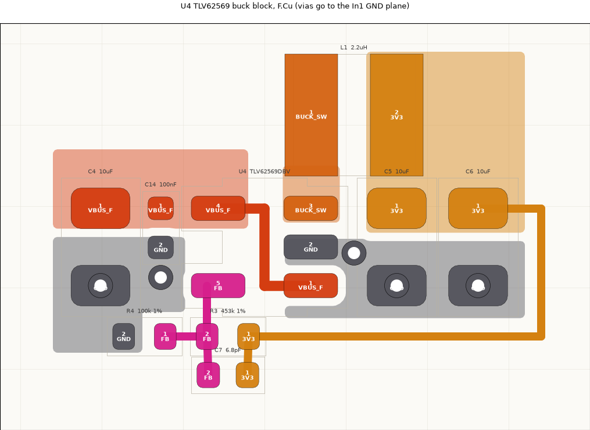

Datasheet SLVSDG1C section 10, figure 20 (DBV):

- Cin and the inductor as close to the IC as possible; power paths short and wide: VIN, SW and VOUT are fills, not
  traces. U4 is turned 180 degrees so the pins fall as in figure 20: VIN top left, SW top right, GND right middle,
  FB bottom left, EN bottom right.
- L1 straight above SW; the SW fill is only the overlap between pin 3 and L1 pad 1 (smallest switching area).
- C14 (100 nF) then C4 (10 uF) beside VIN on the VIN fill; their grounds drop to In1 (C4 via in pad, C14 via beside).
- C5, C6 (10 uF) under L1's output pad on the VOUT fill; ground pads with vias in the pad, a via beside pin 2, a
  ground fill from pin 2 to both, so the output loop is closed on top.
- EN is tied to VIN under the package body (0.25 mm, 0.35 mm from both pin rows): no via.
- FB is a signal: R3/C7/R4 sit below, away from SW; FB drops straight from pin 5. The 3V3 sense runs from C6's pad
  round the outside of the block (as figure 20's sense trace), so it reads the output capacitor and never passes SW.

## U5 TLV75533P analog LDO (3V3A), origin (40, 75)

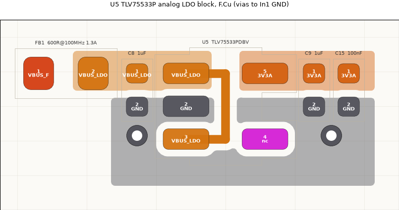

Datasheet SBVS320D section 7.4, figure 7-7 (DBV), at the footprint's own orientation: IN top left, OUT top right,
GND left middle, EN bottom left, NC bottom right.

- Cin (C8, 1 uF) and Cout (C9 1 uF, then C15 100 nF) right at their pins, as close as the courtyards allow.
- C8's ground pad sits beside pin 2, joined on top: the input loop closes on F.Cu without going through a via.
- The ground fill wraps under the package from C8 to C9/C15 (figure 7-7's ground plane), with a via at each end.
- FB1 (from VBUS_F) feeds the VBUS_LDO fill at the far left, so VBUS_F arrives from outside the block.
- EN is tied to IN under the package body, as on U4. NC (pin 4) is left unconnected.
- FB2, R18 and C27/C28 (the VREF_PROBE filter) belong to the ADC end of 3V3A and go in the U8 block.

## U7, U6 TPS2553 load switches (fan, servo), origins (60, 75) and (75, 75)

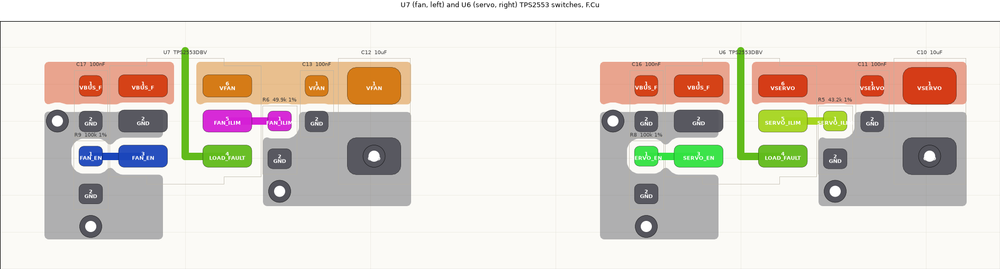

Datasheet SLVS841F section 12, figure 30, at the footprint's own orientation: IN top left, GND left middle, EN bottom
left, OUT top right, ILIM right middle, FAULT bottom right. The two blocks are identical (U7 fan: C17, R9, R6, C13,
C12; U6 servo: C16, R8, R5, C11, C10).

- The 100 nF bypass on IN (C17/C16) sits at pin 1 with its ground pad beside GND pin 2, joined on top: the
  "low-inductance" IN-GND connection, plus a via.
- R_ILIM (R6/R5) stands right beside ILIM, under 1 mm of trace ("as short as possible" for current-limit accuracy),
  grounded with a via and through the output-cap ground fill.
- Output: 100 nF (C13/C11) then 10 uF (C12/C10, via in the ground pad) on the OUT fill, which runs over R_ILIM. The
  bulk at the connectors (C35, C36/C37) is placed with J6/J7.
- EN pull-down (R9/R8) beside EN; the MCU's EN comes in from below.
- FAULT leaves under the body and out the top between the IN and OUT fills, as in figure 30. R7 (the shared
  LOAD_FAULT pull-up) is placed when the two blocks go on the board.

## U2 TPD4E05U06 USB ESD behind J1, with R1/R2 (minimeat-0qm)

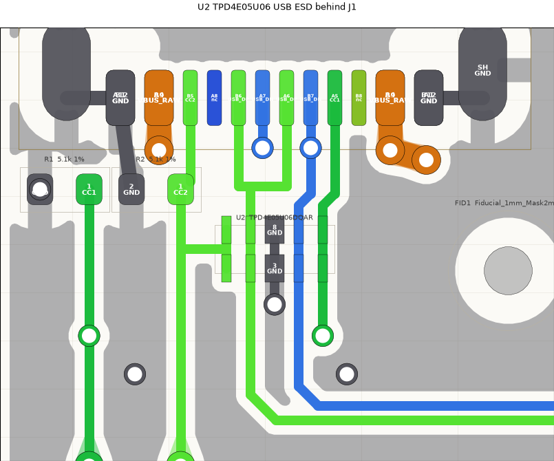

One TPD4E05U06DQAR (the probe jacks' part, U9/U14) replaces the two USBLC6-2SC6 and their C38: D+, D- and both CC
lines on one 0.5 pF, 5.5 V working array with no VBUS pin to decouple. Laid out on the board directly, centred under
J1 (x 4.2, J1's peg holes are at 1.31 and 7.09), rotation 0. Datasheet SLVSBO7O section 10 and figure 7-11: each
channel's NC pad is tied to its I/O pad across the package (1/10, 2/9, 4/7, 5/6) so the line runs straight through
the part, and the GND pads 3/8 are joined down the middle.

- Channels follow J1's pad order, left to right CC2, D+, GND, D-, CC1 (pins 1/10, 2/9, 3/8, 4/7, 5/6), so every
  line drops from J1 into its own lane: CC2 (B5) straight down past R2, D+ (B6 and A6 merged on F.Cu at y 9.8) at
  x 3.7, D- (A7 hopped 1 mm on In2 to B7, the one crossing J1's interleaved pads force) jogging 0.25 mm onto x 4.7,
  CC1 (A5) jogging 0.25 mm onto x 5.2. The D+/D- jogs are mirror images about J1's centre.
- GND: one via straight below the 3/8 tie, between the D+ and D- lanes; the D+ merge leaves no room for one above.
- CC2 leaves the tie between pins 1/10 west to R2's line. CC1 drops through a via below pin 4 and runs west on B.Cu
  under the pair to R1's line. R1/R2 (Rd 5.1k) sit between J1 and U2, each with its ground on J1's GND pad or a via.

## VBUS entry: D1, F1, C1-C3, origin (110-121, 75) (F1 since replaced by U12, below)

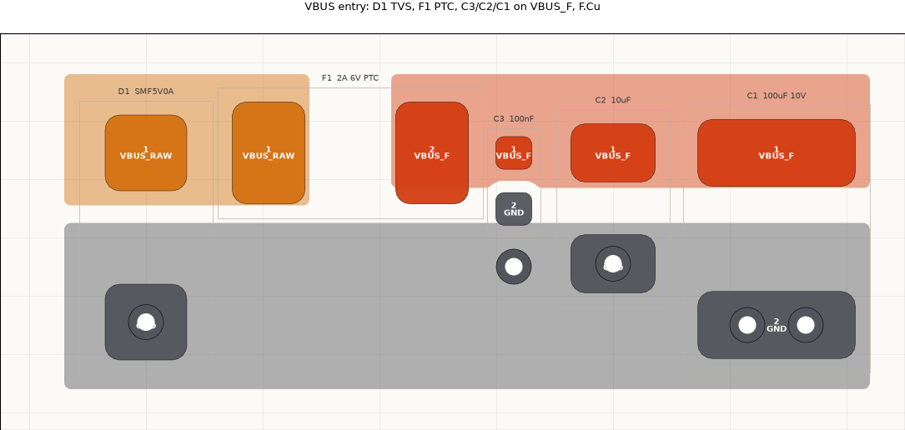

D1 (SMF5V0A TVS) on VBUS_RAW at the input, then F1 (PTC), then the VBUS_F bulk: C3 100 nF, C2 10 uF, C1 100 uF,
all on one fill per net with their ground pads on a common ground strip. Vias in the ground pads (D1, C2, two in
C1's) and one beside C3. In placement D1 goes as close to J1's VBUS pads as it can.

## U12 TPS259531 eFuse, on the board where F1 was (minimeat-8s2)

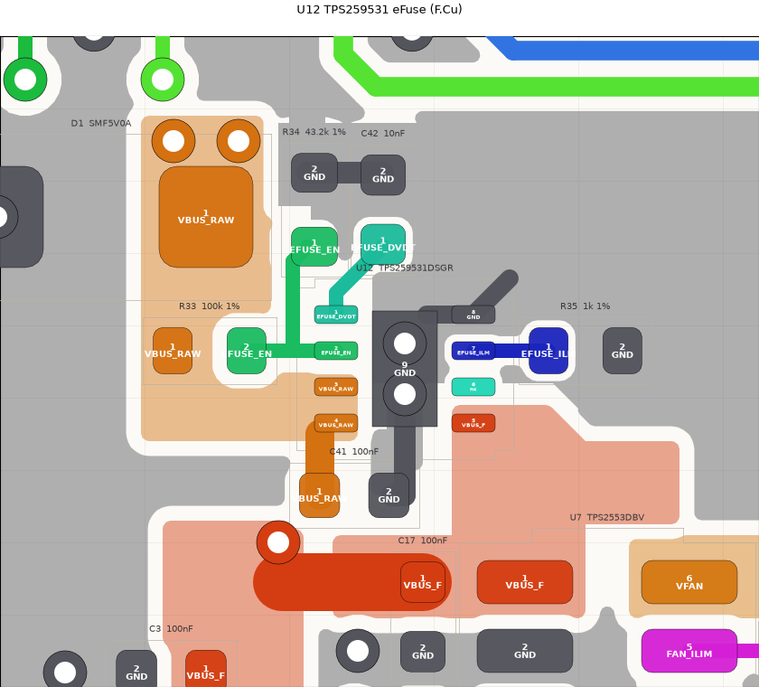

Replaces the F1 PTC between VBUS_RAW and VBUS_F (docs/sim/power.md: soft start, 5.7 V output clamp, 2.04 A limit).
Laid out on the board directly (one IC, five passives). Datasheet SLVSE57C section 11, figure 68, reproduced in its
own orientation (rotation 0): pin 1 top left, IN 3/4 lower left, OUT 5 lower right, GND 8 top right.

- IN on the VIN fill: VIN_RAW now steps right under pins 3/4. OUT on its own fill (U12_OUT, priority 3), widened
  right under R35 and dropping into U7_IN, so the current path is copper, not pins and traces ("short, sized for twice
  the load").
- GND at the device: the exposed pad has two 0.6/0.3 vias to the In1 plane (clear of the In2 VBUS_F run at x 3.85-4.85);
  pin 8 and the exposed pad share a solid GND fill (U12_GND_TOP, priority 4) that also takes the support parts' ground
  ends, the figure's "power ground".
- Support parts at their pins, ends to the device's ground: C42 dVdt (10 nF) straight up from pin 1; the EN divider
  left of the part as in the figure, R33 100k to VIN (sitting in the VIN_RAW fill) and R34 43.2k up to ground; R35
  ILM 1k to the right of pin 7. EN (pin 2) is boxed in by pin 1, pin 3 and the pad, so it leaves left along its row.
- C41 100 nF from IN to ground right under pins 3/4 (the "high frequency bypass" of the figure); FLT (6) open.
- Zones were reshaped and the redundant ones removed with KiCad closed through its python API; DRC: no errors.

## U13 INA181A1 servo current sense with R36 shunt, staged at (-25, 40) (minimeat-sp4; placed in 55j, below)

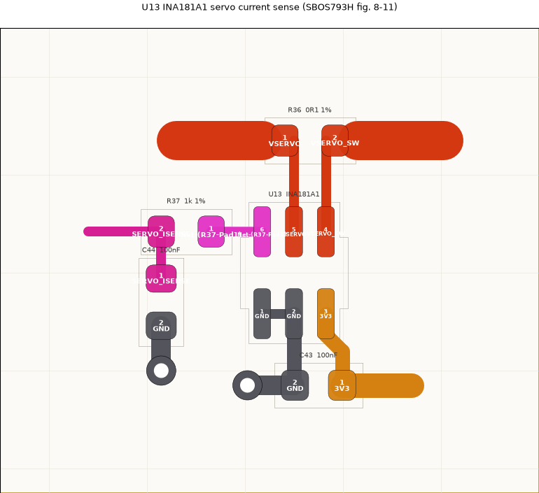

Added after the board was routed (minimeat-vpg: servo stall seen as current, not only on the TPS2553 fault line), so
it has its own small staging outline left of the board (x -31 to -20, y 35-44.5) with an In1 GND zone
(`STAGING_In1_GND`); both go when the block is placed (minimeat-55j). Datasheet SBOS793H section 8.4, figure 8-11
(single channel, SC70), reproduced in its own orientation: U13 at rotation 90 puts OUT 6, IN- 5, IN+ 4 along the top
and REF 1, GND 2, VS 3 along the bottom, as drawn.

- Kelvin connection: R36 (0.1 ohm 0402) lies above the part, VSERVO (load) pad left and VSERVO_SW (bus) pad right,
  current flowing right to left as in the figure. The two 0.2 mm sense lines drop straight from the pads' inner halves
  to IN- and IN+, equal length (1.86 mm), 0.45 mm apart. The 0.8 mm power stubs enter the pads from their outer ends
  and stop 0.15 mm short of the sense taps, so the current does not run along a sense line. A stock 2-pad 0402 does
  this; a 4-terminal or net-tie footprint was considered and is not needed while the power copper is tracks (a power
  fill over the pad would swallow the taps: keep VSERVO/VSERVO_SW fills off the inner halves in placement).
- Bypass: C43 100 nF straight under VS and GND, ground pad left with its via beside it (figure's "VIA to Ground
  Plane"), 3V3 entering from the right. REF tied to the GND pin along the bottom row (unidirectional, 0 V at 0 A).
- Output: OUT left into R37 1k, C44 100 nF to ground straight below R37's far end (the pin side of the filter, its own
  ground via), SERVO_ISENSE leaves left toward U1 IO2 (pin 27; was IO6 until minimeat-9jn). In placement it is a quiet 0.2 mm line away from BUCK_SW, the
  fan PWM and the servo signal.
- Block 6 x 5.5 mm. DRC in the box: only the connections that lead out of the block.

## U9, U14 TPD4E05U06 probe ESD, on the board behind the jacks (minimeat-plr)

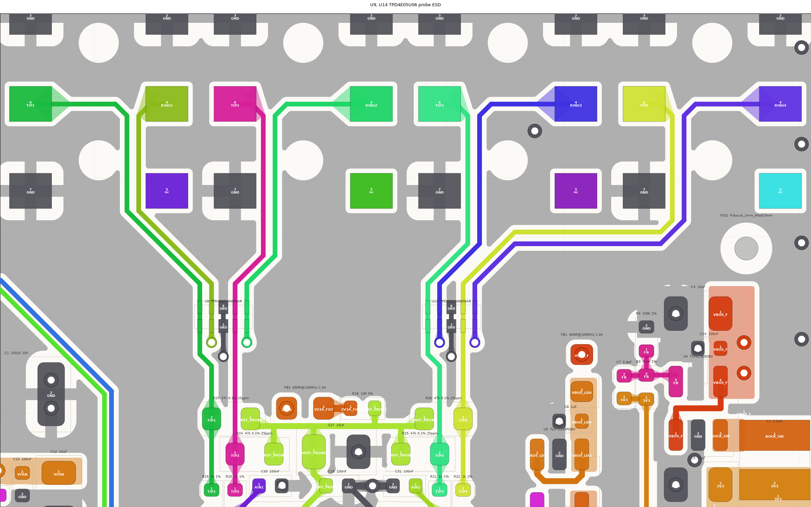

Datasheet SLVSBO7O section 7.4, figure 7-11: straight-through routing. Each line runs straight across the part over
its I/O pad and the NC pad opposite (the schematic ties the NC pins to the I/O pins, which the datasheet allows:
"used for optional straight-through routing"). Tip and ring of a jack sit side by side: U9 is TIP1, RING1, GND,
TIP2, RING2 (pins 1/10, 2/9, 3/8, 4/7, 5/6) and U14 the same for jacks 3 and 4. Both rotation 0 at y 15.9, U9 at
x 20.5 and U14 at x 30.2, centred on U8 (x 25.35).

- Jack escape, one shape on all four jacks: tip (pad 6) and ring (pad 4) run in along the pad row, between the
  jack's two peg holes, and turn down together with level 45 degree bends (y 6.85 to 7.35) into a 0.5 mm-pitch pair
  in the channel between the lower peg hole and the GND/NC pad beside it: J2 on the right of its hole (x 16.4/16.9),
  J3, J4 and J5 on the left of theirs (jack x -1.7/-1.2).
- Each pair turns 45 degrees straight into its TVS columns; every pair's bends are level and every entry is at y 14.5.
  J5's pair turns west under J4's GND/NC pads at y 12.3/12.8 (the ring on the level of the top of J4's diagonal),
  both of its 45 degree bends on x 32.9, and drops into U14 beside J4's pair.
- Below each part, the inner tip (TIP2, TIP4) runs straight on to its 1k (R20, R22) and the outer one (TIP1, TIP3)
  jogs 0.5 mm onto its own (R19, R21), so the four tips meet the U8 block on its x 20 / 21 / 29.7 / 30.7 columns.
  The rings drop through a via straight under their pads (y 17.0) to B.Cu and join the bundle to the pull-ups. The
  GND pads join down the middle to one via at y 17.6, between the ring vias. No GND via above the parts: the In2
  VBUS_F run crosses at y 14.75.
- The 0.2 mm lines match the 0.2 mm pads; 0.3 mm gaps between lines meet the Analog class 0.25 mm.

## U11 ATECC608B secure element, origin (40, 95)

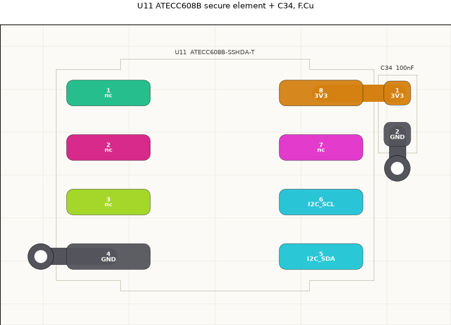

The summary datasheet (DS40002239B) gives no layout guidance; standard practice: C34 (100 nF) beside VCC (pin 8)
with its own ground via, GND (pin 4) to a via at its outer end. NC pins 1-3, 7 left open. SDA/SCL (5, 6) leave to
the right toward the bus; the pull-ups (R14/R15) sit with the MCU.

## U8 ADS122C04 probe ADC, origin (80, 102)

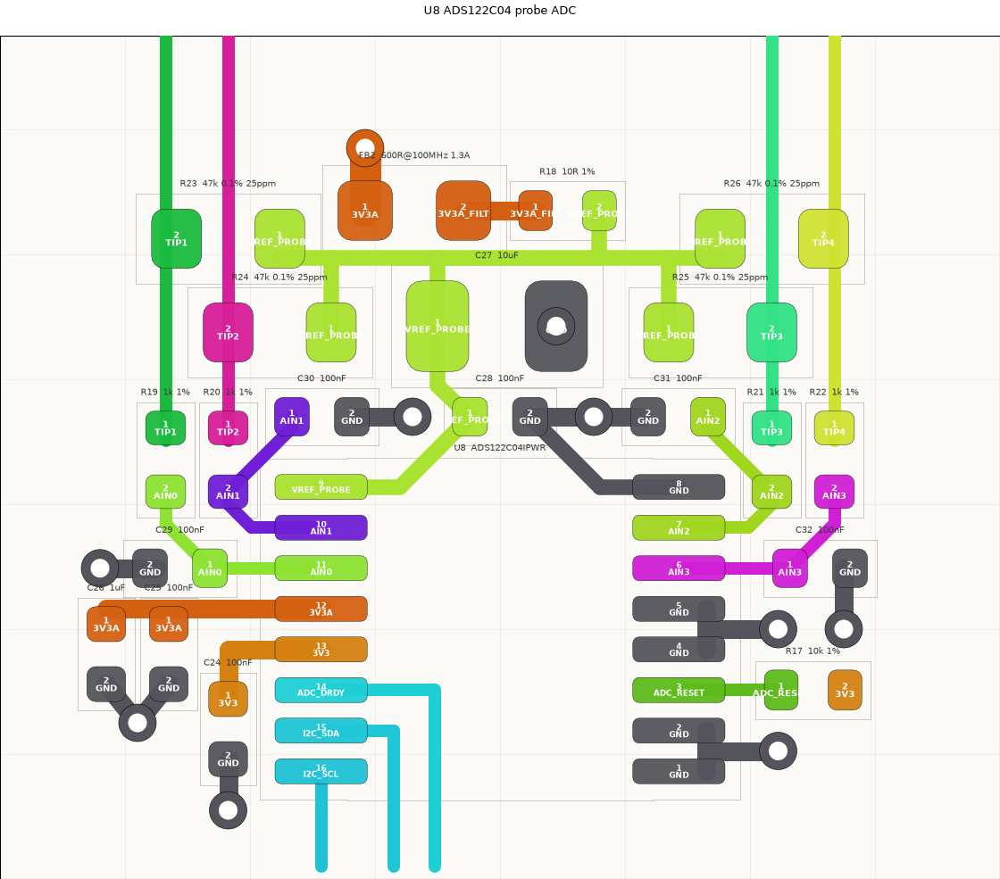

Datasheet SBAS751B section 11, figure 83 (TSSOP turned 180 degrees as in the figure: REFP/AIN1/AIN0/AVDD/DVDD/
DRDY/SDA/SCL down the left, REFN/AIN2/AIN3/AVSS/DGND/RESET/A1/A0 down the right). Block: U8, C24-C26, R17, the
VREF_PROBE filter (FB2, R18, C27, C28), the four 0.1% bias resistors (R23-R26) and the input RC filters
(R19-R22, C29-C32).

- Analog and digital apart: inputs and reference at the top (toward the jacks), DRDY/SDA/SCL leave at the bottom
  (toward the MCU), SDA and DRDY under the package body.
- The two halves mirror each other. Each TIP line runs dead straight from the top of the block to its 1k (R19-R22,
  1 mm apart, level). The outer channels' bias resistors (R23/R26) lie across the inner TIP lines, which pass under
  their bodies between the pads (0603: 0.325 mm each side of a 0.2 mm line), so VREF_PROBE reaches all four from one
  trunk on F.Cu; the inner bias resistors (R24/R25) hang under them, sitting on their own TIP line.
- Input filters as in the figure: from each 1k, AIN goes straight on to its pin (a 45 degree run into AIN1/AIN2, a
  short jog and the 100 nF on the AIN0/AIN3 pin row). The inner channels' 100 nF caps (C30/C31) sit on either side
  of C28 above the package, their ground pads on a via each (C31 shares C28's); the 45 degree feed to them clears the
  REFP/REFN pin corners by 0.17 mm. The outer caps (C29/C32) sit level with pins 11/6, ground vias outboard.
- Reference: C28 sits right across REFP and REFN (the figure's cap between them), both reached under the package
  body; REFN is ground and C28's ground has a via. The VREF_PROBE trunk runs across between the bias resistor rows
  and feeds all four, C28 (straight down) and C27 (10 uF), which lies sideways in the gap between R24 and R25 with
  its VREF pad on the C28 feed and a via in its ground pad. FB2 and R18 (the 3V3A filter) sit in a row above the
  trunk between R23 and R26; 3V3A arrives at FB2 through one via (the middle of the block is enclosed by the
  TIP2/TIP3 lines), and R18's VREF end drops straight onto the trunk.
- "Do not place vias between bypass capacitors and the device": C25 (100 nF) and C26 (1 uF) on AVDD, C24 on DVDD,
  each joined to its pin by a trace on F.Cu, ground vias on the far side.
- AVSS/DGND (5, 4) and A1/A0 (2, 1, address 0x40) pair up to a ground via each; RESET to R17 (pull-up).

## U1 ESP32-C6-WROOM-1 module, origin (108, 100)

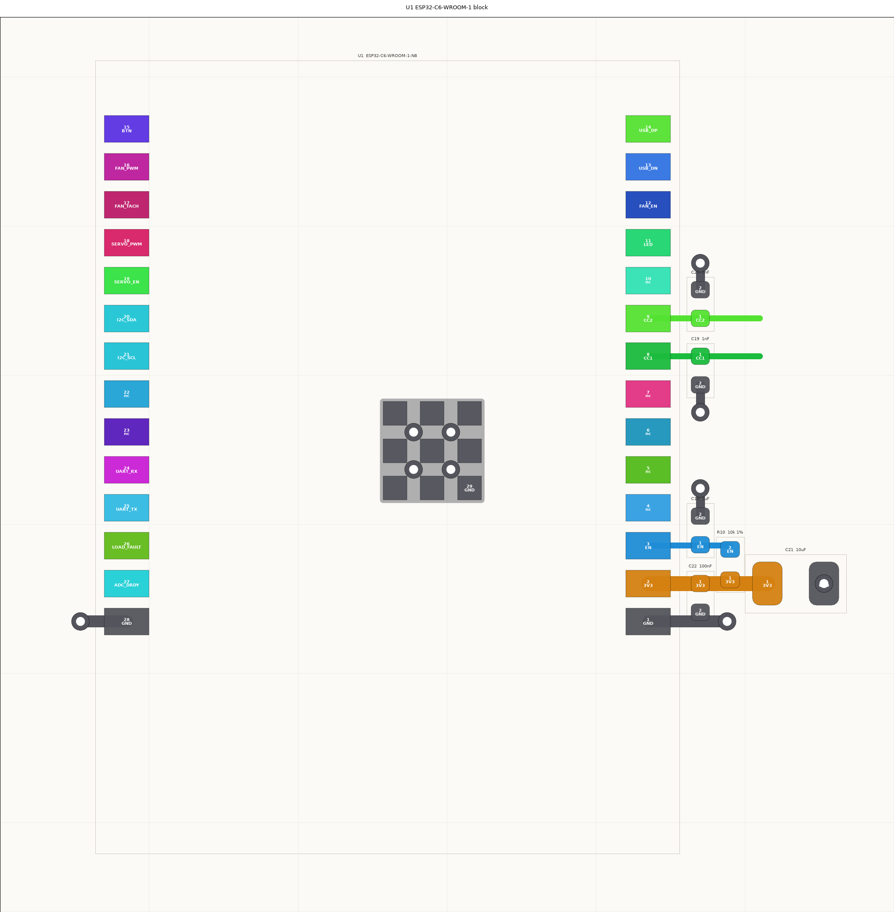

Datasheet (WROOM-1 v1.4, section 9 peripheral schematic) and Espressif's ESP32-C6 hardware design guidelines
(section 1.4). Turned 180 degrees as on the board: antenna down (below pins 1/28), to overhang the board edge.
Block: U1, C21/C22, R10/C18, C19/C20.

- 3V3 (pin 2): 10 uF + 100 nF "close to the pin". C22 (100 nF) sits right at the pin, its ground pad on the pin 1
  ground trace (loop closed on F.Cu, via at its end); C21 (10 uF) further out on the same 3V3 trace, via in its
  ground pad. Everything stays above the pin 1 row, clear of the antenna end.
- EN (pin 3): the recommended RC delay, R10 10k to 3V3 and C18 1 uF to ground, both on the EN trace at the pin;
  C18's ground via sits in the space beside the unused pins 4-7.
- CC1/CC2 (pins 8/9): the 1 nF filter caps C19/C20 on the lines at the pin, ground pads turned toward the unused
  pins 7 and 10 with a via each, so both lines run straight on out toward J1 (U2, R1/R2).
- Ground: the 3x3 centre ground pads (EPAD, optional per the datasheet but better thermally) joined by a solid F.Cu
  fill with four vias between the pads; pins 1 and 28 to a via each.
- Not in the block (placed with what they serve): the left-column pull-ups (R7 LOAD_FAULT, R11 DRDY, R14/R15 I2C;
  the left column has no 3V3 of its own), the BTN parts R13/C23 with SW1, R12 with D2, the connector-side resistors
  R16/R27-R30 at J6/J7, test points TP5-TP7.

## Small groups: connector parts, boot button, pull-ups, test points

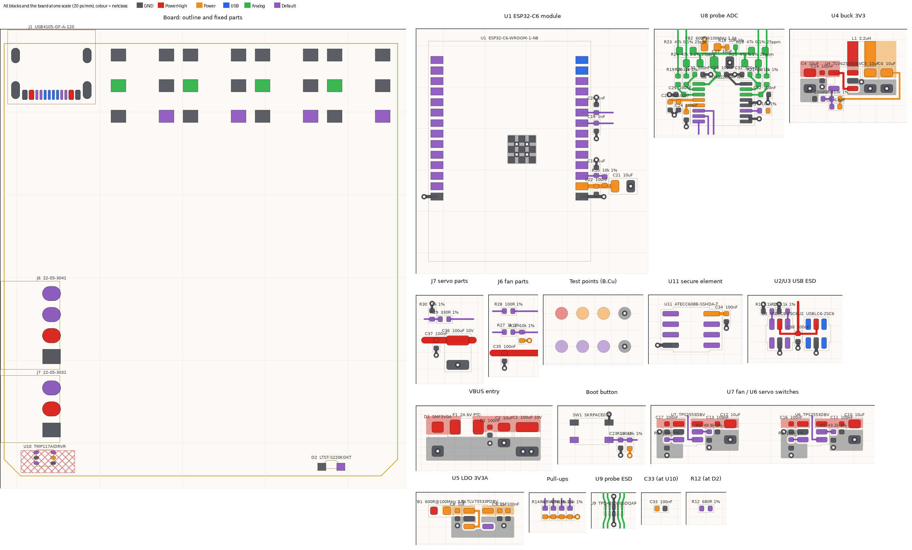

`hw/tools/montage.py` renders every block and the board (outline, fixed parts, pours hidden) at one scale, coloured
by netclass, for the placement review. Each net leaving a block has an arrow at its exit labelled with where it goes
(colour = destination), so a block's best rotation can be read off: its exits should face their destinations. The parts that belong to a fixed part or have no datasheet layout are laid out
as small groups in staging:

- J6 fan parts (40, 110), on J6's 2.54 mm pin pitch in its pin order (PWM, TACH, VFAN, GND top to bottom; the
  connector's pads would sit at x 40): R28 PWM and R27 TACH series resistors inline, R16 tach pull-up on the MCU side
  with a 3V3 via, C35 on VFAN with its ground via.
- J7 servo parts (55, 110), same idea (SIG, VSERVO, GND): R29 series, R30 pull-down on the connector side, C37
  100 nF then C36 100 uF on VSERVO, ground vias (in C36's pad).
- Boot button (20, 115): SW1 (the board is mounted upside down, so SW1 on F.Cu faces the paper-clip hole in the pan
  floor; free to move, the hole follows),
  C23 debounce and R13 pull-up on the BTN line, ground and 3V3 vias.
- Pull-ups (70, 115): R14 SDA, R15 SCL, R7 LOAD_FAULT, R11 DRDY in U1's left-column order on one 3V3 via.
- Test points (50-58, 92-96, B.Cu): TP1-TP4 VBUS_F, 3V3, 3V3A, GND; TP5-TP8 EN, UART TX, RX, GND; vias in the GND
  pads. They are placed and routed LAST (bead minimeat-axk.5), on B.Cu wherever room is left, so they are not in the
  montage or the placement review.
- C33 (TMP117 bypass) goes right at U10's pins 5/4 (the no-copper area around U10 bans pours only, not tracks);
  R12 goes beside D2.

## On the board: placement and routing (axk.2-axk.5)

What changed from the staged blocks, and how the board is routed. The sections above are the blocks as designed.

- **Stack:** F.Cu signals; In1 solid GND (the reference for F.Cu, never cut); In2 a 3V3 plane (`3V3_In2_plane`, over
  the In2 ground pour; the TMP117 corner is left out to keep the sensor isolated) carrying the power and the few signal
  tracks below; B.Cu GND pour with the slow crossings and the test points.
- **GND stitching:** the F.Cu and B.Cu pours are within 5 mm of a GND via everywhere except under the back-silk QR
  code (6.9 mm at its centre; `qr_quiet_zone_in_silk` keeps vias 0.3 mm off its quiet zone, and In1 is solid under
  it). Probe strip: a via beside each jack's GND pad 7 at (jack x - 2.9, 8.7), the same on every jack, and four
  between the pairs. Under U1's body: a column each side of the QR code and a row below it, clear of the antenna end
  (y >= 50). Pads the pour reaches with one thermal spoke (U2, U9, U14, C26, U4, U7, R4, J7; each has its own track
  or via) are allowed by name in `gnd_pad_one_spoke`.
- **USB pair:** F.Cu only, 0.27/0.23 mm, from U2 east under U2, down the x 17.6/18.1 column, under U8, into U1 pins
  14/13. It splits the board, so every slow signal that has to cross it does so on B.Cu or In2. J1's fan-out and U2
  are in the U2 section above; the VBUS pads drop into an In2 VBUS_RAW pour feeding D1. If those crossings ever get
  worse, moving J1 to the right side (enclosure change) would remove them.
- **Fan and servo switches:** U7's block sits in U6's old spot (beside VIN_F, bridged on F.Cu). U6's block is turned
  90 degrees beside J7 (output column into C37/C36/J7, EN toward U1 pin 19); VBUS_F reaches it along the board edge
  under the J6/J7 housings. U1's west pins 16-19 run straight out to R28, R27/R16, R29 and U6. VFAN hops on B.Cu into
  J6 pin 2.
- **Pull-ups:** R11 (DRDY) is gone: DRDY uses the ESP32's internal pull-up (`board.rs`). R14/R15 sit beside U11 on the
  U8 -> U11 I2C run; R7 (LOAD_FAULT) beside J6. SDA/SCL are swapped on U1 (SCL pin 20/GPIO22, SDA pin 21/GPIO23) so
  U8's three lines reach U1 on B.Cu without crossing.
- **In2:** VBUS_F trunk VIN_F -> FB1/U4 (1 mm), 3V3A spur U5 -> U8/FB2, BTN (SW1 -> U1 pin 15) under the module,
  U10's I2C branch (kept above U1's antenna keepout).
- **B.Cu:** U8 SCL/SDA/DRDY to U1's west pins, FAN_EN (U7 -> pin 12), CC1/CC2 (R1/R2 -> pins 8/9), LOAD_FAULT
  (U7, R7, U6, U1 pin 26), LED (pin 11 -> R12), U10's 3V3 hop. Under-module vias sit 0.8 mm inside U1's pad rows.
- **Mechanical:** H1-H3 (2.7 mm NPTH) at the enclosure's standoffs; every route keeps out of their 2.75 mm standoff
  rings on F/B. Fiducials FID1-3 on the board; JLC's tooling holes are on the panel rails (`hw/tools/fab.py`).
- **Test points (B.Cu):** TP1 VBUS_F, TP2 3V3, TP4 GND at U4; TP3 3V3A at U5; TP6 TX, TP7 RX, TP8 GND just west of
  U1's pins (UART through under-module vias); TP5 EN beside R10.
- **Servo current sense (minimeat-55j, 2026-10-15):** room was made beside U6 by raising J6 and J7 4.0 mm along the
  rear edge (R30, R29, C37 and C36 with J7; the enclosure's `Pcb.kk` followed). R28 and R27 stay where they were and J6
  reaches them by 45 degree stubs, because moving them put FAN_PWM through H1's standoff ring. C35 moved into the
  pocket between R28/R27 and R16, fed from the VFAN B.Cu run by a via: in the header column it starved J6 pin 1's
  thermal. C1 (100 uF) moved beside U12's output, C2 up 0.2, VIN_F shortened to clear J6 pin 4 and the edge VBUS_F run
  extended into it; H1 moved to (12.05, 28.5) to clear J6's back-silk labels (`Pcb.holes` followed) and FID2 to
  (37.25, 14.25), between J4 and J5. The staged block went in turned 90 degrees from SBOS793H figure 8-11, the same
  topology: R36 stands vertical against the U6/C10/C11 column (VSERVO pad up, VSERVO_SW pad down), U13 at rotation 0
  beside it so IN- and IN+ face the shunt with straight, equal 0.6 mm sense lines into the pads' inner halves, power
  entering the pads from their outer ends. VSERVO climbs a 0.9 mm gap between C36 and C10 into C36's pad (C36's
  ground via moved into its pad). C43 sits against VS/GND/REF with its own 3V3 and GND vias; OUT escapes under the
  package body to R37, C44 at R37's far end, and SERVO_ISENSE runs 10 mm on In2 to U1 pin 27 (GPIO2, swapped with
  ADC_DRDY in minimeat-9jn; DRDY went on B.Cu from U8 to pin 6; since minimeat-098 it is not wired, see the ring block below). Done with KiCad closed through its python API;
  DRC: no errors, nothing unconnected.

## The probe rings: U14, R38-R45 (minimeat-098)

The jacks' rings (pad 4, `RING1`-`RING4`) go to the module's pins 7, 6, 5, 4 (GPIO7-4, `RING_IO1`-`RING_IO4`, ring 1 on pin 7). Placement: the four rows of a 1k series resistor and a 4.7k pull-up at the module's pins (y = 42.14, 43.41, 44.68, 45.95 mm, the pins' own pitch), a 3V3 bar on the pull-ups' east pads that ends on R13's 3V3 pad. The rings share the tips' ESD arrays (U9, U14, above; U14 first sat alone at the top of the ring bundle). From each array's ring via (y 17.0) the bundle is on B.Cu: rings 1 and 2 run east at y 19.0 and 17.0 and rings 3 and 4 drop at x 29.7 and 31.2, each onto its own 45 degree line (nested, no crossings), then south in a 0.5 mm-pitch corridor at x 37.7-39.2 between the stitching vias and the 3V3 via at (37.0, 31.95), and in to a via in each pull-up's west pad (the ring node). From each pin the 1k is reached on F.Cu; the outer rows kink toward the middle to clear the capacitors' ground pads, the inner two run straight. The rows are symmetric about y = 44.04; the whole block is mirror-symmetric in its pairs (rows 1/4 and 2/3). Tip and ring of each jack run together to its array, 10-24 mm.

Moved for it: FID2 to (42.2, 12.7), FID3 to (44.3, 41.0), TP5 (EN) to (36.2, 47.25) with its label, the BTN trace on In2 off y = 42.35 to y = 42.775. References of U14, R38-R45, C23, C4 and SW1 are hidden (silk). Done with KiCad closed through its python API; DRC: no errors, nothing unconnected, the same lint-only warnings as before.
